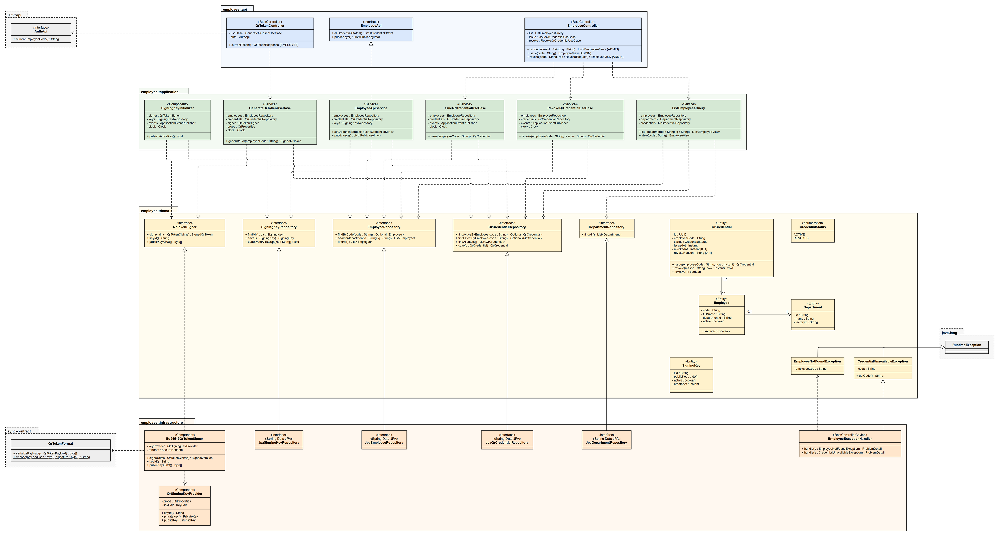

# SRS – `central/employee` (C2 Employee & QR Management)

> Trạng thái: Draft · Người viết: BE-2 · Người duyệt: FE-2 (API), BE-1 (định dạng QR) · Ngày: 17/11/2026
> Hợp đồng API: [../api/central.md](../api/central.md) (OpenAPI: [../api/central.openapi.yaml](../api/central.openapi.yaml))

## 1. Giới thiệu

### 1.1. Mục đích
Đặc tả **C2 Employee & QR Management** – module `com.tmc.central.employee`: quản lý nhân viên (dữ liệu seed), vòng đời **QR credential** (cấp, thu hồi, cấp lại – INV-01), giữ **khóa bí mật duy nhất** để ký **mã QR động Ed25519** cho Portal (ADR-02) và phát sự kiện thay đổi để C1 đưa xuống các cổng.

### 1.2. Phạm vi
- Có: `GET /portal/qr-token`, `GET /employees`, `POST /employees/{code}/qr/issue`, `POST /employees/{code}/qr/revoke`; `EmployeeApi`; sự kiện `QrCredentialChanged`, `SigningKeyPublished`; nạp/sinh khóa ký.
- Không có: đồng bộ hồ sơ từ HR/Payroll (FR-01, C5), kho khóa HSM/Vault, nhật ký kiểm toán (FR-06), xoay vòng khóa định kỳ.

### 1.3. Tài liệu tham chiếu
FR-02, FR-03, FR-04, FR-05; NFR-SEC-01, NFR-SEC-05, NFR-SEC-06, NFR-PRI-03; INV-01, INV-02; ADR-02, ADR-05, ADR-08; DP-04, DP-10, DP-11, DP-12; Bảng port mục 8 (`QrTokenSigner`); đặc tả M2 mục 6.1, 8.1 – 8.4; [sync-contract.md](sync-contract.md) (định dạng QR).

## 2. Mô tả tổng quan

### 2.1. Vị trí
```
Portal (JWT EMPLOYEE) ──GET /portal/qr-token──► QrTokenController ──► GenerateQrTokenUseCase ──► QrTokenSigner (Ed25519)
Admin  (JWT ADMIN)    ──/employees…──────────► EmployeeController ──► Issue / Revoke / ListEmployees
                                                      │ publish QrCredentialChanged, SigningKeyPublished
                                                      ▼
                                               ingestion (C1) → ref_changes → G4 → G3 → G1
```
C2 phụ thuộc `iam.api` (`AuthApi`) và `sync-contract` (`QrTokenFormat`); C1 phụ thuộc `employee.api`.

### 2.2. Tác nhân
| Tác nhân | Thao tác |
|---|---|
| Nhân viên (`EMPLOYEE`) qua Portal giả lập | Lấy mã QR của **chính mình** |
| Quản trị viên (`ADMIN`, gộp quyền HR) qua Admin | Xem danh sách, thu hồi, cấp lại |
| C1 | Đọc trạng thái credential và khóa công khai (bootstrap), nghe sự kiện |

### 2.3. Ràng buộc
- Khóa bí mật chỉ nằm trong tiến trình Central (biến môi trường / tự sinh ở `demo`); không ghi vào CSDL, không log (DP-11, NFR-PRI-03).
- Payload QR không chứa mã nhân viên hay họ tên (DP-12).
- Mọi API kiểm tra vai trò phía server (`@PreAuthorize`, DP-10).

## 3. Yêu cầu chức năng

| Mã | Yêu cầu | Mức | Truy vết |
|---|---|---|---|
| SRS-CE-EMP-FR-01 | `GET /portal/qr-token` (vai trò `EMPLOYEE`) lấy `employeeCode` từ JWT, **không nhận tham số**; trả `{raw, expiresAt, refreshAfterSec}` ký bằng khóa đang hoạt động. | Must | FR-03, S3 |
| SRS-CE-EMP-FR-02 | Payload: `v=1`, `cid` = id credential `ACTIVE`, `iat=now`, `exp=now+60s`, `nonce` = 16 byte ngẫu nhiên (`SecureRandom`) base64url, `kid`. Mỗi lần gọi sinh nonce mới. | Must | ADR-02, NFR-SEC-05 |
| SRS-CE-EMP-FR-03 | Không có credential `ACTIVE`: nếu credential gần nhất bị thu hồi → `409 CREDENTIAL_REVOKED`; nếu chưa từng có → `409 NO_ACTIVE_CREDENTIAL`; nhân viên không hoạt động → `409 EMPLOYEE_INACTIVE`. | Must | FR-04, D3 |
| SRS-CE-EMP-FR-04 | `POST /employees/{code}/qr/issue` (ADMIN): nếu đang có `ACTIVE` thì thu hồi (lý do `REISSUED`) rồi tạo credential mới `ACTIVE`, trong **một** transaction; nhân viên không hoạt động → `409 EMPLOYEE_INACTIVE`. | Must | FR-02, FR-04, INV-01 |
| SRS-CE-EMP-FR-05 | `POST /employees/{code}/qr/revoke {reason}` (ADMIN): `reason` bắt buộc, 3 – 200 ký tự; chuyển `ACTIVE → REVOKED`, ghi `revoked_at`, `revoke_reason`; không có `ACTIVE` → `409 NO_ACTIVE_CREDENTIAL`. | Must | FR-04 |
| SRS-CE-EMP-FR-06 | Ràng buộc CSDL: tối đa một credential `ACTIVE` mỗi nhân viên (unique index một phần); credential cũ không bị xóa. | Must | INV-01, FR-02 |
| SRS-CE-EMP-FR-07 | Mỗi lần credential đổi trạng thái (cấp, thu hồi) phát `QrCredentialChanged` sau commit. | Must | INV-02, NFR-SEC-06 |
| SRS-CE-EMP-FR-08 | Khi khởi động: nạp khóa (`TMC_QR_SIGNING_KEY`, `TMC_QR_PUBLIC_KEY`, `TMC_QR_KEY_ID`) hoặc tự sinh ở profile `demo`; lưu khóa công khai vào `signing_keys` (khóa khác bị đặt `active=false`) và phát `SigningKeyPublished`. Thiếu khóa ngoài `demo` → không khởi động. | Must | ADR-02 |
| SRS-CE-EMP-FR-09 | `GET /employees?department=&q=` (ADMIN) trả danh sách nhân viên kèm bộ phận, nhà máy, trạng thái credential mới nhất; `q` tìm theo mã hoặc họ tên (không phân biệt hoa thường). | Should | FR-04 (UI Admin) |
| SRS-CE-EMP-FR-10 | `EmployeeApi` cung cấp cho module khác: `allCredentialStates()` (credential mới nhất của mỗi nhân viên kèm `employeeActive`), `publicKeys()`. | Must | DP-15 |

## 4. Yêu cầu phi chức năng

| Mã | Yêu cầu | Truy vết |
|---|---|---|
| SRS-CE-EMP-NFR-01 | `GET /portal/qr-token` ≤ 200 ms p95 (ký Ed25519 < 1 ms). | NFR-PER-01 (Portal làm mới 30 s) |
| SRS-CE-EMP-NFR-02 | Token do C2 ký được `Ed25519TokenVerifier` (G1) chấp nhận: test chung bằng vector cố định của `sync-contract`. | ADR-02, mục 13.3 đặc tả M2 |
| SRS-CE-EMP-NFR-03 | Không log `raw`, khóa bí mật; log `employeeCode`, `cid`, thao tác. | NFR-PRI-03 |
| SRS-CE-EMP-NFR-04 | Dữ liệu gửi cho gate chỉ gồm `credentialId`, `employeeCode`, `status`, `employeeActive`. | DP-12 |

## 5. Giao diện ngoài

### 5.1. REST
| Method | Path | Vai trò | Request | Response |
|---|---|---|---|---|
| GET | `/portal/qr-token` | `EMPLOYEE` | — | `{ "raw": "TMC1.…", "expiresAt": "…", "refreshAfterSec": 30 }` |
| GET | `/employees` | `ADMIN` | `department`, `q` (tùy chọn) | `[EmployeeView]` |
| POST | `/employees/{code}/qr/issue` | `ADMIN` | — | `200 EmployeeView` |
| POST | `/employees/{code}/qr/revoke` | `ADMIN` | `{ "reason": "Mất điện thoại" }` | `200 EmployeeView` |

`EmployeeView`: `{ code, fullName, departmentId, departmentName, factoryId, active, credentialId, credentialStatus, issuedAt }`. Lỗi: `401` thiếu/sai JWT, `403` sai vai trò, `404 EMPLOYEE_NOT_FOUND`, `409` (FR-03/04/05), `400 VALIDATION_ERROR` – dạng `ProblemDetail` có `code`.

### 5.2. Interface và sự kiện công khai (`employee.api`, `@NamedInterface("api")`)
| Thành phần | Nội dung |
|---|---|
| `EmployeeApi` | `allCredentialStates() : List<CredentialState>`, `publicKeys() : List<PublicKeyInfo>` |
| `QrCredentialChanged` | `credentialId, employeeCode, status, employeeActive, changedAt` |
| `SigningKeyPublished` | `kid, publicKeyBase64, active, publishedAt` |

### 5.3. Port
| Port | Chữ ký | Cài đặt |
|---|---|---|
| `QrTokenSigner` | `SignedQrToken sign(QrTokenClaims)`, `String keyId()`, `byte[] publicKeyX509()` | `Ed25519QrTokenSigner` |
| `EmployeeRepository`, `DepartmentRepository`, `QrCredentialRepository`, `SigningKeyRepository` | mục 6.2 | Spring Data JPA |

## 6. Thiết kế

### 6.1. Mô tả thành phần

| Tầng | Thành phần | Mô tả |
|---|---|---|
| `api` | `QrTokenController` | Lấy `employeeCode` qua `AuthApi.currentEmployeeCode()`; gọi use case; dựng `QrTokenResponse` |
| | `EmployeeController` | API quản trị; `@Valid RevokeRequest` |
| | `EmployeeApi`, DTO, sự kiện | Interface công khai cho module khác |
| `application` | `GenerateQrTokenUseCase` | Kiểm nhân viên hoạt động, tìm credential `ACTIVE`, dựng `QrTokenClaims`, ký |
| | `IssueQrCredentialUseCase`, `RevokeQrCredentialUseCase` | `@Transactional`; thay đổi vòng đời; `ApplicationEventPublisher.publishEvent` (Spring Modulith lưu và giao sau commit) |
| | `ListEmployeesQuery` | Ghép nhân viên, bộ phận, credential mới nhất |
| | `EmployeeApiService` | Cài đặt `EmployeeApi` |
| | `SigningKeyInitializer` | Lưu khóa công khai, phát `SigningKeyPublished` khi khởi động |
| `domain` | `Employee`, `Department`, `QrCredential`, `SigningKey` | Entity (annotation `jakarta.persistence`, không annotation Spring) |
| | `QrTokenClaims`, `SignedQrToken`, `CredentialStatus` | Giá trị |
| | Port: `QrTokenSigner`, 4 repository | |
| | `EmployeeNotFoundException`, `CredentialUnavailableException(code)` | Lỗi nghiệp vụ |
| `infrastructure` | `Ed25519QrTokenSigner` | `Signature.getInstance("Ed25519")` + `QrTokenFormat.serializePayload/encode` |
| | `QrSigningKeyProvider` | Đọc PKCS#8/X.509 base64 từ cấu hình hoặc `KeyPairGenerator("Ed25519")` ở `demo` |
| | `Jpa*Repository` | Spring Data, kế thừa port của domain (DIP) |
| | `EmployeeExceptionHandler` | `@RestControllerAdvice(assignableTypes = {EmployeeController, QrTokenController})` → `ProblemDetail` |

### 6.2. Danh sách lớp

| Lớp | Tầng | Loại | Ghi chú |
|---|---|---|---|
| `EmployeeController` | api | `@RestController` | |
| `QrTokenController` | api | `@RestController` | |
| `EmployeeApi` | api | interface | theo báo cáo (`EmployeeAPI`) |
| `EmployeeView`, `QrTokenResponse`, `RevokeRequest`, `CredentialState`, `PublicKeyInfo` | api | record | |
| `QrCredentialChanged`, `SigningKeyPublished` | api | record (sự kiện) | theo báo cáo |
| `GenerateQrTokenUseCase`, `IssueQrCredentialUseCase`, `RevokeQrCredentialUseCase` | application | `@Service` | |
| `ListEmployeesQuery`, `EmployeeApiService` | application | `@Service` | |
| `SigningKeyInitializer` | application | `@Component` | bổ sung |
| `QrProperties` | application | record | `tmc.central.qr.*` |
| `Employee`, `Department`, `QrCredential`, `SigningKey` | domain | entity | |
| `CredentialStatus` | domain | enum | |
| `QrTokenClaims`, `SignedQrToken` | domain | record | |
| `QrTokenSigner` | domain | interface | theo báo cáo |
| `EmployeeRepository`, `DepartmentRepository`, `QrCredentialRepository`, `SigningKeyRepository` | domain | interface | |
| `EmployeeNotFoundException`, `CredentialUnavailableException` | domain | exception | |
| `Ed25519QrTokenSigner` | infrastructure | `@Component` | đặc tả M2 8.1 |
| `QrSigningKeyProvider` | infrastructure | `@Component` | bổ sung |
| `JpaEmployeeRepository`, `JpaDepartmentRepository`, `JpaQrCredentialRepository`, `JpaSigningKeyRepository` | infrastructure | Spring Data interface | |
| `EmployeeExceptionHandler` | infrastructure | `@RestControllerAdvice` | |

### 6.3. Sơ đồ lớp
Nguồn: [class-diagram.drawio](../drawio/class-diagram.drawio), tab `central-employee`. Lớp được tô màu theo tầng (api xanh dương, application xanh lá, domain vàng, infrastructure cam, module/thư viện khác xám); record/DTO không vẽ, chỉ xuất hiện làm kiểu trong chữ ký.



### 6.4. Luồng xử lý
**Lấy mã QR**
```
GenerateQrTokenUseCase.generateFor(code):
  emp = employees.findByCode(code) orElse 404 EMPLOYEE_NOT_FOUND
  if !emp.active: throw CredentialUnavailable(EMPLOYEE_INACTIVE)
  cred = credentials.findActiveByEmployee(code)
       orElseThrow( latest(code) is REVOKED ? CREDENTIAL_REVOKED : NO_ACTIVE_CREDENTIAL )
  now = clock.instant()
  return signer.sign(QrTokenClaims(cred.id, now, now + props.tokenTtl))   // nonce do adapter ký sinh
```
`Ed25519QrTokenSigner.sign`: sinh nonce 16 byte → dựng `QrTokenPayload(1, cid, iat, exp, nonce, kid)` → `bytes = QrTokenFormat.serializePayload(p)` → `sig = Ed25519.sign(bytes)` → `raw = QrTokenFormat.encode(bytes, sig)`.

**Thu hồi**
```
RevokeQrCredentialUseCase.revoke(code, reason):          // @Transactional
  employees.findByCode(code) orElse 404
  cred = credentials.findActiveByEmployee(code) orElseThrow NO_ACTIVE_CREDENTIAL
  cred.revoke(reason, now); credentials.save(cred)
  events.publishEvent(QrCredentialChanged(cred.id, code, "REVOKED", emp.active, now))
```
Thu hồi có hiệu lực tại gate sau: Spring Modulith giao sự kiện (≤ 1 s) → C1 ghi `ref_changes` → G4 kéo (≤ 15 s) → G3 → G1 từ chối. Tổng ≤ 60 s (NFR-SEC-06). Portal nhận `409` ngay ở lần làm mới kế tiếp.

### 6.5. Vòng đời `QrCredential`
`issue()` → `ACTIVE` ──`revoke(reason)`──► `REVOKED` (trạng thái cuối; cấp lại = credential mới). `revoke` trên credential đã `REVOKED` → `IllegalStateException`.

### 6.6. Dữ liệu (`V1_1__employee.sql`)
```sql
CREATE TABLE factories   (id VARCHAR(8) PRIMARY KEY, name VARCHAR(100) NOT NULL);
CREATE TABLE departments (id VARCHAR(16) PRIMARY KEY, name VARCHAR(100) NOT NULL,
                          factory_id VARCHAR(8) NOT NULL REFERENCES factories(id));
CREATE TABLE employees   (code VARCHAR(16) PRIMARY KEY, full_name VARCHAR(150) NOT NULL,
                          department_id VARCHAR(16) NOT NULL REFERENCES departments(id),
                          active BOOLEAN NOT NULL DEFAULT TRUE);
CREATE TABLE qr_credentials (
  id UUID PRIMARY KEY, employee_code VARCHAR(16) NOT NULL REFERENCES employees(code),
  status VARCHAR(8) NOT NULL CHECK (status IN ('ACTIVE','REVOKED')),
  issued_at TIMESTAMPTZ NOT NULL, revoked_at TIMESTAMPTZ, revoke_reason VARCHAR(200),
  CHECK ((status = 'REVOKED') = (revoked_at IS NOT NULL))
);
CREATE UNIQUE INDEX ux_one_active ON qr_credentials(employee_code) WHERE status = 'ACTIVE';   -- INV-01
CREATE INDEX ix_cred_employee_issued ON qr_credentials(employee_code, issued_at DESC);
CREATE TABLE signing_keys (kid VARCHAR(32) PRIMARY KEY, public_key BYTEA NOT NULL,
                           active BOOLEAN NOT NULL, created_at TIMESTAMPTZ NOT NULL);
```
Seed (`V2__seed_demo.sql`): nhà máy `BD`, `LA`, mỗi nhà máy 2 bộ phận; `E0001`–`E0020` mỗi người một credential `ACTIVE`; `E0019` `active=false`; `E0020` có credential `REVOKED` (không có `ACTIVE`).

### 6.7. Cấu hình
| Khóa | Mặc định |
|---|---|
| `tmc.central.qr.token-ttl` | `60s` (không được > 60 s – kiểm khi khởi động) |
| `tmc.central.qr.refresh-after` | `30s` |
| `tmc.central.qr.key-id` | `k-demo` |
| `tmc.central.qr.signing-key`, `public-key` | rỗng (PKCS#8 / X.509 base64 từ biến môi trường) |
| `tmc.central.demo.auto-generate-keys` | `false` (`demo`: `true`) |

### 6.8. Xử lý lỗi
| Ngoại lệ | HTTP | `code` |
|---|---|---|
| `EmployeeNotFoundException` | 404 | `EMPLOYEE_NOT_FOUND` |
| `CredentialUnavailableException` | 409 | `CREDENTIAL_REVOKED` \| `NO_ACTIVE_CREDENTIAL` \| `EMPLOYEE_INACTIVE` |
| Vi phạm `ux_one_active` (đua hai lệnh cấp) | 409 | `CONCURRENT_UPDATE` |
| Bean Validation | 400 | `VALIDATION_ERROR` |

## 7. Quyết định thiết kế và độ lệch

| # | Quyết định / độ lệch | Lý do |
|---|---|---|
| D1 | Entity domain dùng annotation `jakarta.persistence`; repository domain được Spring Data kế thừa ở `infrastructure` | Không vi phạm A1 (không import `org.springframework`); tránh lặp lớp entity/ánh xạ |
| D2 | ADMIN gộp quyền HR (cấp/thu hồi QR) | Độ lệch đã ghi (đặc tả M2 3.3) |
| D3 | Thêm mã lỗi `NO_ACTIVE_CREDENTIAL`, `EMPLOYEE_INACTIVE` bên cạnh `CREDENTIAL_REVOKED` | Portal phân biệt được trường hợp; FE-2 cần duyệt |
| D4 | Khóa ký nạp từ biến môi trường, `demo` tự sinh | Không có HSM/Vault (độ lệch đặc tả M2 3.3) |
| D5 | Không ghi audit cho cấp/thu hồi | C8 ngoài MVP; FR-06 không hiện thực |
| D6 | Không có thao tác vô hiệu hóa nhân viên | Dữ liệu seed; FR-01 ngoài MVP |

## 8. Tiêu chí chấp nhận

| Yêu cầu | Test case | Kịch bản |
|---|---|---|
| FR-01, FR-02 | `TC-CE-EMP-01` `e0001` lấy token → giải mã `cid` = credential của E0001; kiểm chữ ký bằng `publicKeyX509` | S3, D1 |
| NFR-02 | `TC-CE-EMP-02` token ký bởi `Ed25519QrTokenSigner` với khóa vector được `Ed25519TokenVerifier` chấp nhận | T4 |
| FR-03 | `TC-CE-EMP-03` `e0020` → `409 CREDENTIAL_REVOKED` | D3 |
| FR-04, FR-06 | `TC-CE-EMP-04` cấp lại → đúng một `ACTIVE`, credential cũ `REVOKED`; Testcontainers với hai lệnh cấp song song | INV-01 |
| FR-05, FR-07 | `TC-CE-EMP-05` thu hồi → sự kiện `QrCredentialChanged` (Spring Modulith `Scenario`) | T2 |
| Phân quyền | `TC-CE-EMP-06` EMPLOYEE gọi `/employees`, `/qr/revoke` → 403; ADMIN gọi `/portal/qr-token` → 403 | S1 |
