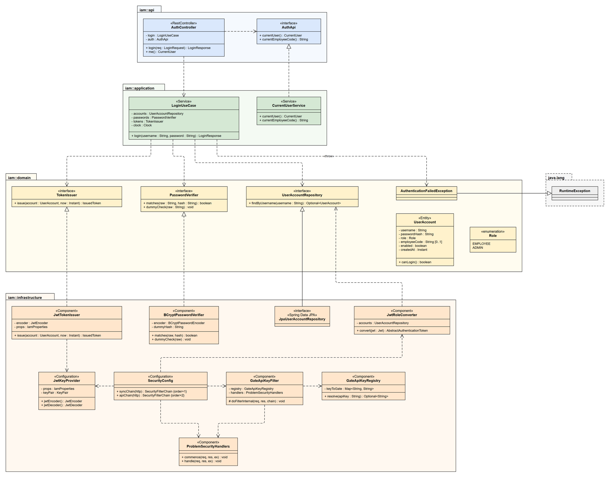

# SRS – `central/iam` (C7 IAM / RBAC – tối thiểu)

> Trạng thái: Draft · Người viết: BE-2 · Người duyệt: FE-2 · Ngày: 17/11/2026
> Hợp đồng API: [../api/central.md](../api/central.md) (OpenAPI: [../api/central.openapi.yaml](../api/central.openapi.yaml))

## 1. Giới thiệu

### 1.1. Mục đích
Đặc tả phần tối thiểu của **C7 IAM / RBAC** – module dùng chung `com.tmc.central.iam`: đăng nhập bằng tài khoản seed, phát **JWT RS256**, kiểm tra quyền cho **mọi API của Central** với hai vai trò `EMPLOYEE`, `ADMIN`, và xác thực Gate Agent trên `/sync/**` bằng API key.

### 1.2. Phạm vi
- Có: `POST /auth/login`, `GET /auth/me`; bảng `user_accounts`; `AuthApi`; hai chuỗi bộ lọc Spring Security; `GateApiKeyFilter`; nạp/sinh khóa RSA.
- Không có: quản lý tài khoản (FR-26), cấu hình quyền (FR-27), vai trò HR/GUARD/SUPERVISOR, lọc theo bộ phận (INV-11), refresh token, khóa tài khoản sau nhiều lần sai.

### 1.3. Tài liệu tham chiếu
FR-25, FR-26, FR-27; NFR-SEC-01, NFR-SEC-03, NFR-SEC-04, NFR-PRI-03; ADR-08; DP-10, DP-11, DP-15; đặc tả M2 mục 3.3, 8.2, 8.3, 12 (S1 – S3).

## 2. Mô tả tổng quan

### 2.1. Vị trí
`iam` là module **dùng chung**: các module nghiệp vụ dùng `AuthApi` và `@PreAuthorize`; `iam` không phụ thuộc module nghiệp vụ nào (DP-15). Tài khoản nhân viên liên kết với nhân viên bằng chuỗi `employee_code`, không có khóa ngoại sang bảng của `employee`.

```
              ┌── /sync/**  ── chuỗi 1: GateApiKeyFilter → GatePrincipal(gateId)  (không JWT)
Request ──────┤
              └── còn lại   ── chuỗi 2: OAuth2 Resource Server (JWT RS256) → JwtRoleConverter → ROLE_EMPLOYEE | ROLE_ADMIN
                                 công khai: /auth/login, /*.html, /assets/**, /actuator/health, /swagger-ui*, /v3/api-docs/**
```

### 2.2. Tác nhân
Nhân viên (Portal), quản trị viên (Admin), Gate Agent (API key), các module của Central (dùng `AuthApi`).

### 2.3. Ràng buộc
- Mật khẩu băm BCrypt (cost 10); không lưu mật khẩu rõ trong migration.
- Khóa RSA: file PEM (`JWT_PRIVATE_KEY_PATH`, `JWT_PUBLIC_KEY_PATH`), không commit; profile `demo` tự sinh khi trống.
- Không log mật khẩu, JWT, API key (NFR-PRI-03).

## 3. Yêu cầu chức năng

| Mã | Yêu cầu | Mức | Truy vết |
|---|---|---|---|
| SRS-CE-IAM-FR-01 | `POST /auth/login {username, password}` trả `{accessToken, expiresAt, role, employeeCode?}` khi đúng mật khẩu và tài khoản `enabled`. | Must | FR-25 |
| SRS-CE-IAM-FR-02 | Sai tên, sai mật khẩu, hoặc tài khoản bị vô hiệu hóa → `401` với **cùng** thông báo `INVALID_CREDENTIALS`; khi tên không tồn tại vẫn chạy so khớp BCrypt với hash giả để thời gian phản hồi tương đương. | Must | NFR-SEC-04, S2 |
| SRS-CE-IAM-FR-03 | JWT RS256: `iss=tmc-central`, `sub=username`, `role`, `employeeCode` (chỉ với EMPLOYEE), `iat`, `exp = iat + 8h`, `jti`. | Must | ADR-08 |
| SRS-CE-IAM-FR-04 | `GET /auth/me` (mọi vai trò) trả `{username, role, employeeCode?}` từ JWT. | Must | FR-25 |
| SRS-CE-IAM-FR-05 | Mọi API không công khai yêu cầu JWT hợp lệ: thiếu/sai/hết hạn → `401`; sai vai trò → `403`. Ma trận quyền ở mục 5.2. | Must | NFR-SEC-01, DP-10, S1 |
| SRS-CE-IAM-FR-06 | Tài khoản bị vô hiệu hóa sau khi đã có token: mỗi request kiểm tra `enabled`; nếu `false` → `401`. | Should | NFR-SEC-04 |
| SRS-CE-IAM-FR-07 | `/sync/**` chỉ xác thực bằng header `X-Gate-Key`; key ánh xạ sang `gateId` theo cấu hình; thiếu/sai → `401`; principal là `GatePrincipal(gateId)`. JWT không được chấp nhận trên `/sync/**`. | Must | DP-11, S1 |
| SRS-CE-IAM-FR-08 | `AuthApi.currentUser()`, `currentEmployeeCode()` cho module khác; `currentEmployeeCode()` ném `AccessDeniedException` nếu người dùng không phải EMPLOYEE. | Must | FR-03 |
| SRS-CE-IAM-FR-09 | Seed: `e0001` … `e0020` (EMPLOYEE, `employee_code` tương ứng; `e0019` `enabled=false`), `admin` (ADMIN). | Must | Đặc tả M2 8.4 |

## 4. Yêu cầu phi chức năng

| Mã | Yêu cầu | Truy vết |
|---|---|---|
| SRS-CE-IAM-NFR-01 | Đăng nhập ≤ 300 ms (BCrypt cost 10 ≈ 80 ms). | Trải nghiệm Portal |
| SRS-CE-IAM-NFR-02 | So sánh API key bằng `MessageDigest.isEqual` (thời gian hằng). | DP-11 |
| SRS-CE-IAM-NFR-03 | Phản hồi lỗi bảo mật dạng `ProblemDetail` JSON (không trang HTML). | Frontend xử lý thống nhất |
| SRS-CE-IAM-NFR-04 | CSRF tắt (API stateless, token trong header `Authorization`); session `STATELESS`. | ADR-08 |

## 5. Giao diện ngoài

### 5.1. REST
| Method | Path | Quyền | Request | Response |
|---|---|---|---|---|
| POST | `/auth/login` | công khai | `{ "username": "e0001", "password": "…" }` | `200 { "accessToken": "eyJ…", "expiresAt": "…", "role": "EMPLOYEE", "employeeCode": "E0001" }` / `401` |
| GET | `/auth/me` | JWT | — | `200 { "username": "e0001", "role": "EMPLOYEE", "employeeCode": "E0001" }` |

Mật khẩu demo chung ghi trong [../api/README.md](../api/README.md) § 3.1.

### 5.2. Ma trận quyền (cấu hình trong `SecurityConfig` và `@PreAuthorize`)
| Đường dẫn | Công khai | EMPLOYEE | ADMIN | Gate (`X-Gate-Key`) |
|---|---|---|---|---|
| `/auth/login`, `/*.html`, `/assets/**`, `/actuator/health`, `/swagger-ui*`, `/v3/api-docs/**` | ✔ | ✔ | ✔ | — |
| `/auth/me` | | ✔ | ✔ | |
| `/portal/qr-token` | | ✔ | ✘ 403 | |
| `/employees/**`, `/stations` | | ✘ 403 | ✔ | |
| `/sync/**` | | ✘ 401 | ✘ 401 | ✔ |

### 5.3. Interface công khai (`iam.api`, `@NamedInterface("api")`)
`AuthApi` (`currentUser()`, `currentEmployeeCode()`), `CurrentUser(username, role, employeeCode)`, `GatePrincipal(gateId)`. Trường `role` kiểu `String` (`"EMPLOYEE"`/`"ADMIN"`) để interface công khai không lộ enum `Role` của tầng `domain`.

### 5.4. Port
| Port | Chữ ký | Cài đặt |
|---|---|---|
| `TokenIssuer` | `IssuedToken issue(UserAccount, Instant)` | `JwtTokenIssuer` |
| `PasswordVerifier` | `boolean matches(String raw, String hash)`, `void dummyCheck(String raw)` | `BCryptPasswordVerifier` |
| `UserAccountRepository` | `Optional<UserAccount> findByUsername(String)` | `JpaUserAccountRepository` |

## 6. Thiết kế

### 6.1. Mô tả thành phần

| Tầng | Thành phần | Mô tả |
|---|---|---|
| `api` | `AuthController` | `/auth/login`, `/auth/me` |
| | `AuthApi`, `CurrentUser`, `LoginRequest`, `LoginResponse`, `GatePrincipal` | Interface/DTO công khai |
| `application` | `LoginUseCase` | Tra tài khoản → so mật khẩu → kiểm `canLogin()` → phát token; mọi nhánh thất bại ném cùng `AuthenticationFailedException` |
| | `CurrentUserService` | Cài đặt `AuthApi` từ `SecurityContextHolder` (JWT claim) |
| | `IamProperties` | `tmc.central.iam.*`, `tmc.central.sync.gate-api-keys` |
| `domain` | `UserAccount`, `Role`, `IssuedToken` | Entity và giá trị |
| | `TokenIssuer`, `PasswordVerifier`, `UserAccountRepository` | Port |
| | `AuthenticationFailedException` | |
| `infrastructure` | `SecurityConfig` | Hai `SecurityFilterChain` (`@Order(1)` cho `/sync/**`, `@Order(2)` cho phần còn lại); `@EnableMethodSecurity` |
| | `GateApiKeyFilter`, `GateApiKeyRegistry` | Xác thực gate |
| | `JwtTokenIssuer`, `JwtKeyProvider` | `NimbusJwtEncoder`/`NimbusJwtDecoder` với cặp khóa RSA 2048 |
| | `JwtRoleConverter` | `Jwt` → `JwtAuthenticationToken` với authority `ROLE_<role>`; kiểm `enabled` (FR-06) |
| | `BCryptPasswordVerifier` | `BCryptPasswordEncoder(strength)` + hash giả |
| | `ProblemSecurityHandlers` | `AuthenticationEntryPoint` (401) và `AccessDeniedHandler` (403) trả `ProblemDetail` |
| | `JpaUserAccountRepository` | Spring Data |

### 6.2. Danh sách lớp

| Lớp | Tầng | Loại | Ghi chú |
|---|---|---|---|
| `AuthController` | api | `@RestController` | đặc tả M2 5 |
| `AuthApi` | api | interface | theo báo cáo (`AuthAPI`) |
| `CurrentUser`, `LoginRequest`, `LoginResponse`, `GatePrincipal` | api | record | `GatePrincipal` bổ sung |
| `LoginUseCase` | application | `@Service` | đặc tả M2 5 |
| `CurrentUserService` | application | `@Service` | |
| `IamProperties` | application | record | |
| `UserAccount` | domain | entity | theo domain model |
| `Role` | domain | enum | `EMPLOYEE`, `ADMIN` |
| `IssuedToken` | domain | record | |
| `TokenIssuer` | domain | interface | đặc tả M2 5 |
| `PasswordVerifier`, `UserAccountRepository` | domain | interface | bổ sung |
| `AuthenticationFailedException` | domain | exception | |
| `JwtTokenIssuer`, `JwtKeyProvider`, `SecurityConfig`, `GateApiKeyFilter` | infrastructure | Spring bean | đặc tả M2 5 |
| `GateApiKeyRegistry`, `JwtRoleConverter`, `BCryptPasswordVerifier`, `ProblemSecurityHandlers` | infrastructure | Spring bean | bổ sung |
| `JpaUserAccountRepository` | infrastructure | Spring Data interface | |

### 6.3. Sơ đồ lớp
Nguồn: [class-diagram.drawio](../drawio/class-diagram.drawio), tab `central-iam`. Lớp được tô màu theo tầng (api xanh dương, application xanh lá, domain vàng, infrastructure cam, module/thư viện khác xám); record/DTO không vẽ, chỉ xuất hiện làm kiểu trong chữ ký.



### 6.4. Luồng xử lý
```
LoginUseCase.login(username, password):
  acc = accounts.findByUsername(username.trim().toLowerCase())
  if acc empty:            passwords.dummyCheck(password); throw AuthenticationFailed
  if !passwords.matches(password, acc.passwordHash): throw AuthenticationFailed
  if !acc.canLogin():      throw AuthenticationFailed            // enabled = false
  t = tokens.issue(acc, clock.instant())
  return LoginResponse(t.accessToken, t.expiresAt, acc.role, acc.employeeCode)

GateApiKeyFilter (chỉ áp cho /sync/**):
  key = header "X-Gate-Key"; gateId = registry.resolve(key)
  empty → handlers.commence(401 INVALID_GATE_KEY); return
  SecurityContext ← UsernamePasswordAuthenticationToken(GatePrincipal(gateId), null, [ROLE_GATE])
```

### 6.5. Dữ liệu (`V1_4__iam.sql`)
```sql
CREATE TABLE user_accounts (
  username      VARCHAR(32) PRIMARY KEY,
  password_hash VARCHAR(100) NOT NULL,
  role          VARCHAR(16) NOT NULL CHECK (role IN ('EMPLOYEE','ADMIN')),
  employee_code VARCHAR(16) UNIQUE,                                  -- mỗi nhân viên ≤ 1 tài khoản
  enabled       BOOLEAN NOT NULL DEFAULT TRUE,
  created_at    TIMESTAMPTZ NOT NULL DEFAULT now(),
  CHECK (role <> 'EMPLOYEE' OR employee_code IS NOT NULL)
);
```

### 6.6. Cấu hình
| Khóa | Mặc định |
|---|---|
| `tmc.central.iam.jwt.issuer` | `tmc-central` |
| `tmc.central.iam.jwt.ttl` | `8h` |
| `tmc.central.iam.jwt.private-key-path`, `public-key-path` | rỗng (`demo` tự sinh) |
| `tmc.central.iam.password.bcrypt-strength` | `10` |
| `tmc.central.sync.gate-api-keys` | `gate-bd=change-me-bd,gate-la=change-me-la` (ghi đè bằng `GATE_API_KEYS`) |

### 6.7. Xử lý lỗi
| Tình huống | HTTP | `code` |
|---|---|---|
| Đăng nhập thất bại (mọi lý do) | 401 | `INVALID_CREDENTIALS` |
| Thiếu/sai/hết hạn JWT, tài khoản bị vô hiệu hóa | 401 | `UNAUTHENTICATED` |
| Sai vai trò | 403 | `FORBIDDEN` |
| Thiếu/sai `X-Gate-Key` | 401 | `INVALID_GATE_KEY` |
| Body đăng nhập thiếu trường | 400 | `VALIDATION_ERROR` |

## 7. Quyết định thiết kế và độ lệch

| # | Độ lệch / quyết định | Lý do |
|---|---|---|
| D1 | Hai vai trò `EMPLOYEE`, `ADMIN`; quyền cố định trong mã; không lọc theo bộ phận | Đặc tả M2 3.3 |
| D2 | API key cho gate thay mTLS | Đặc tả M2 3.3 |
| D3 | Khóa RSA từ file PEM, `demo` tự sinh (token mất hiệu lực khi khởi động lại) | Không có kho khóa |
| D4 | Không refresh token; hết hạn 8 giờ thì đăng nhập lại | Đủ cho một ca làm việc |
| D5 | HTTP trong mạng Docker (không TLS) | Đặc tả M2 3.3 (NFR-SEC-03) |
| D6 | `UserAccount` một vai trò (không bảng `roles`/`permissions`) | Domain model có quan hệ nhiều-nhiều; MVP chỉ cần một vai trò mỗi tài khoản |

## 8. Tiêu chí chấp nhận

| Yêu cầu | Test case | Kịch bản |
|---|---|---|
| FR-01, FR-03 | `TC-CE-IAM-01` đăng nhập `e0001`, giải mã JWT kiểm claim | INT-1 |
| FR-02 | `TC-CE-IAM-02` sai mật khẩu và `e0019` → cùng `401 INVALID_CREDENTIALS` | S2 |
| FR-05 | `TC-CE-IAM-03` ma trận mục 5.2 (`spring-security-test`) | S1 |
| FR-06 | `TC-CE-IAM-04` vô hiệu hóa sau khi đăng nhập → request tiếp theo 401 | NFR-SEC-04 |
| FR-07 | `TC-CE-IAM-05` `/sync/heartbeat` thiếu key / sai key / JWT hợp lệ → 401; key đúng → 204 | S1 |
| Kiến trúc | `iam` không phụ thuộc `employee`, `station`, `ingestion` | A3 |
