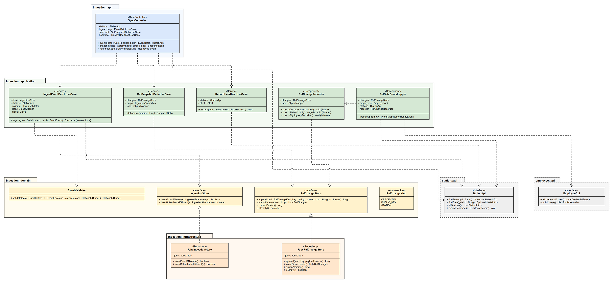

# SRS – `central/ingestion` (C1 Gate Sync & Ingestion)

> Trạng thái: Draft · Người viết: BE-2 · Người duyệt: BE-1 · Ngày: 17/11/2026

## 1. Giới thiệu

### 1.1. Mục đích
Đặc tả **C1 Gate Sync & Ingestion** – module Spring Modulith `com.tmc.central.ingestion`: cung cấp `SyncAPI` cho các Gate Agent, tiếp nhận lượt quét và giao dịch **idempotent theo `eventId`**, phát delta dữ liệu tham chiếu (credential, khóa công khai, cấu hình trạm) xuống cổng và chuyển heartbeat sang C3.

### 1.2. Phạm vi
- Có: `POST /sync/events`, `GET /sync/snapshot`, `POST /sync/heartbeat`; bảng `scan_attempts`, `attendance_transactions`, `ref_changes`; nghe sự kiện `QrCredentialChanged`, `StationConfigChanged`, `SigningKeyPublished`.
- Không có: phát `TransactionRecorded` cho C4/C6 (không có module nghe), tra cứu chấm công, `IngestionAPI` cho C4/C6.

### 1.3. Tài liệu tham chiếu
FR-05, FR-13, FR-15, FR-17; NFR-DIN-01/02, NFR-SEC-06, NFR-INT-04; INV-02, INV-06; ADR-03, ADR-05, ADR-08; DP-03, DP-04, DP-11, DP-15; Bảng connector (C2, C3, C9 → C1; C1 → C3), Hình `seq_f2_sync`, `module_uses`; đặc tả M2 mục 6.2, 6.3, 8.1, 8.3.

## 2. Mô tả tổng quan

### 2.1. Vị trí
```
G4 ──X-Gate-Key──► [iam] GateApiKeyFilter ──► SyncController (C1)
                                                 ├─► IngestEventBatchUseCase ──► IngestionStore (scan_attempts, attendance_transactions)
                                                 ├─► GetSnapshotDeltaUseCase ──► RefChangeStore (ref_changes)
                                                 └─► RecordHeartbeatUseCase  ──► StationApi.recordHeartbeat (C3)
employee (C2) ──QrCredentialChanged, SigningKeyPublished──► RefChangeRecorder
station  (C3) ──StationConfigChanged────────────────────────► RefChangeRecorder
```
Phụ thuộc giữa module: `ingestion → employee.api`, `ingestion → station.api`, `ingestion → iam.api`; không module nào phụ thuộc `ingestion` (không vòng – DP-15).

### 2.2. Ràng buộc
- C1 **không đọc bảng** của C2/C3 (DP-04); delta được dựng từ bảng `ref_changes` riêng, được ghi khi nghe sự kiện.
- `/sync/**` chỉ xác thực bằng `X-Gate-Key` (C7 cấu hình), không dùng JWT.
- Sự kiện trong tiến trình qua Spring Modulith `@ApplicationModuleListener` (bất đồng bộ, sau commit, lưu trong `event_publication` để không mất khi khởi động lại).

### 2.3. Giả định
Mỗi nhà máy một Gate Agent (`gate-bd` ↔ `BD`, `gate-la` ↔ `LA`), ánh xạ lưu ở C3 (`gate_agents`).

## 3. Yêu cầu chức năng

| Mã | Yêu cầu | Mức | Truy vết |
|---|---|---|---|
| SRS-CE-ING-FR-01 | `POST /sync/events` nhận `EventBatch`; `contractVersion` không hỗ trợ → `400 UNSUPPORTED_CONTRACT_VERSION`; > 200 sự kiện → `400 BATCH_TOO_LARGE`; `gateId` trong body khác gate đã xác thực → `403 GATE_MISMATCH`. | Must | DP-11 |
| SRS-CE-ING-FR-02 | Mỗi sự kiện được lưu bằng `INSERT … ON CONFLICT (event_id) DO NOTHING`; chèn được → `accepted`, đã tồn tại → `duplicates`. Gửi lại cùng lô không tạo bản ghi mới. | Must | INV-06, NFR-DIN-02, T6 |
| SRS-CE-ING-FR-03 | Sự kiện không hợp lệ → `rejected` với lý do: `UNKNOWN_EVENT_TYPE`, `INVALID_PAYLOAD` (không đọc được, thiếu trường, `payload.eventId ≠ envelope.eventId`, giá trị enum sai), `UNKNOWN_STATION`, `STATION_NOT_IN_FACTORY` (trạm không thuộc nhà máy của gate). Sự kiện hợp lệ trong cùng lô vẫn được lưu. | Must | DP-11 |
| SRS-CE-ING-FR-04 | `ATTENDANCE_RECORDED` lưu đủ `employeeCode`, `occurredAt`, `stationId`, `direction`, `scanEventId` (UNIQUE). | Must | FR-13, NFR-DIN-01 |
| SRS-CE-ING-FR-05 | `SCAN_ATTEMPT_RECORDED` lưu kết quả `ACCEPTED`/`REJECTED`/`GATE_FAILED` và lý do; `credentialId` có thể rỗng. | Must | FR-15, INV-07 |
| SRS-CE-ING-FR-06 | Khi nhận `QrCredentialChanged`, `SigningKeyPublished`, `StationConfigChanged`: thêm một dòng `ref_changes(version=nextval, kind, key, payload)`. | Must | DP-04, NFR-SEC-06 |
| SRS-CE-ING-FR-07 | `GET /sync/snapshot?since=v` trả `SnapshotDelta` gồm bản mới nhất theo `(kind, key)` của các dòng có `version > v`; `fromVersion=v`, `toVersion=max(version)` (hoặc `v` nếu không có thay đổi); `settings.offlineThresholdMinutes` từ cấu hình. `since=0` trả toàn bộ. `since` âm hoặc lớn hơn version hiện tại → trả delta đầy đủ từ 0 (gate tự đồng bộ lại). | Must | FR-05, FR-17 |
| SRS-CE-ING-FR-08 | Khi khởi động, nếu `ref_changes` rỗng: ghi toàn bộ trạng thái hiện tại lấy qua `EmployeeApi.allCredentialStates()`, `EmployeeApi.publicKeys()`, `StationApi.allStations()` (bootstrap). | Must | Dữ liệu seed không đi qua sự kiện |
| SRS-CE-ING-FR-09 | `POST /sync/heartbeat` chuyển `Heartbeat` thành `HeartbeatRecord` (thêm `receivedAt`) và gọi `StationApi.recordHeartbeat`; trả `204`. | Must | FR-09 |

## 4. Yêu cầu phi chức năng

| Mã | Yêu cầu | Truy vết |
|---|---|---|
| SRS-CE-ING-NFR-01 | Xử lý lô 200 sự kiện ≤ 500 ms (một transaction, batch insert). | NFR-PER-02, T5 |
| SRS-CE-ING-NFR-02 | Từ lúc C2 commit thu hồi tới lúc `ref_changes` có dòng mới ≤ 5 s. | NFR-SEC-06 (≤ 60 s tổng) |
| SRS-CE-ING-NFR-03 | `scan_attempts`, `attendance_transactions` chỉ được INSERT; không có câu UPDATE/DELETE trong mã. | DP-02 |
| SRS-CE-ING-NFR-04 | Không log payload sự kiện; chỉ log `gateId`, số lượng, `eventId` bị từ chối. | NFR-PRI-03 |

## 5. Giao diện ngoài

### 5.1. REST (`SyncAPI`)
| Method | Path | Body / query | Trả về | Lỗi |
|---|---|---|---|---|
| POST | `/sync/events` | `EventBatch` | `200 BatchAck` | `400`, `401` (thiếu/sai key), `403` |
| GET | `/sync/snapshot` | `since` (long, mặc định 0) | `200 SnapshotDelta` | `401` |
| POST | `/sync/heartbeat` | `Heartbeat` | `204` | `400` (`gateId` khác), `401` |

Lỗi dùng `ProblemDetail` (RFC 7807) với thuộc tính `code`.

### 5.2. Sự kiện nghe
| Sự kiện | Phát bởi | Payload dùng | `kind` / `key` |
|---|---|---|---|
| `QrCredentialChanged` | C2 | `credentialId, employeeCode, status, employeeActive, changedAt` | `CREDENTIAL` / `credentialId` |
| `SigningKeyPublished` | C2 | `kid, publicKeyBase64, active` | `PUBLIC_KEY` / `kid` |
| `StationConfigChanged` | C3 | `stationId, factoryId, direction, enabled, turnstileId` | `STATION` / `stationId` |

### 5.3. Interface của module khác được dùng
`StationApi.findStation`, `findGate`, `allStations`, `recordHeartbeat` (C3); `EmployeeApi.allCredentialStates`, `publicKeys` (C2); `GatePrincipal` (C7, principal do `GateApiKeyFilter` tạo).

## 6. Thiết kế

### 6.1. Mô tả thành phần

| Tầng | Thành phần | Mô tả |
|---|---|---|
| `api` | `SyncController` | Ba endpoint; lấy `GatePrincipal`, tra `StationApi.findGate` → `GateContext(gateId, factoryId)` |
| `application` | `IngestEventBatchUseCase` | `@Transactional`; với mỗi envelope: tra trạm (cache theo lô), `EventValidator`, parse payload, insert idempotent, phân loại vào ack |
| | `GetSnapshotDeltaUseCase` | Đọc `RefChangeStore.latestSince`, giải JSON từng dòng thành DTO của `sync-contract` theo `kind` |
| | `RecordHeartbeatUseCase` | Kiểm `gateId`, gọi C3 |
| | `RefChangeRecorder` | `@ApplicationModuleListener` cho 3 sự kiện; tuần tự hóa payload theo DTO của `sync-contract` |
| | `RefDataBootstrapper` | `@EventListener(ApplicationReadyEvent)`; chạy một lần khi bảng rỗng |
| | `IngestionProperties` | `tmc.central.sync.max-batch-size`, `tmc.central.settings.offline-threshold` |
| `domain` | `EventValidator` | Hàm thuần kiểm `type`, khớp `eventId`, trạm thuộc nhà máy |
| | `GateContext`, `IngestedScanAttempt`, `IngestedAttendance`, `RefChange`, `RefChangeKind` | Kiểu miền |
| | `IngestionStore`, `RefChangeStore` | Port lưu trữ |
| `infrastructure` | `JdbcIngestionStore`, `JdbcRefChangeStore` | Spring `JdbcClient` trên PostgreSQL (cần `ON CONFLICT`, `DISTINCT ON`) |

### 6.2. Danh sách lớp

| Lớp | Tầng | Loại | Ghi chú |
|---|---|---|---|
| `SyncController` | api | `@RestController` | đặc tả M2 8.1 |
| `IngestEventBatchUseCase` | application | `@Service` | bổ sung |
| `GetSnapshotDeltaUseCase` | application | `@Service` | bổ sung |
| `RecordHeartbeatUseCase` | application | `@Service` | bổ sung |
| `RefChangeRecorder` | application | `@Component` (listener) | bổ sung |
| `RefDataBootstrapper` | application | `@Component` | bổ sung |
| `IngestionProperties` | application | record | |
| `EventValidator` | domain | class | |
| `GateContext`, `IngestedScanAttempt`, `IngestedAttendance`, `RefChange` | domain | record | |
| `RefChangeKind` | domain | enum | `CREDENTIAL`, `PUBLIC_KEY`, `STATION` |
| `IngestionStore`, `RefChangeStore` | domain | interface | |
| `JdbcIngestionStore`, `JdbcRefChangeStore` | infrastructure | `@Repository` | |

### 6.3. Sơ đồ lớp
Nguồn: [class-diagram.drawio](../drawio/class-diagram.drawio), tab `central-ingestion`. Lớp được tô màu theo tầng (api xanh dương, application xanh lá, domain vàng, infrastructure cam, module/thư viện khác xám); record/DTO không vẽ, chỉ xuất hiện làm kiểu trong chữ ký.



### 6.4. Luồng xử lý `IngestEventBatchUseCase.ingest`
```
ingest(gate, batch):                                      // @Transactional
  require ContractVersion.isSupported(batch.contractVersion)   else 400
  require batch.gateId == gate.gateId                          else 403
  require batch.events.size ≤ props.maxBatchSize               else 400
  accepted, duplicates, rejected = [], [], []
  for e in batch.events:
     stationFactory = cache.computeIfAbsent(stationIdOf(e), stations::findStation).map(factoryId)
     err = validator.validate(gate, e, stationFactory)
     if err: rejected += (e.eventId, err); continue
     inserted = e.type == SCAN_ATTEMPT_RECORDED ? store.insertScanIfAbsent(map(e)) : store.insertAttendanceIfAbsent(map(e))
     (inserted ? accepted : duplicates) += e.eventId
  return BatchAck(accepted, duplicates, rejected)
```
Lỗi CSDL không mong đợi → rollback cả lô, `500`; G4 gửi lại toàn bộ ở chu kỳ sau (an toàn nhờ idempotent).

### 6.5. Dữ liệu (`V1_2__ingestion.sql`)
```sql
CREATE TABLE scan_attempts (
  event_id UUID PRIMARY KEY, gate_id VARCHAR(32) NOT NULL, station_id VARCHAR(32) NOT NULL,
  credential_id UUID, result VARCHAR(16) NOT NULL CHECK (result IN ('ACCEPTED','REJECTED','GATE_FAILED')),
  reason VARCHAR(40), occurred_at TIMESTAMPTZ NOT NULL, received_at TIMESTAMPTZ NOT NULL
);
CREATE TABLE attendance_transactions (
  event_id UUID PRIMARY KEY, scan_event_id UUID NOT NULL UNIQUE, gate_id VARCHAR(32) NOT NULL,
  employee_code VARCHAR(16) NOT NULL, station_id VARCHAR(32) NOT NULL,
  direction VARCHAR(3) NOT NULL CHECK (direction IN ('IN','OUT')),
  occurred_at TIMESTAMPTZ NOT NULL, received_at TIMESTAMPTZ NOT NULL
);
CREATE INDEX ix_att_employee_time ON attendance_transactions(employee_code, occurred_at);
CREATE TABLE ref_changes (
  version BIGSERIAL PRIMARY KEY, kind VARCHAR(16) NOT NULL CHECK (kind IN ('CREDENTIAL','PUBLIC_KEY','STATION')),
  key VARCHAR(64) NOT NULL, payload JSONB NOT NULL, changed_at TIMESTAMPTZ NOT NULL
);
CREATE INDEX ix_ref_kind_key ON ref_changes(kind, key, version DESC);
```
Tên bảng giữ đúng đặc tả M2 mục 8.3; chỉ module `ingestion` được truy cập ba bảng này (DP-04).

Truy vấn delta:
```sql
SELECT DISTINCT ON (kind, key) version, kind, key, payload, changed_at
FROM ref_changes WHERE version > :since ORDER BY kind, key, version DESC;
```

### 6.6. Cấu hình
| Khóa | Mặc định |
|---|---|
| `tmc.central.sync.max-batch-size` | `200` |
| `tmc.central.settings.offline-threshold` | `8h` (profile `demo`: `2m`) – gửi xuống dạng phút |
| `spring.modulith.events.republish-outstanding-events-on-restart` | `true` |

### 6.7. Xử lý lỗi
| Tình huống | Mã | `code` |
|---|---|---|
| Sai phiên bản hợp đồng | 400 | `UNSUPPORTED_CONTRACT_VERSION` |
| Lô quá lớn | 400 | `BATCH_TOO_LARGE` |
| `gateId` khác principal | 403 | `GATE_MISMATCH` |
| Gate chưa đăng ký ở C3 | 403 | `UNKNOWN_GATE` |
| Sự kiện lẻ không hợp lệ | 200 | nằm trong `rejected` |

## 7. Quyết định thiết kế và độ lệch

| # | Quyết định / độ lệch | Lý do |
|---|---|---|
| D1 | Dùng `JdbcClient` thay JPA trong C1 | Cần `ON CONFLICT DO NOTHING` và `DISTINCT ON` – SQL thuần rõ ràng hơn; vẫn PostgreSQL (ADR-10) |
| D2 | `RefDataBootstrapper` dựng `ref_changes` lần đầu qua interface công khai của C2/C3 | Dữ liệu seed Flyway không phát sự kiện; không đọc bảng của module khác (DP-04) |
| D3 | `settings` lấy từ cấu hình, không lưu trong `ref_changes` | Thay C9 (ngoài MVP) |
| D4 | Không phát `TransactionRecorded`, không có `IngestionAPI` | Không có C4/C6 trong MVP |

## 8. Tiêu chí chấp nhận

| Yêu cầu | Test case | Kịch bản |
|---|---|---|
| FR-02 | `TC-CE-ING-01` Testcontainers: gửi cùng lô 2 lần → số dòng không đổi, lần 2 toàn `duplicates` | T6 |
| FR-01, FR-03 | `TC-CE-ING-02..04` lô sai phiên bản, sai gate, sự kiện trạm khác nhà máy | S1 |
| FR-06, FR-07 | `TC-CE-ING-05` thu hồi credential → delta từ version cũ chứa `REVOKED`, `toVersion` tăng | T2 |
| FR-08 | `TC-CE-ING-06` khởi động với bảng rỗng → `since=0` có đủ 20 credential, 4 trạm, ≥ 1 khóa | INT-1 |
| FR-09 | `TC-CE-ING-07` heartbeat → `GET /stations` thấy online | D4 |
| Kiến trúc | `ApplicationModules.verify()` | A3 |
