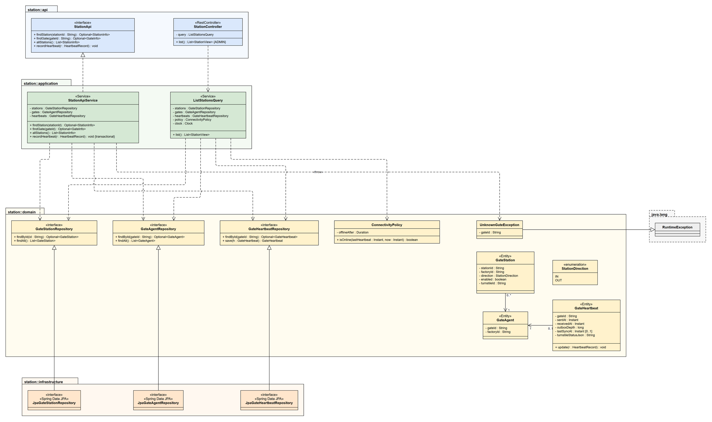

# SRS – `central/station` (C3 Gate Station Management – tối thiểu)

> Trạng thái: Draft · Người viết: BE-2 · Người duyệt: FE-2 (API), BE-1 (heartbeat) · Ngày: 17/11/2026

## 1. Giới thiệu

### 1.1. Mục đích
Đặc tả phần tối thiểu của **C3 Gate Station Management** – module `com.tmc.central.station`: giữ danh mục trạm cổng và Gate Agent (seed), nhận heartbeat từ C1, tính trạng thái online/offline và cung cấp `GET /stations` cho màn hình Admin; cung cấp `StationApi` cho C1.

### 1.2. Phạm vi
- Có: bảng `gate_agents`, `gate_stations`, `gate_heartbeats`; `StationApi`; `GET /stations`; sự kiện `StationConfigChanged` (định nghĩa, phát khi cấu hình đổi).
- Không có: đăng ký/sửa trạm qua UI hay API (FR-07 một phần), bật/tắt trạm (FR-08), nhật ký mở cổng thủ công, cảnh báo chủ động.

### 1.3. Tài liệu tham chiếu
FR-07, FR-08, FR-09; NFR-AVL-04, NFR-SCA-01; INV-03; ADR-05; DP-09, DP-15, DP-17; Bảng connector "C1 → C3 lời gọi trong tiến trình"; đặc tả M2 mục 3.1, 8.1 – 8.4.

## 2. Mô tả tổng quan

### 2.1. Vị trí
```
ingestion (C1) ──StationApi.recordHeartbeat / findStation / findGate / allStations──► station (C3)
Admin (JWT ADMIN) ──GET /stations──► StationController
station ──StationConfigChanged──► ingestion (C1)    (khi cấu hình trạm thay đổi)
```
C1 gọi trực tiếp interface của C3 thay vì phát sự kiện, để không có vòng phụ thuộc C1 ↔ C3 (Bảng connector). C3 không phụ thuộc module nghiệp vụ nào (chỉ `iam` cho phân quyền qua annotation).

### 2.2. Ràng buộc
- Thêm trạm/nhà máy chỉ cần thêm dữ liệu, không sửa mã (NFR-SCA-01).
- Heartbeat là dữ liệu dựng lại được: chỉ giữ bản mới nhất mỗi gate (DP-01 trường hợp linh hoạt).

## 3. Yêu cầu chức năng

| Mã | Yêu cầu | Mức | Truy vết |
|---|---|---|---|
| SRS-CE-STA-FR-01 | Danh mục trạm seed: `BD-IN-01`, `BD-OUT-01`, `LA-IN-01`, `LA-OUT-01` (đều `enabled=true`, `turnstile_id = 'TS-' + station_id`); Gate Agent `gate-bd` (BD), `gate-la` (LA). | Must | FR-07 (một phần) |
| SRS-CE-STA-FR-02 | `StationApi.recordHeartbeat(record)`: upsert bản ghi heartbeat mới nhất của gate (`sentAt`, `receivedAt`, `outboxDepth`, `lastSyncAt`, `turnstileStatus`); bỏ qua heartbeat có `sentAt` cũ hơn bản đang lưu. | Must | FR-09, DP-09 |
| SRS-CE-STA-FR-03 | `StationApi.findStation`, `findGate`, `allStations` trả dữ liệu tham chiếu cho C1 (kiểm trạm thuộc nhà máy, bootstrap delta). | Must | DP-11, DP-15 |
| SRS-CE-STA-FR-04 | `GET /stations` (ADMIN) trả mọi trạm kèm `gateId`, `online`, `lastHeartbeatAt`, `outboxDepth`, `lastSyncAt`, trạng thái cổng xoay của trạm. | Must | FR-09, NFR-AVL-04 |
| SRS-CE-STA-FR-05 | `online = (now − receivedAt của heartbeat mới nhất) ≤ heartbeat-offline-after` (30 s); chưa có heartbeat → `online=false`. | Must | FR-09 |
| SRS-CE-STA-FR-06 | Khi cấu hình trạm thay đổi (thông qua mã quản trị sau này hoặc migration có chủ đích), phát `StationConfigChanged`. Trong MVP không có thao tác thay đổi; C1 lấy dữ liệu ban đầu qua `allStations()`. | Should | INV-03, ADR-05 |

## 4. Yêu cầu phi chức năng

| Mã | Yêu cầu | Truy vết |
|---|---|---|
| SRS-CE-STA-NFR-01 | `GET /stations` ≤ 200 ms (Admin làm mới mỗi 5 s). | NFR-AVL-04 |
| SRS-CE-STA-NFR-02 | `recordHeartbeat` ≤ 20 ms, không chặn `/sync/heartbeat`. | DP-06 |
| SRS-CE-STA-NFR-03 | Ngưỡng offline đọc từ cấu hình. | DP-17 |

## 5. Giao diện ngoài

### 5.1. REST
| Method | Path | Vai trò | Response |
|---|---|---|---|
| GET | `/stations` | `ADMIN` | `[ { "stationId": "BD-IN-01", "factoryId": "BD", "direction": "IN", "enabled": true, "gateId": "gate-bd", "online": true, "lastHeartbeatAt": "…", "outboxDepth": 0, "lastSyncAt": "…", "turnstileStatus": "UP" } ]` |

`401` khi thiếu/sai JWT, `403` khi không phải ADMIN.

### 5.2. Interface và sự kiện công khai (`station.api`, `@NamedInterface("api")`)
| Thành phần | Nội dung |
|---|---|
| `StationApi` | `findStation(String) : Optional<StationInfo>`, `findGate(String) : Optional<GateInfo>`, `allStations() : List<StationInfo>`, `recordHeartbeat(HeartbeatRecord)` |
| `StationInfo` | `stationId, factoryId, direction, enabled, turnstileId` |
| `GateInfo` | `gateId, factoryId` |
| `HeartbeatRecord` | `gateId, sentAt, receivedAt, outboxDepth, lastSyncAt, turnstileStatus` |
| `StationConfigChanged` | `stationId, factoryId, direction, enabled, turnstileId, changedAt` |

## 6. Thiết kế

### 6.1. Mô tả thành phần

| Tầng | Thành phần | Mô tả |
|---|---|---|
| `api` | `StationController` | `GET /stations`, `@PreAuthorize("hasRole('ADMIN')")` |
| | `StationApi` + DTO + sự kiện | Interface công khai |
| `application` | `StationApiService` | Cài đặt `StationApi`; `recordHeartbeat` là `@Transactional` |
| | `ListStationsQuery` | Ghép trạm ↔ gate (theo `factoryId`) ↔ heartbeat, áp `ConnectivityPolicy` |
| | `StationProperties` | `tmc.central.station.heartbeat-offline-after` |
| `domain` | `GateStation`, `GateAgent`, `GateHeartbeat` | Entity (`jakarta.persistence`) |
| | `StationDirection` | `IN`, `OUT` |
| | `ConnectivityPolicy` | Hàm thuần `isOnline(lastHeartbeat, now)` |
| | 3 port repository | |
| `infrastructure` | `JpaGateStationRepository`, `JpaGateAgentRepository`, `JpaGateHeartbeatRepository` | Spring Data kế thừa port |

### 6.2. Danh sách lớp

| Lớp | Tầng | Loại | Ghi chú |
|---|---|---|---|
| `StationController` | api | `@RestController` | đặc tả M2 8.1 |
| `StationApi` | api | interface | theo báo cáo (`StationAPI`) |
| `StationInfo`, `GateInfo`, `HeartbeatRecord`, `StationView` | api | record | |
| `StationConfigChanged` | api | record (sự kiện) | theo báo cáo |
| `StationApiService` | application | `@Service` | |
| `ListStationsQuery` | application | `@Service` | |
| `StationProperties` | application | record | |
| `GateStation`, `GateAgent`, `GateHeartbeat` | domain | entity | `GateAgent` bổ sung |
| `StationDirection` | domain | enum | |
| `ConnectivityPolicy` | domain | class | bổ sung |
| `GateStationRepository`, `GateAgentRepository`, `GateHeartbeatRepository` | domain | interface | |
| `Jpa*Repository` (3) | infrastructure | Spring Data interface | |

### 6.3. Sơ đồ lớp
Nguồn: [class-diagram.drawio](../drawio/class-diagram.drawio), tab `central-station`. Lớp được tô màu theo tầng (api xanh dương, application xanh lá, domain vàng, infrastructure cam, module/thư viện khác xám); record/DTO không vẽ, chỉ xuất hiện làm kiểu trong chữ ký.



### 6.4. Luồng xử lý
```
recordHeartbeat(r):                                   // @Transactional
  gates.findById(r.gateId) orElseThrow UnknownGate      // C1 đã kiểm, kiểm lại cho chắc
  h = heartbeats.findById(r.gateId).orElse(new GateHeartbeat(r.gateId))
  if h.sentAt == null or r.sentAt > h.sentAt: h.update(r); heartbeats.save(h)

ListStationsQuery.list():
  hbByFactory = gates.findAll() → {factoryId: heartbeats.findById(gateId)}
  for s in stations.findAll() sorted by stationId:
     hb = hbByFactory[s.factoryId]
     StationView(s…, gateId, policy.isOnline(hb?.receivedAt, clock.instant()),
                 hb?.receivedAt, hb?.outboxDepth, hb?.lastSyncAt, hb?.turnstileStatus[s.stationId])
```

### 6.5. Dữ liệu (`V1_3__station.sql`)
```sql
CREATE TABLE gate_agents (gate_id VARCHAR(32) PRIMARY KEY, factory_id VARCHAR(8) NOT NULL UNIQUE);
CREATE TABLE gate_stations (
  station_id VARCHAR(32) PRIMARY KEY, factory_id VARCHAR(8) NOT NULL,
  direction VARCHAR(3) NOT NULL CHECK (direction IN ('IN','OUT')),
  enabled BOOLEAN NOT NULL DEFAULT TRUE, turnstile_id VARCHAR(32) NOT NULL UNIQUE
);
CREATE TABLE gate_heartbeats (
  gate_id VARCHAR(32) PRIMARY KEY REFERENCES gate_agents(gate_id),
  sent_at TIMESTAMPTZ NOT NULL, received_at TIMESTAMPTZ NOT NULL,
  outbox_depth BIGINT NOT NULL, last_sync_at TIMESTAMPTZ, turnstile_status TEXT NOT NULL  -- JSON {stationId: UP|DOWN|CIRCUIT_OPEN}
);
```
`factory_id` không có khóa ngoại sang `factories` của module `employee` (không tham chiếu bảng của module khác – DP-04); tính nhất quán do dữ liệu seed bảo đảm.

### 6.6. Cấu hình
| Khóa | Mặc định |
|---|---|
| `tmc.central.station.heartbeat-offline-after` | `30s` |

### 6.7. Xử lý lỗi
Gate không tồn tại trong `recordHeartbeat` → `UnknownGateException` (C1 trả `403 UNKNOWN_GATE`). `turnstile_status` không đọc được khi hiển thị → để trống trường, không làm hỏng cả danh sách.

## 7. Quyết định thiết kế và độ lệch

| # | Quyết định / độ lệch | Lý do |
|---|---|---|
| D1 | Thêm thực thể `GateAgent` (bảng `gate_agents`) | Cần ánh xạ gate ↔ nhà máy để C1 kiểm DP-11 mà vẫn khai báo bằng dữ liệu (NFR-SCA-01); báo cáo chưa tách khái niệm này khỏi `GateStation` |
| D2 | Không đăng ký/sửa/bật/tắt trạm | Đặc tả M2 3.1; gate vẫn kiểm `enabled` (INV-03) |
| D3 | Chỉ lưu heartbeat mới nhất | Heartbeat là dữ liệu dựng lại được; không cần lịch sử cho demo |
| D4 | Trạng thái online tính khi đọc, không có tác vụ cảnh báo | C6 (giám sát) ngoài MVP |

## 8. Tiêu chí chấp nhận

| Yêu cầu | Test case | Kịch bản |
|---|---|---|
| FR-02, FR-05 | `TC-CE-STA-01` heartbeat mới → online; quá 30 s (`Clock` giả) → offline; heartbeat cũ bị bỏ qua | D4 |
| FR-03 | `TC-CE-STA-02` `findStation`, `findGate` với dữ liệu seed | |
| FR-04 | `TC-CE-STA-03` MockMvc `GET /stations` ADMIN 200, EMPLOYEE 403, không token 401 | S1 |
| Kiến trúc | `ApplicationModules.verify()` không vòng `ingestion ↔ station` | A3 |
