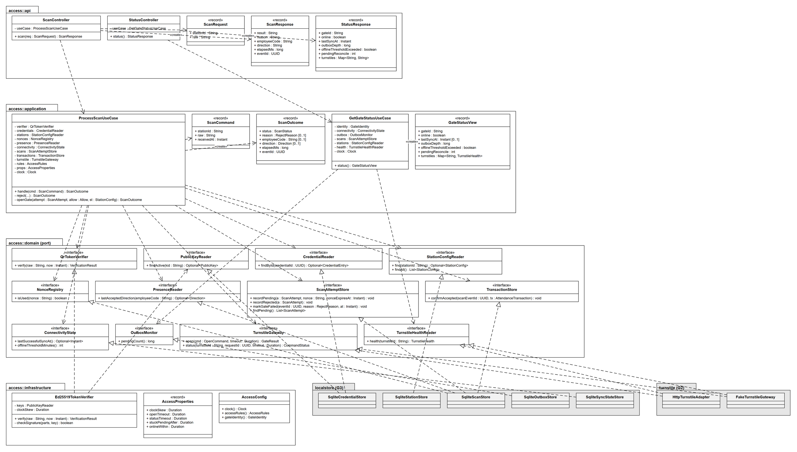
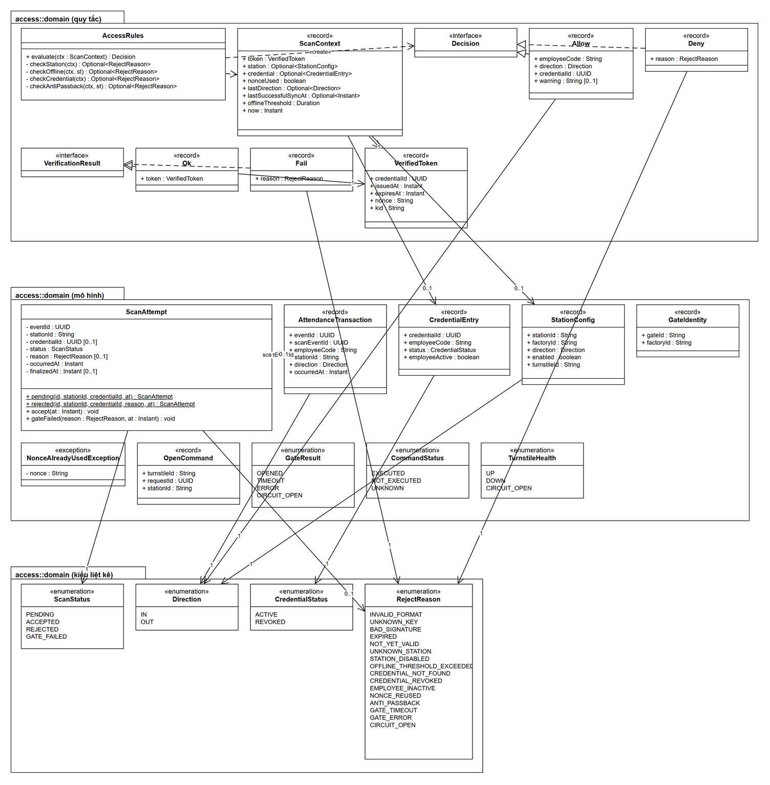

# SRS – `gate-agent/access` (G1 Access Control)

> Trạng thái: Draft · Người viết: BE-1 · Người duyệt: BE-2 · Ngày: 17/11/2026

## 1. Giới thiệu

### 1.1. Mục đích
Đặc tả yêu cầu và thiết kế chi tiết của **G1 Access Control** – package `com.tmc.gate.access`: xác thực mã QR động tại biên, áp dụng các quy tắc cho qua, điều phối luồng **F1 – quét mã QR** (ghi bền vững → mở cổng → ghi giao dịch) và cung cấp trạng thái gate cho kiosk.

### 1.2. Phạm vi
- Có: `POST /scan`, `GET /status`; `ProcessScanUseCase`, `AccessRules`, `Ed25519TokenVerifier`; toàn bộ port mà G1 cần (cài đặt nằm ở G2, G3).
- Không có: lưu trữ (G3), gọi HTTP cổng xoay (G2), đồng bộ (G4), mở cổng thủ công (FR-10, ngoài MVP).

### 1.3. Tài liệu tham chiếu
Báo cáo: FR-08, FR-11 – FR-15, FR-17; NFR-PER-01, NFR-AVL-02/03/04, NFR-REL-02/03, NFR-SEC-02/05/06; INV-03 – INV-07; ADR-01, ADR-02, ADR-03, ADR-06; DP-01, DP-05, DP-07, DP-08, DP-11, DP-12; Bảng 6.3 "Ngân sách thời gian", Bảng "Hành vi của Gate Agent theo trạng thái kết nối", Bảng port mục 8, Hình `class_access_ports`. Đặc tả M2 mục 2.3, 6.1, 7.1 – 7.3, 10.3.

### 1.4. Thuật ngữ
| Thuật ngữ | Nghĩa |
|---|---|
| Lượt quét (`ScanAttempt`) | Một lần trình mã QR tại một trạm, có vòng đời `PENDING → ACCEPTED \| GATE_FAILED`, hoặc `REJECTED` ngay |
| Giao dịch (`AttendanceTransaction`) | Bản ghi vào/ra, chỉ tạo khi cổng xác nhận mở (FR-13) |
| Nonce | Giá trị ngẫu nhiên trong mã QR, chỉ được dùng một lần |
| Presence | Chiều của lượt được chấp nhận gần nhất của mỗi nhân viên tại nhà máy (anti-passback) |

## 2. Mô tả tổng quan

### 2.1. Vị trí trong kiến trúc
G1 là lõi nghiệp vụ của Gate Agent (Q1), kiểu **ports and adapters** (ADR-04). G1 định nghĩa port trong `access::domain`; G2 (`turnstile`) và G3 (`localstore`) cài đặt. Đường xử lý một lượt quét **không có lời gọi nào tới Central** (DP-05).

```
Kiosk ──POST /scan──► ScanController ──► ProcessScanUseCase ──► AccessRules
                                            │  ports
                       ┌────────────────────┼─────────────────────────┐
                 QrTokenVerifier     CredentialReader …          TurnstileGateway
               (Ed25519TokenVerifier)  (G3 Sqlite*)            (G2 Http/Fake adapter)
```

### 2.2. Tác nhân
| Tác nhân | Tương tác |
|---|---|
| Kiosk (máy quét USB hoặc webcam) | `POST /scan`, `GET /status` mỗi 3 s; không cần tài khoản (ADR-08) |
| G5 Guard | Đọc `ScanAttemptStore.findPending()` |
| G4 Sync | Đọc `StationConfigReader`, `TurnstileHealthReader` cho heartbeat |

### 2.3. Ràng buộc
- `access.domain` là Java thuần: không import `org.springframework..`, `..infrastructure..` (ArchUnit A1); coverage ≥ 80 % (JaCoCo).
- Thời gian phản hồi `POST /scan` < 2 s (p95), kể cả khi cổng xoay không trả lời.
- Không log chuỗi `raw` của QR (NFR-PRI-03); chỉ log `eventId`, `cid`, `stationId`.

### 2.4. Giả định
- Đồng hồ máy chủ biên đồng bộ NTP; độ lệch với Central ≤ 30 s.
- Mỗi trạm (`stationId`) gắn với đúng một cổng xoay (`turnstileId`) và một chiều cố định.
- Một Gate Agent phục vụ đúng một nhà máy, nên bảng `presence` cục bộ chính là phạm vi "trong nhà máy" của INV-04.

### 2.5. Phụ thuộc
| Dùng của | Thứ được dùng |
|---|---|
| G3 `localstore` | Cài đặt `CredentialReader`, `PublicKeyReader`, `StationConfigReader`, `NonceRegistry`, `PresenceReader`, `ScanAttemptStore`, `TransactionStore`, `ConnectivityState`, `OutboxMonitor` |
| G2 `turnstile` | Cài đặt `TurnstileGateway`, `TurnstileHealthReader` |
| `sync-contract` | `QrTokenFormat.parse` (chỉ trong `infrastructure`) |

| Cung cấp cho | Thứ được cung cấp |
|---|---|
| Kiosk (web) | `POST /scan`, `GET /status` |
| G2, G3, G4, G5 | Các port và kiểu miền ở `access.domain` |

## 3. Yêu cầu chức năng

| Mã | Yêu cầu | Mức | Truy vết |
|---|---|---|---|
| SRS-GA-ACCESS-FR-01 | Nhận yêu cầu quét `{stationId, raw}`, trả kết quả `ACCEPTED`, `REJECTED` hoặc `GATE_FAILED` kèm `reason`, `employeeCode`, `direction`, `elapsedMs`, `eventId`. | Must | FR-11, FR-14 |
| SRS-GA-ACCESS-FR-02 | Kiểm tra định dạng, `kid` đã biết và chữ ký Ed25519 bằng khóa công khai cục bộ; sai → `INVALID_FORMAT` / `UNKNOWN_KEY` / `BAD_SIGNATURE`. | Must | NFR-SEC-02, DP-11, ADR-02 |
| SRS-GA-ACCESS-FR-03 | Kiểm tra thời hạn với độ lệch ±30 s: hợp lệ khi `iat − 30s ≤ now ≤ exp + 30s`; ngược lại `NOT_YET_VALID` / `EXPIRED`. | Must | NFR-SEC-05 |
| SRS-GA-ACCESS-FR-04 | Trạm phải tồn tại và đang bật; ngược lại `UNKNOWN_STATION` / `STATION_DISABLED`, không gửi lệnh mở cổng. | Must | INV-03, FR-08 |
| SRS-GA-ACCESS-FR-05 | Nếu mất kết nối quá ngưỡng (`now − lastSuccessfulSyncAt > threshold`, hoặc chưa từng đồng bộ) thì từ chối **chiều vào** với `OFFLINE_THRESHOLD_EXCEEDED`; chiều ra luôn được xét tiếp. | Must | FR-17, DP-08 |
| SRS-GA-ACCESS-FR-06 | Credential phải có trong bản sao cục bộ, `ACTIVE`, nhân viên đang hoạt động; ngược lại `CREDENTIAL_NOT_FOUND` / `CREDENTIAL_REVOKED` / `EMPLOYEE_INACTIVE`. | Must | INV-01, INV-02, FR-11 |
| SRS-GA-ACCESS-FR-07 | Nonce chưa từng được dùng; đã dùng → `NONCE_REUSED`. Nonce được đánh dấu đã dùng ngay khi ghi `PENDING` và giữ tới `exp + 30 s`. | Must | NFR-SEC-05, R-06 |
| SRS-GA-ACCESS-FR-08 | Anti-passback: chiều VÀO khi lượt được chấp nhận gần nhất của nhân viên cũng là VÀO → `ANTI_PASSBACK`. Chiều RA sau RA được cho qua kèm cảnh báo (mục 7, D2). | Must | INV-04 |
| SRS-GA-ACCESS-FR-09 | Lượt bị từ chối được ghi `REJECTED` + lý do + bản ghi outbox trong **một** transaction; không tạo giao dịch chấm công. | Must | INV-07, FR-15 |
| SRS-GA-ACCESS-FR-10 | Lượt hợp lệ được ghi `PENDING` (kèm đánh dấu nonce) **trước** khi gọi cổng xoay. | Must | INV-05, DP-01, ADR-03 |
| SRS-GA-ACCESS-FR-11 | Gọi `TurnstileGateway.open` với `requestId = eventId` và giới hạn `openTimeout` (800 ms). | Must | FR-12, DP-07 |
| SRS-GA-ACCESS-FR-12 | Khi cổng xác nhận mở: trong **một** transaction ghi `ACCEPTED`, `attendance_transaction`, `presence`, hai bản ghi outbox; chỉ sau khi commit mới trả `ACCEPTED`. | Must | FR-13, INV-05, NFR-REL-03 |
| SRS-GA-ACCESS-FR-13 | Khi `open` trả `TIMEOUT` hoặc `ERROR`: gọi `status(turnstileId, eventId, statusTimeout)` **một lần**; `EXECUTED` → xử lý như mở thành công; còn lại → `GATE_FAILED` với `GATE_TIMEOUT`/`GATE_ERROR`. Không tự gửi lại lệnh mở. | Must | NFR-REL-02, NFR-AVL-03 |
| SRS-GA-ACCESS-FR-14 | Khi `open` trả `CIRCUIT_OPEN`: `GATE_FAILED` với `CIRCUIT_OPEN`, không gọi `status`. | Must | ADR-06 |
| SRS-GA-ACCESS-FR-15 | Không bao giờ trả `ACCEPTED` khi chưa có xác nhận mở cổng hoặc chưa commit. | Must | INV-05, NFR-AVL-03 |
| SRS-GA-ACCESS-FR-16 | `GET /status` trả `gateId`, `online`, `lastSyncAt`, `outboxDepth`, `offlineThresholdExceeded`, `pendingReconcile`, trạng thái từng cổng xoay. | Must | FR-09, NFR-AVL-04 |
| SRS-GA-ACCESS-FR-17 | Kết quả trả kiosk chỉ chứa mã nhân viên, không chứa họ tên. | Must | DP-12, ADR-08 |

## 4. Yêu cầu phi chức năng

| Mã | Yêu cầu | Truy vết |
|---|---|---|
| SRS-GA-ACCESS-NFR-01 | p95 thời gian xử lý `POST /scan` < 2 s với 800 lượt/30 phút; trường hợp cổng không phản hồi ≤ 1,3 s (800 ms + 200 ms + ghi). | NFR-PER-01/02, T9 |
| SRS-GA-ACCESS-NFR-02 | Xác thực QR + tra cứu cục bộ ≤ 50 ms; mỗi lần ghi SQLite ≤ 50 ms. | Bảng ngân sách thời gian |
| SRS-GA-ACCESS-NFR-03 | `kill -9` ở bất kỳ thời điểm nào không làm mất lượt đã được trả `ACCEPTED`; lượt đang `PENDING` vẫn còn sau khởi động lại. | NFR-REL-03, T8 |
| SRS-GA-ACCESS-NFR-04 | `ProcessScanUseCase` chỉ phụ thuộc interface; kiểm thử đủ nhánh bằng `FakeTurnstileGateway` và `Clock.fixed`. | DIP, LSP, mục 8 báo cáo |
| SRS-GA-ACCESS-NFR-05 | Mọi ngưỡng (độ lệch đồng hồ, timeout) lấy từ cấu hình `tmc.gate.*`. | DP-17 |

## 5. Giao diện ngoài

### 5.1. REST
| Method | Path | Request | Response | Mã HTTP |
|---|---|---|---|---|
| POST | `/scan` | `{ "stationId": "BD-IN-01", "raw": "TMC1.…" }` | `{ "result": "ACCEPTED", "reason": null, "employeeCode": "E0012", "direction": "IN", "elapsedMs": 612, "eventId": "…" }` | `200` cho cả ba kết quả nghiệp vụ; `400` khi thiếu trường / `raw` > 1024 ký tự; `500` khi lỗi lưu trữ (kiosk hiển thị "Không xác định") |
| GET | `/status` | — | `{ "gateId": "gate-bd", "online": true, "lastSyncAt": "…", "outboxDepth": 0, "offlineThresholdExceeded": false, "pendingReconcile": 0, "turnstiles": { "BD-IN-01": "UP" } }` | `200` |

Bảng lý do hiển thị: đặc tả M2 mục 10.3 (dùng chung với `web/shared`).

### 5.2. Port (hợp đồng hành vi – căn cứ LSP)
| Port | Chữ ký | Hợp đồng |
|---|---|---|
| `QrTokenVerifier` | `VerificationResult verify(String raw, Instant now)` | Không ném ngoại lệ; mọi lỗi trả `Fail(reason)` với reason ∈ {INVALID_FORMAT, UNKNOWN_KEY, BAD_SIGNATURE, EXPIRED, NOT_YET_VALID} |
| `PublicKeyReader` | `Optional<PublicKey> findActive(String kid)` | Chỉ trả khóa `active=true` |
| `CredentialReader` | `Optional<CredentialEntry> findById(UUID)` | Chỉ đọc (ISP) |
| `StationConfigReader` | `find(stationId)`, `findAll()` | Chỉ đọc |
| `NonceRegistry` | `boolean isUsed(String nonce)` | Nonce đã hết hạn và bị dọn trả `false` (an toàn vì token đã hết hạn) |
| `PresenceReader` | `Optional<Direction> lastAcceptedDirection(String employeeCode)` | |
| `ScanAttemptStore` | `recordPending(a, nonce, nonceExpiresAt)` | Một transaction: insert `scan_attempts` PENDING + insert `used_nonces`; nonce trùng → `NonceAlreadyUsedException`, không ghi gì |
| | `recordRejected(a)` | Một transaction: insert `scan_attempts` REJECTED + 1 outbox |
| | `markGateFailed(eventId, reason, at)` | Một transaction: PENDING → GATE_FAILED + 1 outbox |
| | `findPending()` | Mọi lượt còn PENDING |
| `TransactionStore` | `confirmAccepted(scanEventId, tx)` | Một transaction: PENDING → ACCEPTED, insert attendance, upsert presence, 2 outbox. Hoặc đủ, hoặc không gì |
| `TurnstileGateway` | `GateResult open(OpenCommand, Duration timeout)` | Luôn trả trong `timeout` (+ ≤ 50 ms); không ném ngoại lệ; `requestId` dùng chống lặp |
| | `CommandStatus status(String turnstileId, UUID requestId, Duration timeout)` | Luôn trả trong `timeout`; không chắc chắn → `UNKNOWN` |
| `TurnstileHealthReader` | `TurnstileHealth health(String turnstileId)` | Không gọi mạng; trả trạng thái gần nhất |
| `ConnectivityState` | `lastSuccessfulSyncAt()`, `offlineThresholdMinutes()` | Ngưỡng lấy từ snapshot, mặc định từ cấu hình |
| `OutboxMonitor` | `long pendingCount()` | Số bản ghi outbox `PENDING` |

## 6. Thiết kế

### 6.1. Mô tả thành phần

| Tầng | Thành phần | Mô tả |
|---|---|---|
| `api` | `ScanController`, `StatusController` + DTO | Chuyển HTTP ↔ lệnh/kết quả của use case; ghi `receivedAt` ngay khi nhận để tính `elapsedMs`; không chứa quy tắc |
| `application` | `ProcessScanUseCase` | Điều phối F1 đúng thứ tự (mục 6.4); là nơi duy nhất quyết định trả kết quả gì (SRP) |
| | `GetGateStatusUseCase` | Gom trạng thái kết nối, outbox, lượt PENDING bị kẹt, sức khỏe cổng xoay |
| `domain` | `AccessRules` | Hàm thuần: `ScanContext → Decision`, kiểm tra quy tắc 3 – 7 theo thứ tự cố định |
| | Mô hình: `ScanAttempt`, `AttendanceTransaction`, `CredentialEntry`, `StationConfig`, `VerifiedToken`, `GateIdentity`, các enum | Kiểu miền bất biến hoặc có vòng đời được kiểm soát |
| | 12 port | Mục 5.2 |
| `infrastructure` | `Ed25519TokenVerifier` | Cài đặt `QrTokenVerifier` bằng `java.security` (`Signature.getInstance("Ed25519")`) + `QrTokenFormat` |
| | `AccessProperties`, `AccessConfig` | Cấu hình `tmc.gate.qr.*`, `tmc.gate.turnstile.*-timeout`; khai báo bean `Clock.systemUTC()`, `AccessRules`, `GateIdentity` |

### 6.2. Danh sách lớp

| Lớp | Tầng | Loại | Trách nhiệm | Ghi chú |
|---|---|---|---|---|
| `ScanController` | api | `@RestController` | `POST /scan` | |
| `StatusController` | api | `@RestController` | `GET /status` | |
| `ScanRequest`, `ScanResponse`, `StatusResponse` | api | record | DTO HTTP | |
| `ProcessScanUseCase` | application | `@Service` | Điều phối luồng F1 | tên theo báo cáo |
| `ScanCommand`, `ScanOutcome` | application | record | Đầu vào/ra của use case | |
| `GetGateStatusUseCase` | application | `@Service` | Trạng thái gate | bổ sung |
| `GateStatusView` | application | record | Kết quả trạng thái | bổ sung |
| `AccessRules` | domain | class | Quy tắc cho qua | tên theo báo cáo |
| `ScanContext` | domain | record | Dữ liệu đầu vào của quy tắc | |
| `Decision` (`Allow`, `Deny`) | domain | sealed interface + record | Kết quả quy tắc | |
| `VerificationResult` (`Ok`, `Fail`) | domain | sealed interface + record | Kết quả xác thực token | |
| `VerifiedToken` | domain | record | Token đã kiểm chữ ký và thời hạn | |
| `ScanAttempt` | domain | class | Lượt quét và vòng đời trạng thái | |
| `AttendanceTransaction` | domain | record | Giao dịch chấm công | |
| `CredentialEntry`, `StationConfig`, `OpenCommand`, `GateIdentity` | domain | record | Dữ liệu tham chiếu, lệnh mở, danh tính gate | `GateIdentity` bổ sung |
| `ScanStatus`, `RejectReason`, `Direction`, `CredentialStatus`, `GateResult`, `CommandStatus`, `TurnstileHealth` | domain | enum | | |
| `NonceAlreadyUsedException` | domain | exception | Báo nonce trùng khi ghi PENDING (đua) | bổ sung |
| `QrTokenVerifier`, `CredentialReader`, `ScanAttemptStore`, `TransactionStore`, `TurnstileGateway` | domain | interface | Port theo báo cáo | |
| `StationConfigReader`, `NonceRegistry`, `PresenceReader`, `ConnectivityState` | domain | interface | Port bổ sung (đặc tả M2 7.1) | |
| `PublicKeyReader`, `OutboxMonitor`, `TurnstileHealthReader` | domain | interface | Port bổ sung (spec này) | bổ sung |
| `Ed25519TokenVerifier` | infrastructure | `@Component` | Kiểm chữ ký, thời hạn | |
| `AccessProperties` | infrastructure | `@ConfigurationProperties` record | Tham số | |
| `AccessConfig` | infrastructure | `@Configuration` | Khai báo bean | |

### 6.3. Sơ đồ lớp
Nguồn: [class-gate-agent-access.drawio](../drawio/class-gate-agent-access.drawio) (2 trang).

Trang 1 – use case, port và adapter (mọi realization đều hướng vào `access::domain`, DIP):


Trang 2 – mô hình miền:


### 6.4. Luồng xử lý `ProcessScanUseCase.handle`

```
handle(cmd):
  now = clock.instant(); eventId = UUID.randomUUID()
  1  vr = verifier.verify(cmd.raw, now)
     Fail(r)  → return reject(eventId, cmd.stationId, credentialId=null, r)
  2  ctx = ScanContext(token, stations.find(stationId), credentials.findById(token.cid),
                       nonces.isUsed(token.nonce), presence.lastAcceptedDirection(...)*, connectivity…, now)
     (* chỉ đọc presence khi đã có credential)
  3  decision = rules.evaluate(ctx)            // quy tắc 3 → 7, dừng ở quy tắc đầu tiên vi phạm
     Deny(r)  → return reject(eventId, stationId, token.cid, r)
  4  attempt = ScanAttempt.pending(eventId, stationId, token.cid, now)
     try scans.recordPending(attempt, token.nonce, token.expiresAt + clockSkew)     // TX #1, fsync
     catch NonceAlreadyUsedException → return reject(eventId, stationId, token.cid, NONCE_REUSED)
  5  r = turnstile.open(OpenCommand(st.turnstileId, eventId, stationId), props.openTimeout)
  6  if r == TIMEOUT or ERROR:
        s = turnstile.status(st.turnstileId, eventId, props.statusTimeout)
        if s == EXECUTED: r = OPENED
  7  if r == OPENED:
        tx = AttendanceTransaction(UUID.randomUUID(), eventId, allow.employeeCode, stationId, st.direction, clock.instant())
        transactions.confirmAccepted(eventId, tx)                                   // TX #2
        return ScanOutcome(ACCEPTED, null, code, direction, elapsed, eventId)
     else:
        reason = {TIMEOUT→GATE_TIMEOUT, ERROR→GATE_ERROR, CIRCUIT_OPEN→CIRCUIT_OPEN}[r]
        scans.markGateFailed(eventId, reason, clock.instant())
        return ScanOutcome(GATE_FAILED, reason, code, direction, elapsed, eventId)

reject(eventId, stationId, cid, reason):
  scans.recordRejected(ScanAttempt.rejected(eventId, stationId, cid, reason, now))   // 1 TX + outbox
  return ScanOutcome(REJECTED, reason, …)
```

`elapsedMs = clock.millis() − cmd.receivedAt.toEpochMilli()`. Nếu bước 7 (`confirmAccepted`) ném ngoại lệ lưu trữ: lượt giữ `PENDING`, trả HTTP 500 (kiosk "Không xác định"), log ERROR – không bao giờ trả xanh (INV-05); bảo vệ đối soát qua G5.

### 6.5. Thứ tự quy tắc trong `AccessRules.evaluate`

| Thứ tự | Kiểm tra | Từ chối |
|---|---|---|
| (1, 2) | Định dạng, chữ ký, thời hạn | Đã làm ở `QrTokenVerifier` |
| 3 | `station` có và `enabled` | `UNKNOWN_STATION`, `STATION_DISABLED` |
| 4 | `station.direction == IN` và (`lastSuccessfulSyncAt` rỗng hoặc `now − lastSuccessfulSyncAt > offlineThreshold`) | `OFFLINE_THRESHOLD_EXCEEDED` |
| 5 | `credential` có / `ACTIVE` / `employeeActive` | `CREDENTIAL_NOT_FOUND`, `CREDENTIAL_REVOKED`, `EMPLOYEE_INACTIVE` |
| 6 | `!nonceUsed` | `NONCE_REUSED` |
| 7 | `station.direction == IN` và `lastDirection == IN` | `ANTI_PASSBACK` |
| — | Hợp lệ | `Allow(employeeCode, direction, credentialId, warning)`; `warning = "OUT_AFTER_OUT"` khi RA sau RA |

Quy tắc trạm đặt trước quy tắc credential để trạm bị tắt không làm lộ thông tin credential (INV-03).

### 6.6. Vòng đời `ScanAttempt`
```
            pending()                    accept()
  (mới) ───────────────► PENDING ──────────────────► ACCEPTED
     │                      │ gateFailed()
     │ rejected()           └──────────────────────► GATE_FAILED
     └────────────────────────────────────────────► REJECTED
```
`accept`/`gateFailed` ném `IllegalStateException` nếu trạng thái hiện tại không phải `PENDING` (DP-02).

### 6.7. Dữ liệu
G1 sở hữu (theo nghĩa DP-04: chỉ G1 ghi) các bảng `scan_attempts`, `attendance_transactions`, `used_nonces`, `presence` và các bản ghi outbox do G1 sinh; lược đồ và cài đặt ở [gate-agent-localstore.md](gate-agent-localstore.md). G1 chỉ đọc `credentials`, `public_keys`, `stations`, `sync_state`.

### 6.8. Cấu hình
| Khóa | Mặc định | Ý nghĩa |
|---|---|---|
| `tmc.gate.gate-id`, `tmc.gate.factory-id` | `gate-bd`, `BD` | `GateIdentity` |
| `tmc.gate.qr.clock-skew` | `30s` | Độ lệch đồng hồ cho phép |
| `tmc.gate.turnstile.open-timeout` | `800ms` | Giới hạn chờ lệnh mở |
| `tmc.gate.turnstile.status-timeout` | `200ms` | Giới hạn chờ kiểm tra trạng thái |
| `tmc.gate.access.stuck-pending-after` | `5s` | Lượt PENDING lâu hơn ngưỡng này được đếm vào `pendingReconcile` |
| `tmc.gate.access.online-within` | `30s` | `online = now − lastSuccessfulSyncAt ≤ online-within` (≈ 3 chu kỳ heartbeat) |

### 6.9. Xử lý lỗi
| Tình huống | Xử lý |
|---|---|
| Body thiếu `stationId`/`raw`, `raw` > 1024 ký tự | `400` (Bean Validation), không ghi lượt quét |
| Token sai / quy tắc vi phạm | `200 REJECTED` + ghi `REJECTED` |
| Nonce trùng do hai yêu cầu đồng thời | Bắt `NonceAlreadyUsedException` → `NONCE_REUSED` |
| Cổng timeout/lỗi/circuit open | `200 GATE_FAILED` |
| Lỗi SQLite ở bước ghi | `500` + ProblemDetail `{code: "LOCAL_STORE_ERROR"}`; không trả xanh |

## 7. Quyết định thiết kế và độ lệch

| # | Quyết định / độ lệch | Lý do |
|---|---|---|
| D1 | Việc gọi `status()` sau timeout nằm ở `ProcessScanUseCase`, không nằm trong adapter | Giữ đúng luồng F1 (đặc tả M2 mục 2.3); adapter đơn giản và mọi adapter (kể cả Fake) có cùng hành vi |
| D2 | RA sau RA: **cho qua**, ghi log WARN `OUT_AFTER_OUT` (đề xuất, chờ nhóm xác nhận) | Không giữ người trong nhà máy (DP-08) |
| D3 | `TurnstileGateway.status` nhận thêm `requestId`; tách `TurnstileHealthReader` riêng | Báo cáo ghi `status(station)`; cần biết **lệnh nào** đã thực hiện (NFR-REL-02). Tách health để không bắt G4 phụ thuộc thao tác mở cổng (ISP) |
| D4 | Thêm port `PublicKeyReader`, `OutboxMonitor`, `TurnstileHealthReader`; kiểu `GateIdentity` | Cần cho xác thực và `/status` mà không để `access` phụ thuộc `sync` |
| D5 | Chưa từng đồng bộ → coi như quá ngưỡng (chiều vào bị từ chối) | An toàn khi thiếu thông tin (DP-08) |
| D6 | Nonce vẫn bị tiêu thụ khi `GATE_FAILED` | Không cho dùng lại token; nhân viên có mã mới sau ≤ 30 s |
| D7 | Quá ngưỡng mất kết nối: chiều vào bị từ chối thay vì "mở thủ công qua Guard Console" | Độ lệch đã ghi ở đặc tả M2 mục 3.3 |

## 8. Tiêu chí chấp nhận

| Yêu cầu | Test case | Kịch bản |
|---|---|---|
| FR-02, FR-03 | `TC-GA-ACCESS-01..04` unit `Ed25519TokenVerifier` với vector của `sync-contract` + `Clock.fixed` | T3, T4 |
| FR-04 … FR-08 | `TC-GA-ACCESS-05..11` unit `AccessRules`, mỗi lý do một case, kiểm thứ tự quy tắc | T10, T11 |
| FR-09 … FR-15 | `TC-GA-ACCESS-12..17` `ProcessScanUseCase` với Fake: OPENED, TIMEOUT, ERROR, CIRCUIT_OPEN, TIMEOUT + EXECUTED, REJECTED; kiểm thứ tự gọi port (Mockito `InOrder`) | T1, T7 |
| FR-16 | `TC-GA-ACCESS-18` `GET /status` (MockMvc) | D4 |
| NFR-01 | `TC-GA-ACCESS-19` E2E `elapsedMs` < 2000; k6 p95 | T1, T9 |
| NFR-03 | E2E kill-9 | T8 |
| NFR-04 | ArchUnit A1; JaCoCo `access.domain` ≥ 80 % | A1, U |
