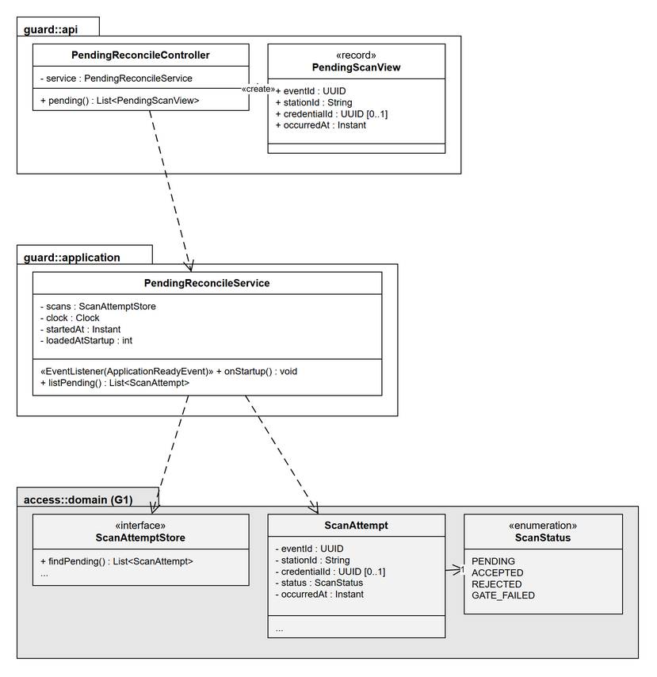

# SRS – `gate-agent/guard` (G5 Guard Console – rút gọn)

> Trạng thái: Draft · Người viết: BE-1 · Người duyệt: FE-1 · Ngày: 17/11/2026

## 1. Giới thiệu

### 1.1. Mục đích
Đặc tả phần rút gọn của **G5 Guard Console** – package `com.tmc.gate.guard`: cung cấp danh sách các lượt quét còn ở trạng thái `PENDING` sau khi Gate Agent khởi động lại, để bảo vệ đối soát (ADR-03, T8).

### 1.2. Phạm vi
- Có: nạp và ghi log số lượt `PENDING` khi khởi động; `GET /guard/pending`.
- Không có (ngoài MVP): giao diện Guard Console, luồng sự kiện thời gian thực, mở cổng thủ công (FR-10), xử lý/đóng một lượt đối soát.

### 1.3. Tài liệu tham chiếu
FR-09, FR-15 (phần hiển thị); NFR-REL-03; INV-05; ADR-03 ("các lượt chờ xác nhận được đưa lên bảng điều khiển của bảo vệ để đối soát"); Bảng "Phân tích chế độ lỗi" mục 6.3; đặc tả M2 mục 3.1, 7.3, 7.4.

## 2. Mô tả tổng quan

### 2.1. Vị trí
G5 nằm trong Gate Agent, chỉ có tầng `api` và `application`; đọc qua port `ScanAttemptStore` của G1 (cài đặt ở G3). Không có `domain` riêng vì không có quy tắc nghiệp vụ mới.

### 2.2. Tác nhân
Bảo vệ hoặc người trình diễn (qua trình duyệt / `curl`); không xác thực trong MVP vì endpoint chỉ mở trên mạng nội bộ nhà máy (đồng bộ với kiosk, ADR-08).

### 2.3. Ràng buộc
Chỉ đọc; không thay đổi trạng thái lượt quét (DP-04: dữ liệu lượt quét do G1 sở hữu).

## 3. Yêu cầu chức năng

| Mã | Yêu cầu | Mức | Truy vết |
|---|---|---|---|
| SRS-GA-GUARD-FR-01 | Khi ứng dụng sẵn sàng (`ApplicationReadyEvent`), ghi nhận thời điểm khởi động `startedAt` và đọc `ScanAttemptStore.findPending()`; ghi log WARN số lượt `PENDING` tồn đọng. | Should | ADR-03, T8 |
| SRS-GA-GUARD-FR-02 | `GET /guard/pending` trả danh sách lượt có `status = PENDING` và `occurredAt < startedAt`, sắp theo `occurredAt` tăng dần, gồm `eventId`, `stationId`, `credentialId`, `occurredAt`. | Should | ADR-03, T8 |
| SRS-GA-GUARD-FR-03 | Lượt `PENDING` phát sinh sau khi khởi động (đang chờ cổng xoay) không xuất hiện trong danh sách. | Should | Tránh báo nhầm |
| SRS-GA-GUARD-FR-04 | Không trả họ tên, không trả chuỗi QR. | Must | DP-12 |

## 4. Yêu cầu phi chức năng

| Mã | Yêu cầu | Truy vết |
|---|---|---|
| SRS-GA-GUARD-NFR-01 | Phản hồi ≤ 200 ms với ≤ 1.000 lượt PENDING (có index `ix_scan_pending`). | DP-09 |
| SRS-GA-GUARD-NFR-02 | Không ảnh hưởng luồng quét (chỉ một câu `SELECT`). | DP-05 |

## 5. Giao diện ngoài

| Method | Path | Response | Mã |
|---|---|---|---|
| GET | `/guard/pending` | `[ { "eventId": "…", "stationId": "BD-IN-01", "credentialId": "6f1c…", "occurredAt": "2026-11-20T07:58:01Z" } ]` | `200` (mảng rỗng nếu không có) |

Port sử dụng: `ScanAttemptStore.findPending() : List<ScanAttempt>` (định nghĩa ở G1).

## 6. Thiết kế

### 6.1. Mô tả thành phần
| Tầng | Thành phần | Mô tả |
|---|---|---|
| `api` | `PendingReconcileController` | `GET /guard/pending`; ánh xạ `ScanAttempt` → `PendingScanView` |
| `application` | `PendingReconcileService` | Lưu `startedAt`, nạp và log khi khởi động, lọc khi được hỏi |

### 6.2. Danh sách lớp
| Lớp | Tầng | Loại | Trách nhiệm |
|---|---|---|---|
| `PendingReconcileController` | api | `@RestController` | Endpoint đối soát |
| `PendingScanView` | api | record | DTO trả về |
| `PendingReconcileService` | application | `@Service` | Logic lọc lượt tồn đọng |

### 6.3. Sơ đồ lớp
Nguồn: [class-gate-agent-guard.drawio](../drawio/class-gate-agent-guard.drawio) · Ảnh: 

### 6.4. Luồng xử lý
```
onStartup():                          // @EventListener(ApplicationReadyEvent)
  startedAt = clock.instant()
  loadedAtStartup = scans.findPending().count(a -> a.occurredAt < startedAt)
  if loadedAtStartup > 0: log WARN "{} lượt PENDING cần đối soát"

listPending():
  return scans.findPending().filter(a -> a.occurredAt < startedAt).sortedBy(occurredAt)
```
Lọc theo thời điểm khởi động thay vì giữ danh sách trong bộ nhớ: danh sách luôn phản ánh trạng thái thật trong SQLite và vẫn đúng nếu sau này có chức năng đóng lượt đối soát.

### 6.5. Dữ liệu và cấu hình
Không có bảng riêng, không có tham số riêng.

### 6.6. Xử lý lỗi
Lỗi đọc SQLite → `500` ProblemDetail `{code: "LOCAL_STORE_ERROR"}`.

## 7. Quyết định thiết kế và độ lệch

| # | Độ lệch so với báo cáo | Lý do |
|---|---|---|
| D1 | Không có giao diện Guard Console; chỉ có `GET /guard/pending` | Đặc tả M2 3.1, 3.3; đủ chứng minh T8 |
| D2 | Không mở cổng thủ công (FR-10) | Ngoài MVP |
| D3 | Endpoint không yêu cầu xác thực | Chỉ phục vụ mạng LAN nhà máy trong demo; ghi vào bảng độ lệch |

## 8. Tiêu chí chấp nhận

| Yêu cầu | Test case |
|---|---|
| FR-01 … FR-03 | `TC-GA-GUARD-01` service với `ScanAttemptStore` giả: lượt trước/sau `startedAt` |
| FR-02 | `TC-GA-GUARD-02` MockMvc trả đúng JSON |
| T8 | E2E: dừng gate sau bước ghi PENDING (`kill-gate.sh`), bật lại → lượt xuất hiện ở `/guard/pending` |
