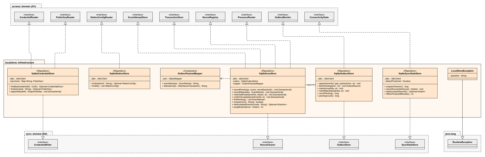

# SRS – `gate-agent/localstore` (G3 Local Store & Outbox)

> Trạng thái: Draft · Người viết: BE-1 · Người duyệt: BE-2 · Ngày: 17/11/2026

## 1. Giới thiệu

### 1.1. Mục đích
Đặc tả **G3 Local Store & Outbox** – package `com.tmc.gate.localstore`: kho SQLite bền vững tại máy chủ biên, giữ bản sao dữ liệu tham chiếu, các bản ghi phát sinh tại cổng và hàng đợi **transactional outbox**. G3 là thành phần giúp cổng chạy được khi **mất kết nối** và không mất dữ liệu khi khởi động lại.

### 1.2. Phạm vi
- Có: migration `V1__init.sql`; 5 adapter `Sqlite*Store` cài đặt port của G1 và G4; ánh xạ payload outbox sang `sync-contract`; cấu hình transaction.
- Không có: mã hóa SQLite, sao chép sang node dự phòng (độ lệch, mục 7); bảng mở cổng thủ công.

### 1.3. Tài liệu tham chiếu
FR-13, FR-15, FR-17; NFR-REL-03, NFR-DIN-01/02, NFR-AVL-04; INV-05, INV-06, INV-07; ADR-03, ADR-10; DP-01, DP-02, DP-04, DP-12; ISP (mục 8: `SqliteCredentialStore` cài đặt `CredentialReader` và `CredentialWriter`); đặc tả M2 mục 4 (ghi chú SQLite), 7.5.

## 2. Mô tả tổng quan

### 2.1. Vị trí
G3 chỉ có tầng `infrastructure`, cài đặt port do `access::domain` (G1) và `sync::domain` (G4) định nghĩa (DIP). Không ai ngoài G3 truy cập trực tiếp `DataSource` của SQLite.

### 2.2. Quyền ghi theo DP-04

| Bảng | Ghi bởi (qua port) | Đọc bởi |
|---|---|---|
| `credentials`, `public_keys`, `stations` | G4 (`CredentialWriter.applyDelta`) | G1 |
| `sync_state` | G4 (`CredentialWriter`, `SyncStateStore`) | G1 (`ConnectivityState`) |
| `scan_attempts`, `attendance_transactions`, `used_nonces`, `presence` | G1 (`ScanAttemptStore`, `TransactionStore`); G4 xóa nonce hết hạn (`NonceCleaner`) | G1, G5 |
| `outbox` | G1 thêm (gián tiếp qua store); G4 đổi trạng thái (`OutboxStore`) | G4, G1 (`OutboxMonitor`) |

### 2.3. Ràng buộc
- SQLite qua `org.xerial:sqlite-jdbc` + Spring JDBC `JdbcClient`; **không dùng JPA**.
- PRAGMA: `journal_mode=WAL`, `synchronous=FULL`, `foreign_keys=true`, `busy_timeout=5000` (URL JDBC).
- Hikari `maximum-pool-size=1`: mọi lệnh đi tuần tự qua một kết nối, tránh `SQLITE_BUSY`.
- Transaction bằng `DataSourceTransactionManager` + `@Transactional` trên phương thức của store.

### 2.4. Giả định
Tải đỉnh 2 – 5 lượt/giây, một kết nối là đủ (Bảng tải và dung lượng, mục 6.3 báo cáo). File DB nằm trên volume bền vững (`/data/gate-local.db`).

## 3. Yêu cầu chức năng

| Mã | Yêu cầu | Mức | Truy vết |
|---|---|---|---|
| SRS-GA-STORE-FR-01 | Tạo lược đồ bằng Flyway (`db/migration/V1__init.sql`) khi khởi động. | Must | ADR-10 |
| SRS-GA-STORE-FR-02 | `recordPending`: trong một transaction, thêm `scan_attempts(status=PENDING)` và `used_nonces`; nonce trùng (vi phạm PK) → rollback và ném `NonceAlreadyUsedException`. | Must | INV-05, NFR-SEC-05 |
| SRS-GA-STORE-FR-03 | `recordRejected`: trong một transaction, thêm `scan_attempts(status=REJECTED, reason)` và một bản ghi outbox `SCAN_ATTEMPT_RECORDED`. | Must | INV-07, FR-15 |
| SRS-GA-STORE-FR-04 | `markGateFailed`: trong một transaction, cập nhật `PENDING → GATE_FAILED` (điều kiện `WHERE status='PENDING'`), đặt `finalized_at`, thêm outbox `SCAN_ATTEMPT_RECORDED`. | Must | NFR-AUD-04, DP-02 |
| SRS-GA-STORE-FR-05 | `confirmAccepted`: trong một transaction, cập nhật `PENDING → ACCEPTED`, thêm `attendance_transactions`, upsert `presence`, thêm 2 bản ghi outbox (`SCAN_ATTEMPT_RECORDED`, `ATTENDANCE_RECORDED`). Hoặc đủ cả, hoặc không gì. | Must | FR-13, INV-05, NFR-REL-03 |
| SRS-GA-STORE-FR-06 | `applyDelta`: trong một transaction, upsert `credentials`, `public_keys`, `stations`, cập nhật `sync_state.snapshot_version = toVersion` và `offline_threshold_min`; bỏ qua delta có `fromVersion ≠ snapshot_version` hiện tại (trừ `fromVersion=0`). | Must | FR-05, NFR-SEC-06, DP-04 |
| SRS-GA-STORE-FR-07 | `fetchPending(limit)` trả các bản ghi outbox `PENDING` theo `seq` tăng dần; `markSynced` / `markRejected` chỉ đổi trạng thái các `event_id` được nêu. | Must | ADR-03, INV-06 |
| SRS-GA-STORE-FR-08 | `findPending()` trả mọi lượt `PENDING` (đối soát sau crash). | Must | ADR-03, T8 |
| SRS-GA-STORE-FR-09 | `purgeExpired(now)` xóa `used_nonces` có `expires_at < now`. | Must | NFR-SEC-05 |
| SRS-GA-STORE-FR-10 | `ConnectivityState`: `lastSuccessfulSyncAt` từ `sync_state.last_success_at`; `offlineThresholdMinutes` từ `sync_state.offline_threshold_min`, nếu chưa có thì lấy `tmc.gate.sync.default-offline-threshold`. | Must | FR-17 |
| SRS-GA-STORE-FR-11 | Bản sao credential chỉ lưu `credential_id`, `employee_code`, `status`, `employee_active`, `updated_at` (không họ tên). | Must | DP-12, ADR-08 |

## 4. Yêu cầu phi chức năng

| Mã | Yêu cầu | Truy vết |
|---|---|---|
| SRS-GA-STORE-NFR-01 | Mỗi transaction ghi ≤ 50 ms trên SSD (p95). | Ngân sách thời gian |
| SRS-GA-STORE-NFR-02 | Sau `kill -9`, mọi transaction đã commit còn nguyên (WAL + `synchronous=FULL`). | NFR-REL-03, T8 |
| SRS-GA-STORE-NFR-03 | Outbox chứa được ≥ 2.000 bản ghi (8 giờ offline một nhà máy) mà `fetchPending(200)` vẫn ≤ 20 ms (có index). | Bảng tải, mục 6.3 |
| SRS-GA-STORE-NFR-04 | Store không chứa quy tắc nghiệp vụ (chỉ lưu/đọc); kiểm tra trạng thái chuyển đổi hợp lệ bằng điều kiện SQL. | SRP, DP-02 |

## 5. Giao diện ngoài
Các port được cài đặt (định nghĩa ở G1/G4):

| Port | Module định nghĩa | Lớp cài đặt |
|---|---|---|
| `CredentialReader`, `PublicKeyReader` | access | `SqliteCredentialStore` |
| `CredentialWriter` | sync | `SqliteCredentialStore` |
| `StationConfigReader` | access | `SqliteStationStore` |
| `ScanAttemptStore`, `TransactionStore`, `NonceRegistry`, `PresenceReader` | access | `SqliteScanStore` |
| `NonceCleaner` | sync | `SqliteScanStore` |
| `OutboxStore` | sync | `SqliteOutboxStore` |
| `OutboxMonitor` | access | `SqliteOutboxStore` |
| `SyncStateStore` | sync | `SqliteSyncStateStore` |
| `ConnectivityState` | access | `SqliteSyncStateStore` |

## 6. Thiết kế

### 6.1. Mô tả thành phần

| Thành phần | Mô tả |
|---|---|
| `SqliteCredentialStore` | Đọc credential/khóa công khai cho G1; áp delta snapshot cho G4. Hai phía thấy hai interface hẹp khác nhau (ISP) – G1 không có cách nào sửa bản sao. Giải mã `publicKeyBase64` → `PublicKey` bằng `KeyFactory("Ed25519")`, có cache trong bộ nhớ theo `kid`, xóa cache khi `applyDelta`. |
| `SqliteStationStore` | Đọc cấu hình trạm. |
| `SqliteScanStore` | Ghi vòng đời lượt quét, giao dịch, presence, nonce; mỗi thao tác ghi gọi `SqliteOutboxStore.append` **trong cùng transaction** (transactional outbox, ADR-03). |
| `SqliteOutboxStore` | Thêm bản ghi outbox (gói nội bộ), đọc theo lô, đánh dấu đã đồng bộ/từ chối, đếm. |
| `SqliteSyncStateStore` | Bảng khóa–giá trị `sync_state`. |
| `OutboxPayloadMapper` | Chuyển `ScanAttempt`/`AttendanceTransaction` → JSON của `ScanAttemptPayload`/`AttendancePayload` (`sync-contract`). Nhờ đó `access.domain` không phụ thuộc hợp đồng. |
| `LocalStoreConfig` | `@Configuration`: `JdbcClient`, `DataSourceTransactionManager`. |
| `LocalStoreException` | Bọc `DataAccessException` khi cần báo lỗi lưu trữ có ngữ cảnh. |

### 6.2. Danh sách lớp

| Lớp | Loại | Cài đặt port | Ghi chú |
|---|---|---|---|
| `SqliteCredentialStore` | `@Repository` | `CredentialReader`, `PublicKeyReader`, `CredentialWriter` | |
| `SqliteStationStore` | `@Repository` | `StationConfigReader` | |
| `SqliteScanStore` | `@Repository` | `ScanAttemptStore`, `TransactionStore`, `NonceRegistry`, `PresenceReader`, `NonceCleaner` | |
| `SqliteOutboxStore` | `@Repository` | `OutboxStore`, `OutboxMonitor` | |
| `SqliteSyncStateStore` | `@Repository` | `SyncStateStore`, `ConnectivityState` | |
| `OutboxPayloadMapper` | `@Component` | — | bổ sung |
| `LocalStoreConfig` | `@Configuration` | — | bổ sung |
| `LocalStoreException` | exception | — | bổ sung |

### 6.3. Sơ đồ lớp
Nguồn: [class-diagram.drawio](../drawio/class-diagram.drawio), tab `gate-agent-localstore`. Lớp được tô màu theo tầng (api xanh dương, application xanh lá, domain vàng, infrastructure cam, module/thư viện khác xám); record/DTO không vẽ, chỉ xuất hiện làm kiểu trong chữ ký.



### 6.4. Lược đồ dữ liệu (`V1__init.sql`)

```sql
CREATE TABLE credentials (
  credential_id   TEXT PRIMARY KEY,                 -- UUID
  employee_code   TEXT NOT NULL,
  status          TEXT NOT NULL CHECK (status IN ('ACTIVE','REVOKED')),
  employee_active INTEGER NOT NULL CHECK (employee_active IN (0,1)),
  updated_at      TEXT NOT NULL                     -- ISO-8601 UTC
);
CREATE TABLE public_keys (
  kid TEXT PRIMARY KEY, public_key TEXT NOT NULL, active INTEGER NOT NULL CHECK (active IN (0,1))
);
CREATE TABLE stations (
  station_id TEXT PRIMARY KEY, factory_id TEXT NOT NULL,
  direction TEXT NOT NULL CHECK (direction IN ('IN','OUT')),
  enabled INTEGER NOT NULL CHECK (enabled IN (0,1)), turnstile_id TEXT NOT NULL
);
CREATE TABLE sync_state ( key TEXT PRIMARY KEY, value TEXT NOT NULL );
-- keys: snapshot_version, last_success_at, offline_threshold_min

CREATE TABLE scan_attempts (
  event_id      TEXT PRIMARY KEY,
  station_id    TEXT NOT NULL,
  credential_id TEXT,                               -- NULL khi không xác định được (INV-07)
  status        TEXT NOT NULL CHECK (status IN ('PENDING','ACCEPTED','REJECTED','GATE_FAILED')),
  reason        TEXT,
  occurred_at   TEXT NOT NULL,
  finalized_at  TEXT
);
CREATE INDEX ix_scan_pending ON scan_attempts(status) WHERE status = 'PENDING';

CREATE TABLE attendance_transactions (
  event_id      TEXT PRIMARY KEY,
  scan_event_id TEXT NOT NULL UNIQUE REFERENCES scan_attempts(event_id),
  employee_code TEXT NOT NULL, station_id TEXT NOT NULL,
  direction     TEXT NOT NULL CHECK (direction IN ('IN','OUT')),
  occurred_at   TEXT NOT NULL
);
CREATE TABLE used_nonces ( nonce TEXT PRIMARY KEY, expires_at TEXT NOT NULL );
CREATE INDEX ix_nonce_exp ON used_nonces(expires_at);
CREATE TABLE presence ( employee_code TEXT PRIMARY KEY, last_direction TEXT NOT NULL, last_at TEXT NOT NULL );

CREATE TABLE outbox (
  seq        INTEGER PRIMARY KEY AUTOINCREMENT,
  event_id   TEXT NOT NULL UNIQUE,
  type       TEXT NOT NULL CHECK (type IN ('SCAN_ATTEMPT_RECORDED','ATTENDANCE_RECORDED')),
  payload    TEXT NOT NULL,                         -- JSON theo sync-contract
  status     TEXT NOT NULL DEFAULT 'PENDING' CHECK (status IN ('PENDING','SYNCED','REJECTED')),
  reject_reason TEXT,
  created_at TEXT NOT NULL,
  synced_at  TEXT
);
CREATE INDEX ix_outbox_pending ON outbox(status, seq);
```

Ghi chú:
- `attendance_transactions` và `scan_attempts` **không** có câu lệnh `UPDATE`/`DELETE` nào ngoài chuyển trạng thái `PENDING → *` (DP-02).
- Thời điểm lưu dạng chuỗi ISO-8601 UTC để so sánh chuỗi được và đọc trực tiếp khi gỡ lỗi.
- `outbox.event_id` của bản ghi `SCAN_ATTEMPT_RECORDED` bằng `scan_attempts.event_id`; của `ATTENDANCE_RECORDED` bằng `attendance_transactions.event_id` → idempotent ở C1.

### 6.5. Câu lệnh chính
| Thao tác | SQL (rút gọn) |
|---|---|
| `markGateFailed` | `UPDATE scan_attempts SET status='GATE_FAILED', reason=?, finalized_at=? WHERE event_id=? AND status='PENDING'` – 0 dòng → `IllegalStateException` (rollback) |
| `confirmAccepted` | `UPDATE … SET status='ACCEPTED' … WHERE … AND status='PENDING'`; `INSERT INTO attendance_transactions …`; `INSERT INTO presence … ON CONFLICT(employee_code) DO UPDATE SET last_direction=excluded.last_direction, last_at=excluded.last_at`; 2 × `INSERT INTO outbox` |
| `applyDelta` (credential) | `INSERT INTO credentials … ON CONFLICT(credential_id) DO UPDATE SET … WHERE excluded.updated_at >= credentials.updated_at` |
| `fetchPending` | `SELECT seq,event_id,type,payload,created_at FROM outbox WHERE status='PENDING' ORDER BY seq LIMIT ?` |
| `markSynced` | `UPDATE outbox SET status='SYNCED', synced_at=? WHERE event_id IN (…) AND status='PENDING'` |
| `lastAcceptedDirection` | `SELECT last_direction FROM presence WHERE employee_code=?` |

### 6.6. Cấu hình
| Khóa | Mặc định |
|---|---|
| `spring.datasource.url` | `jdbc:sqlite:${SQLITE_PATH:./gate-local.db}?journal_mode=WAL&synchronous=FULL&foreign_keys=true&busy_timeout=5000` |
| `spring.datasource.hikari.maximum-pool-size` | `1` |
| `spring.flyway.locations` | `classpath:db/migration` |
| `tmc.gate.sync.default-offline-threshold` | `8h` (profile `demo`: `2m`) |

### 6.7. Xử lý lỗi
- Vi phạm PK `used_nonces` → `NonceAlreadyUsedException` (domain của G1).
- Chuyển trạng thái không hợp lệ (0 dòng được cập nhật) → `IllegalStateException`, rollback cả transaction.
- Lỗi I/O, đĩa đầy → `DataAccessException` lan lên use case (G1 trả `500`, G4 thử lại chu kỳ sau). Không nuốt lỗi.

## 7. Quyết định thiết kế và độ lệch

| # | Quyết định / độ lệch | Lý do |
|---|---|---|
| D1 | `SqliteCredentialStore.applyDelta` ghi cả `public_keys`, `stations`, `sync_state` | Một delta phải được áp trong **một** transaction (đặc tả M2 7.4); tránh trạng thái nửa vời giữa credential và khóa |
| D2 | `SqliteScanStore` cũng cài đặt `NonceCleaner` | Nonce là dữ liệu của luồng quét; G4 chỉ kích hoạt việc dọn |
| D3 | Payload outbox được tạo ở G3 bằng `OutboxPayloadMapper` | Giữ `access.domain` độc lập với `sync-contract` |
| D4 | SQLite **không mã hóa** | Độ lệch đã ghi (đặc tả M2 3.3): SQLCipher cần driver riêng |
| D5 | Không sao chép sang node dự phòng | Demo một máy (ADR-01 bị rút gọn) |
| D6 | Thêm cột `outbox.reject_reason` | Lưu lý do C1 từ chối để đối soát |

## 8. Tiêu chí chấp nhận

| Yêu cầu | Test case |
|---|---|
| FR-02 | `TC-GA-STORE-01` nonce trùng → ngoại lệ, không có dòng `scan_attempts` mới |
| FR-03 … FR-05 | `TC-GA-STORE-02..04` mỗi thao tác tạo đúng số dòng; `TC-GA-STORE-05` **atomic**: ép lỗi ở lệnh insert outbox thứ 2 trong `confirmAccepted` → không dòng nào thay đổi |
| FR-06 | `TC-GA-STORE-06` delta tuần tự; delta lệch version bị bỏ qua; credential REVOKED đọc ra đúng |
| FR-07 | `TC-GA-STORE-07` thứ tự `seq`, `markSynced` chỉ đổi id được nêu |
| NFR-02 | E2E T8 (kill -9) |
| NFR-03 | `TC-GA-STORE-08` 2.000 bản ghi, đo `fetchPending` |
