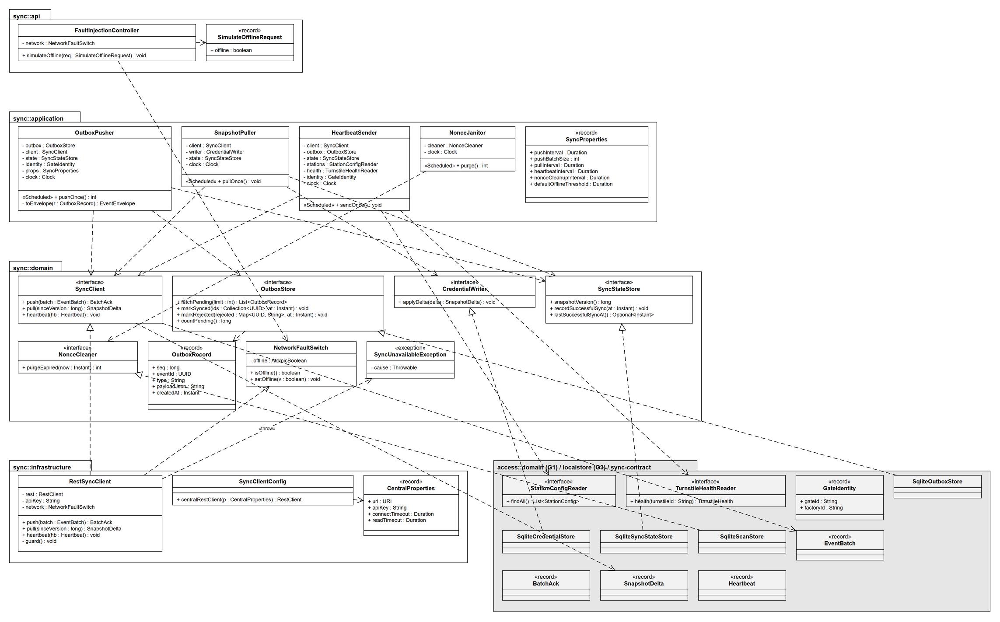

# SRS – `gate-agent/sync` (G4 Gate Sync Agent)

> Trạng thái: Draft · Người viết: BE-1 · Người duyệt: BE-2 · Ngày: 17/11/2026

## 1. Giới thiệu

### 1.1. Mục đích
Đặc tả **G4 Gate Sync Agent** – package `com.tmc.gate.sync`: các tác vụ nền đồng bộ hai chiều giữa Gate Agent và Central qua `SyncAPI` (luồng **F2**): đẩy outbox lên C1, kéo delta dữ liệu tham chiếu về G3, gửi heartbeat, dọn nonce hết hạn; và công tắc giả lập mất kết nối cho demo.

### 1.2. Phạm vi
- Có: `OutboxPusher`, `SnapshotPuller`, `HeartbeatSender`, `NonceJanitor`, `RestSyncClient`, `POST /admin/simulate-offline` (profile `demo`).
- Không có: mTLS (thay bằng API key), backoff lũy thừa (chu kỳ cố định đủ cho MVP), đồng bộ lần mở cổng thủ công.

### 1.3. Tài liệu tham chiếu
FR-05, FR-09, FR-17; NFR-SEC-06, NFR-REL-03, NFR-AVL-04, NFR-DIN-02; INV-02, INV-06; ADR-01, ADR-03, ADR-05; DP-03, DP-05, DP-06, DP-07, DP-09, DP-11; Hình `seq_f2_sync`; Bảng "Hành vi của Gate Agent theo trạng thái kết nối"; đặc tả M2 mục 6.2, 6.3, 7.4; [sync-contract.md](sync-contract.md).

## 2. Mô tả tổng quan

### 2.1. Vị trí
G4 là connector bất đồng bộ duy nhất của Q1 với Q2. Không nằm trên đường xử lý lượt quét: G1 chỉ ghi outbox (G3), G4 đọc và gửi sau.

```
G3 outbox ──fetchPending──► OutboxPusher ──POST /sync/events──► C1
G3 ◄──applyDelta── SnapshotPuller ◄──GET /sync/snapshot?since=v── C1
HeartbeatSender ──POST /sync/heartbeat──► C1 ──► C3
```

### 2.2. Ràng buộc
- Mọi lời gọi tới Central có connect timeout và read timeout (DP-07); lỗi mạng không làm dừng tác vụ, chỉ chờ chu kỳ sau.
- Các tác vụ chạy trên luồng của `@Scheduled` (`fixedDelay`), không chạy chồng lên nhau.
- Xác thực với Central bằng header `X-Gate-Key` (thay mTLS).

### 2.3. Giả định
- C1 idempotent theo `eventId` (INV-06) nên gửi lại an toàn ("ít nhất một lần").
- `snapshot_version` của Central tăng đơn điệu.

## 3. Yêu cầu chức năng

| Mã | Yêu cầu | Mức | Truy vết |
|---|---|---|---|
| SRS-GA-SYNC-FR-01 | Mỗi `push-interval` (2 s): lấy ≤ `push-batch-size` (200) bản ghi outbox `PENDING` theo `seq`, gửi một `EventBatch`; lặp lại ngay trong cùng chu kỳ nếu lô đầy (tối đa 10 lô/chu kỳ). | Must | ADR-03, FR-17 |
| SRS-GA-SYNC-FR-02 | Chỉ đánh dấu `SYNCED` các `eventId` nằm trong `accepted` hoặc `duplicates`; `rejected` → đánh dấu `REJECTED` kèm lý do, không gửi lại; `eventId` không xuất hiện trong ack → giữ `PENDING`. | Must | INV-06, DP-03 |
| SRS-GA-SYNC-FR-03 | Lỗi mạng/timeout/5xx khi gửi → giữ nguyên outbox, thử lại ở chu kỳ sau; không mất bản ghi. | Must | NFR-REL-03 |
| SRS-GA-SYNC-FR-04 | Mỗi `pull-interval` (15 s, phải ≤ 60 s): gọi `GET /sync/snapshot?since={snapshot_version}`; áp delta bằng `CredentialWriter.applyDelta` trong một transaction. | Must | FR-05, NFR-SEC-06, INV-02 |
| SRS-GA-SYNC-FR-05 | Mỗi `heartbeat-interval` (10 s): gửi `Heartbeat` gồm `gateId`, `sentAt`, `outboxDepth`, `lastSyncAt`, trạng thái cổng xoay của mọi trạm. | Must | FR-09, DP-09 |
| SRS-GA-SYNC-FR-06 | Mỗi lời gọi Central thành công (push, pull hoặc heartbeat) cập nhật `last_success_at` (G1 dùng cho ngưỡng mất kết nối). | Must | FR-17, NFR-AVL-04 |
| SRS-GA-SYNC-FR-07 | Mỗi `nonce-cleanup-interval` (60 s): xóa nonce có `expires_at < now`. | Must | NFR-SEC-05 |
| SRS-GA-SYNC-FR-08 | `POST /admin/simulate-offline {offline}` (chỉ khi `tmc.gate.fault-injection.enabled=true`) bật/tắt chế độ giả lập mất kết nối: mọi lời gọi Central ném `SyncUnavailableException` mà không ra mạng. | Must | D4, T11 |
| SRS-GA-SYNC-FR-09 | Lần pull đầu tiên khi khởi động chạy ngay (không chờ chu kỳ) để gate mới có dữ liệu tham chiếu sớm nhất. | Should | NFR-SEC-06 |

## 4. Yêu cầu phi chức năng

| Mã | Yêu cầu | Truy vết |
|---|---|---|
| SRS-GA-SYNC-NFR-01 | Sau khi kết nối trở lại, outbox 1.600 sự kiện về 0 trong ≤ 30 s. | Bảng tải, T5 |
| SRS-GA-SYNC-NFR-02 | Thu hồi QR ở Central có hiệu lực tại gate ≤ 60 s (pull 15 s + độ trễ C1). | NFR-SEC-06, T2 |
| SRS-GA-SYNC-NFR-03 | Tác vụ nền không chặn hay làm chậm `POST /scan` (luồng riêng; SQLite một kết nối, mỗi thao tác ngắn). | DP-06 |
| SRS-GA-SYNC-NFR-04 | Không log API key, nội dung payload; chỉ log số lượng, `eventId` bị từ chối. | NFR-PRI-03 |

## 5. Giao diện ngoài

### 5.1. REST cung cấp
| Method | Path | Request | Response | Điều kiện |
|---|---|---|---|---|
| POST | `/admin/simulate-offline` | `{ "offline": true }` | `204` | Bean chỉ tồn tại khi `tmc.gate.fault-injection.enabled=true` (profile `demo`); nếu không → `404` |

### 5.2. REST sử dụng (Central C1)
`POST /sync/events`, `GET /sync/snapshot?since=`, `POST /sync/heartbeat` – header `X-Gate-Key`; DTO ở [sync-contract.md](sync-contract.md).

### 5.3. Port định nghĩa trong `sync::domain`
| Port | Chữ ký | Hợp đồng |
|---|---|---|
| `SyncClient` | `push(EventBatch) : BatchAck`, `pull(long) : SnapshotDelta`, `heartbeat(Heartbeat)` | Lỗi mạng, timeout, 5xx, 401 → `SyncUnavailableException`; không trả `null` |
| `OutboxStore` | `fetchPending(int)`, `markSynced(Collection<UUID>, Instant)`, `markRejected(Map<UUID,String>, Instant)`, `countPending()` | |
| `CredentialWriter` | `applyDelta(SnapshotDelta)` | Một transaction; idempotent nếu áp lại cùng delta |
| `SyncStateStore` | `snapshotVersion()`, `recordSuccessfulSync(Instant)`, `lastSuccessfulSyncAt()` | |
| `NonceCleaner` | `purgeExpired(Instant) : int` | |

## 6. Thiết kế

### 6.1. Mô tả thành phần

| Tầng | Thành phần | Mô tả |
|---|---|---|
| `api` | `FaultInjectionController` | Đổi cờ của `NetworkFaultSwitch` |
| `application` | `OutboxPusher` | Đọc lô, dựng `EventEnvelope` (`payload` = `JsonNode` đọc từ chuỗi outbox), gửi, xử lý ack |
| | `SnapshotPuller` | Kéo và áp delta, cập nhật mốc đồng bộ |
| | `HeartbeatSender` | Dựng `Heartbeat` từ `OutboxStore.countPending`, `SyncStateStore`, `StationConfigReader.findAll` + `TurnstileHealthReader.health` |
| | `NonceJanitor` | Kích hoạt dọn nonce |
| | `SyncProperties` | `@ConfigurationProperties("tmc.gate.sync")` |
| `domain` | 5 port, `OutboxRecord`, `NetworkFaultSwitch`, `SyncUnavailableException` | Java thuần (phụ thuộc `sync-contract` – thư viện thuần Java) |
| `infrastructure` | `RestSyncClient` | `RestClient` với `JdkClientHttpRequestFactory` (connect 2 s, read 5 s), header `X-Gate-Key`; kiểm `NetworkFaultSwitch` trước mỗi lời gọi |
| | `SyncClientConfig`, `CentralProperties` | Bean `RestClient` từ `tmc.gate.central.*` |

### 6.2. Danh sách lớp

| Lớp | Tầng | Loại | Ghi chú |
|---|---|---|---|
| `FaultInjectionController` | api | `@RestController` + `@ConditionalOnProperty` | |
| `SimulateOfflineRequest` | api | record | |
| `OutboxPusher` | application | `@Component` (`@Scheduled`) | tên theo đặc tả M2 |
| `SnapshotPuller` | application | `@Component` (`@Scheduled`) | tên theo báo cáo |
| `HeartbeatSender` | application | `@Component` (`@Scheduled`) | |
| `NonceJanitor` | application | `@Component` (`@Scheduled`) | |
| `SyncProperties` | application | record | |
| `SyncClient`, `OutboxStore`, `CredentialWriter`, `SyncStateStore` | domain | interface | `CredentialWriter` theo báo cáo |
| `NonceCleaner` | domain | interface | bổ sung |
| `OutboxRecord` | domain | record | |
| `NetworkFaultSwitch` | domain | class | bổ sung; `AtomicBoolean` |
| `SyncUnavailableException` | domain | exception | bổ sung |
| `RestSyncClient` | infrastructure | `@Component` | |
| `SyncClientConfig` | infrastructure | `@Configuration` | |
| `CentralProperties` | infrastructure | record | `tmc.gate.central.*` |

### 6.3. Sơ đồ lớp
Nguồn: [class-gate-agent-sync.drawio](../drawio/class-gate-agent-sync.drawio) · Ảnh: 

### 6.4. Luồng xử lý

**`OutboxPusher.pushOnce()`**
```
for i in 1..10:
  records = outbox.fetchPending(props.pushBatchSize); if empty: break
  batch = EventBatch(ContractVersion.CURRENT, identity.gateId, identity.factoryId, records.map(toEnvelope))
  try ack = client.push(batch)
  catch SyncUnavailableException: log DEBUG; return              // giữ nguyên outbox
  outbox.markSynced(ack.accepted ∪ ack.duplicates, now)
  if ack.rejected non-empty: outbox.markRejected(...); log WARN từng eventId + reason
  state.recordSuccessfulSync(now)
  if records.size < batchSize: break
```

**`SnapshotPuller.pullOnce()`**
```
v = state.snapshotVersion()
delta = client.pull(v)                  // SyncUnavailableException → return
if delta.toVersion > v or v == 0: writer.applyDelta(delta)
state.recordSuccessfulSync(now)
```

**`HeartbeatSender.sendOnce()`**: `turnstileStatus = stations.findAll() → {stationId: health(turnstileId).name()}`; gửi; thành công → `recordSuccessfulSync`.

### 6.5. Dữ liệu
G4 không có bảng riêng; dùng `outbox`, `sync_state`, bảng tham chiếu và `used_nonces` của G3 qua port. Mốc đồng bộ (`snapshot_version`, `last_success_at`) là dữ liệu G4 sở hữu (Bảng component, mục 6.2 báo cáo).

### 6.6. Cấu hình
| Khóa | Mặc định | Ghi chú |
|---|---|---|
| `tmc.gate.central.url` | `http://localhost:8080` | `CENTRAL_URL` |
| `tmc.gate.central.api-key` | `change-me` | `GATE_API_KEY`, không commit giá trị thật |
| `tmc.gate.central.connect-timeout`, `read-timeout` | `2s`, `5s` | |
| `tmc.gate.sync.push-interval`, `push-batch-size` | `2s`, `200` | |
| `tmc.gate.sync.pull-interval` | `15s` | khởi động kiểm `≤ 60s`, sai → không khởi động (fail fast) |
| `tmc.gate.sync.heartbeat-interval` | `10s` | |
| `tmc.gate.sync.nonce-cleanup-interval` | `60s` | |
| `tmc.gate.fault-injection.enabled` | `false` (`demo`: `true`) | |

### 6.7. Xử lý lỗi
| Tình huống | Xử lý |
|---|---|
| Mất mạng, timeout, 5xx, giả lập offline | `SyncUnavailableException` → bỏ chu kỳ, không cập nhật `last_success_at` |
| 401 (sai API key) | `SyncUnavailableException` + log ERROR một lần mỗi phút (cấu hình sai) |
| 400 cả lô (sai `contractVersion`) | log ERROR, giữ outbox (cần sửa phiên bản, không tự xóa dữ liệu) |
| Ngoại lệ không mong đợi trong tác vụ | Bắt ở mức tác vụ, log ERROR, để `@Scheduled` chạy tiếp chu kỳ sau |

## 7. Quyết định thiết kế và độ lệch

| # | Quyết định / độ lệch | Lý do |
|---|---|---|
| D1 | API key `X-Gate-Key` thay mTLS | Độ lệch đã ghi (đặc tả M2 3.3) |
| D2 | Mọi lời gọi thành công đều cập nhật `last_success_at` (không chỉ heartbeat) | Bất kỳ lời gọi thành công nào cũng chứng minh có kết nối; giảm báo động giả |
| D3 | Chu kỳ cố định thay exponential backoff | Lời gọi rẻ, Central chịu được; NFR-REL-01 áp dụng cho cổng xoay và HR/Payroll |
| D4 | `sync::domain` dùng trực tiếp DTO của `sync-contract` | `sync-contract` là thư viện thuần Java (DP-14 cho phép dùng chung); tránh lớp ánh xạ trùng lặp |
| D5 | `NetworkFaultSwitch` giả lập offline ở tầng client (cộng thêm script ngắt mạng Docker) | Demo được D4/T11 không cần quyền Docker; script `offline.sh` vẫn dùng cho kịch bản thật |

## 8. Tiêu chí chấp nhận

| Yêu cầu | Test case | Kịch bản |
|---|---|---|
| FR-01 … FR-03 | `TC-GA-SYNC-01..03` `OutboxPusher` với `SyncClient` giả: ack đủ 3 loại; lỗi mạng giữ nguyên | T5, T6 |
| FR-04 | `TC-GA-SYNC-04` `SnapshotPuller` áp delta, version tăng | T2 |
| FR-05, FR-06 | `TC-GA-SYNC-05` heartbeat đủ trường; `last_success_at` cập nhật | D4 |
| FR-08 | `TC-GA-SYNC-06` bật offline → không có request ra WireMock | T11 |
| NFR-01 | E2E: ngắt WAN, quét 50 lượt, nối lại → Central có 50 giao dịch, outbox = 0 | T5 |
| `RestSyncClient` | `TC-GA-SYNC-07` WireMock: header `X-Gate-Key`, timeout, 5xx → `SyncUnavailableException` | |
