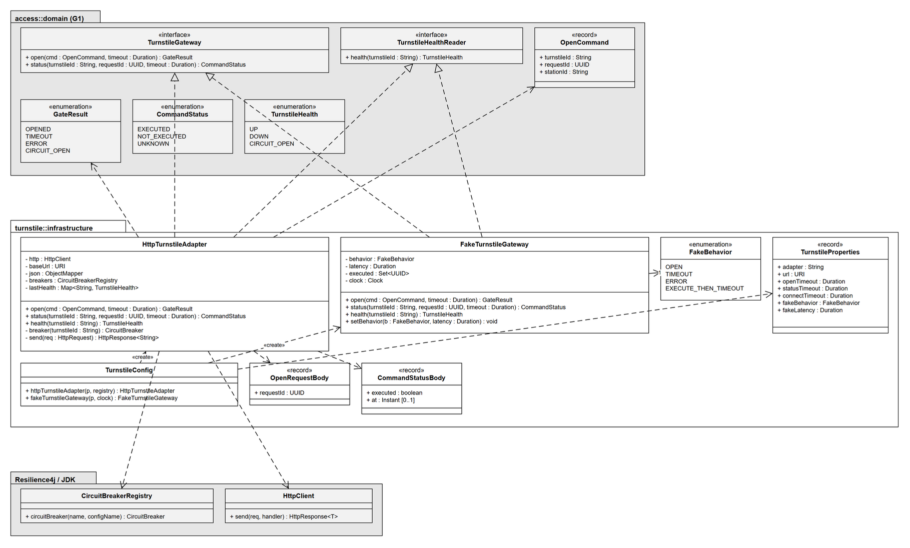

# SRS – `gate-agent/turnstile` (G2 Turnstile Adapter)

> Trạng thái: Draft · Người viết: BE-1 · Người duyệt: BE-2 · Ngày: 17/11/2026

## 1. Giới thiệu

### 1.1. Mục đích
Đặc tả **G2 Turnstile Adapter** – package `com.tmc.gate.turnstile`: các adapter cài đặt port `TurnstileGateway` và `TurnstileHealthReader` của G1, che giấu API của hệ thống cổng xoay (ở MVP là `turnstile-sim`) khỏi nghiệp vụ.

### 1.2. Phạm vi
- Có: `HttpTurnstileAdapter` (HTTP, giới hạn thời gian chờ, kiểm tra trạng thái lệnh, circuit breaker theo từng cổng), `FakeTurnstileGateway` (profile `fake` và test), chọn adapter theo cấu hình.
- Không có: plugin cho nhiều nhà cung cấp thật, gửi lại lệnh mở tự động, mở cổng thủ công.

### 1.3. Tài liệu tham chiếu
FR-12; NFR-AVL-03, NFR-REL-01, NFR-REL-02, NFR-INT-01, NFR-MOD-01; ADR-04, ADR-06; DP-03, DP-07, DP-16; OCP và LSP (mục 8 báo cáo); Bảng ngân sách thời gian; đặc tả M2 mục 7.6, 9; [turnstile-sim.md](turnstile-sim.md).

## 2. Mô tả tổng quan

### 2.1. Vị trí
G2 chỉ có tầng `infrastructure`. G1 (`ProcessScanUseCase`) gọi qua port; G4 (`HeartbeatSender`) và G1 (`GetGateStatusUseCase`) đọc sức khỏe qua `TurnstileHealthReader`.

```
access::domain ◄─realize── turnstile::infrastructure ──HTTP (LAN nhà máy)──► turnstile-sim / Turnstile Controller
 TurnstileGateway            HttpTurnstileAdapter
 TurnstileHealthReader       FakeTurnstileGateway
```

### 2.2. Ràng buộc
- Hợp đồng LSP: mọi adapter **trả kết quả trong `timeout`** được truyền vào (sai số ≤ 50 ms) và **không ném ngoại lệ** ra ngoài.
- Chỉ một adapter được kích hoạt trong một tiến trình (`tmc.gate.turnstile.adapter = http | fake`).
- Không tự gửi lại lệnh mở (NFR-REL-02: chỉ xác minh trạng thái).

### 2.3. Giả định
- API cổng xoay idempotent theo `requestId` (đúng với `turnstile-sim`; nhà cung cấp thật cần xác nhận – rủi ro R-05).
- Mạng LAN tới cổng xoay ổn định; độ trễ bình thường 300 – 500 ms (A-04).

## 3. Yêu cầu chức năng

| Mã | Yêu cầu | Mức | Truy vết |
|---|---|---|---|
| SRS-GA-TURN-FR-01 | `open(cmd, timeout)` gửi `POST {url}/turnstiles/{turnstileId}/open` với body `{requestId}`; HTTP 2xx → `OPENED`. | Must | FR-12, NFR-INT-01 |
| SRS-GA-TURN-FR-02 | Hết `timeout` → `TIMEOUT`; HTTP 5xx, lỗi kết nối, body không đọc được → `ERROR`; HTTP 4xx → `ERROR` (lệnh sai, không đếm vào circuit breaker). | Must | NFR-AVL-03, DP-07 |
| SRS-GA-TURN-FR-03 | `status(turnstileId, requestId, timeout)` gửi `GET {url}/turnstiles/{id}/commands/{requestId}`; `executed=true` → `EXECUTED`, `false` → `NOT_EXECUTED`, lỗi/timeout → `UNKNOWN`. | Must | NFR-REL-02 |
| SRS-GA-TURN-FR-04 | Circuit breaker riêng cho từng `turnstileId`: mở sau 5 lỗi liên tiếp (`TIMEOUT`/`ERROR` do 5xx hoặc mạng), nửa mở sau 30 s, cho 1 lệnh thử. Khi mạch mở, `open` trả `CIRCUIT_OPEN` ngay, không gọi mạng. | Must | ADR-06, R-03 |
| SRS-GA-TURN-FR-05 | `health(turnstileId)` trả `CIRCUIT_OPEN` khi mạch mở, `DOWN` khi lần gọi gần nhất thất bại, `UP` khi lần gần nhất thành công hoặc chưa gọi lần nào; không gọi mạng. | Must | FR-09, DP-09 |
| SRS-GA-TURN-FR-06 | `FakeTurnstileGateway` cấu hình được hành vi `OPEN`, `TIMEOUT`, `ERROR`, `EXECUTE_THEN_TIMEOUT` và độ trễ; ghi nhớ `requestId` đã thực hiện để `status` trả đúng. | Must | LSP, T7 |
| SRS-GA-TURN-FR-07 | Chọn adapter theo `tmc.gate.turnstile.adapter`; thêm nhà cung cấp mới chỉ cần thêm lớp cài đặt port và một giá trị cấu hình. | Must | NFR-MOD-01, OCP |

## 4. Yêu cầu phi chức năng

| Mã | Yêu cầu | Truy vết |
|---|---|---|
| SRS-GA-TURN-NFR-01 | `open` trả trong `timeout + 50 ms` ở mọi trường hợp (kể cả server treo); `status` trong `statusTimeout + 50 ms`. | NFR-PER-01, LSP |
| SRS-GA-TURN-NFR-02 | Connect timeout riêng ≤ 300 ms để lỗi DNS/kết nối không tiêu hết ngân sách. | DP-07 |
| SRS-GA-TURN-NFR-03 | An toàn luồng: nhiều yêu cầu `/scan` song song dùng chung adapter. | NFR-PER-02 |
| SRS-GA-TURN-NFR-04 | Log mỗi lần `TIMEOUT`/`ERROR`/chuyển trạng thái circuit breaker kèm `turnstileId`, `requestId`. | NFR-AUD-04, DP-09 |

## 5. Giao diện ngoài

### 5.1. Port được cài đặt (định nghĩa ở G1)
`TurnstileGateway.open(OpenCommand, Duration) : GateResult`, `TurnstileGateway.status(String, UUID, Duration) : CommandStatus`, `TurnstileHealthReader.health(String) : TurnstileHealth` – hợp đồng chi tiết ở [gate-agent-access.md](gate-agent-access.md) mục 5.2.

### 5.2. API cổng xoay được gọi
| Method | Path | Body | Phản hồi dùng |
|---|---|---|---|
| POST | `/turnstiles/{id}/open` | `{ "requestId": "uuid" }` | Mã HTTP |
| GET | `/turnstiles/{id}/commands/{requestId}` | — | `{ "executed": bool, "at": "…" }` |

## 6. Thiết kế

### 6.1. Mô tả thành phần

| Thành phần | Mô tả |
|---|---|
| `HttpTurnstileAdapter` | Dùng `java.net.http.HttpClient` (connect timeout cố định) và `HttpRequest.timeout(timeout)` cho **từng lời gọi**, cộng `CompletableFuture.orTimeout` làm chốt chặn cứng. Bọc lời gọi `open` trong `CircuitBreaker` của Resilience4j lấy từ registry theo tên `turnstile-<turnstileId>`, cấu hình gốc `turnstile` trong `application.yml`. Giữ `lastHealth` trong `ConcurrentHashMap`. |
| `FakeTurnstileGateway` | Mô phỏng trong bộ nhớ, không I/O: độ trễ giả lập bằng `Thread.sleep(min(latency, timeout))`; `EXECUTE_THEN_TIMEOUT` ghi `requestId` vào tập đã thực hiện rồi trả `TIMEOUT`. |
| `FakeBehavior` | Enum hành vi của Fake. |
| `TurnstileProperties` | `@ConfigurationProperties("tmc.gate.turnstile")`. |
| `TurnstileConfig` | `@Configuration`: tạo `HttpTurnstileAdapter` khi `adapter=http` (`@ConditionalOnProperty`, mặc định), `FakeTurnstileGateway` khi `adapter=fake`. Bean được đăng ký với kiểu port để G1 tiêm qua interface. |
| `OpenRequestBody`, `CommandStatusBody` | DTO JSON của API cổng xoay (không lộ ra ngoài package). |

### 6.2. Danh sách lớp

| Lớp | Loại | Cài đặt | Trách nhiệm |
|---|---|---|---|
| `HttpTurnstileAdapter` | class | `TurnstileGateway`, `TurnstileHealthReader` | Gọi API thật/giả lập, timeout, circuit breaker |
| `FakeTurnstileGateway` | class | `TurnstileGateway`, `TurnstileHealthReader` | Thay thế cho test và profile `fake` (LSP) |
| `FakeBehavior` | enum | — | `OPEN`, `TIMEOUT`, `ERROR`, `EXECUTE_THEN_TIMEOUT` |
| `TurnstileProperties` | record | — | Tham số |
| `TurnstileConfig` | `@Configuration` | — | Chọn adapter |
| `OpenRequestBody` | record | — | Body lệnh mở |
| `CommandStatusBody` | record | — | Phản hồi kiểm tra lệnh |

### 6.3. Sơ đồ lớp
Nguồn: [class-gate-agent-turnstile.drawio](../drawio/class-gate-agent-turnstile.drawio) · Ảnh: 

### 6.4. Luồng `HttpTurnstileAdapter.open`
```
open(cmd, timeout):
  cb = breaker(cmd.turnstileId)
  if !cb.tryAcquirePermission(): lastHealth[id]=CIRCUIT_OPEN; return CIRCUIT_OPEN
  start = nanoTime()
  try:
     resp = http.sendAsync(POST …/open {requestId}, timeout=timeout).orTimeout(timeout).join()
     if 2xx:  cb.onSuccess(elapsed); lastHealth[id]=UP;   return OPENED
     if 4xx:  cb.releasePermission(); log WARN;           return ERROR
     else:    cb.onError(elapsed, GateError); lastHealth[id]=DOWN; return ERROR
  catch HttpTimeoutException | TimeoutException:
     cb.onError(...); lastHealth[id]=DOWN; return TIMEOUT
  catch Exception (IO, parse…):
     cb.onError(...); lastHealth[id]=DOWN; return ERROR
```
`status(...)` dùng cùng `HttpClient`, **không** đi qua circuit breaker (để vẫn xác minh được khi mạch vừa mở), mọi lỗi → `UNKNOWN`.

### 6.5. Bảng ánh xạ hành vi Fake
| `FakeBehavior` | `open` | `status` sau đó |
|---|---|---|
| `OPEN` | sau `latency` → `OPENED` | `EXECUTED` |
| `TIMEOUT` | sau `timeout` → `TIMEOUT` | `NOT_EXECUTED` |
| `ERROR` | ngay → `ERROR` | `NOT_EXECUTED` |
| `EXECUTE_THEN_TIMEOUT` | ghi đã thực hiện, sau `timeout` → `TIMEOUT` | `EXECUTED` |

### 6.6. Cấu hình
| Khóa | Mặc định | Ghi chú |
|---|---|---|
| `tmc.gate.turnstile.adapter` | `http` | `fake` ở profile `fake` |
| `tmc.gate.turnstile.url` | `http://localhost:9001` | `TURNSTILE_URL` |
| `tmc.gate.turnstile.open-timeout` | `800ms` | truyền vào `open` bởi G1 |
| `tmc.gate.turnstile.status-timeout` | `200ms` | |
| `tmc.gate.turnstile.connect-timeout` | `300ms` | bổ sung |
| `tmc.gate.turnstile.fake-behavior`, `fake-latency` | `OPEN`, `300ms` | chỉ cho Fake |
| `resilience4j.circuitbreaker.instances.turnstile.*` | 5 lệnh, 100 % lỗi, mở 30 s, nửa mở 1 lệnh | đã có trong `application.yml` |

### 6.7. Xử lý lỗi
Không ngoại lệ nào thoát khỏi adapter; mọi lỗi được ánh xạ sang `GateResult`/`CommandStatus` như mục 3. Lỗi cấu hình (URL sai cú pháp) làm ứng dụng không khởi động được (fail fast).

## 7. Quyết định thiết kế và độ lệch

| # | Quyết định | Lý do |
|---|---|---|
| D1 | Dùng `java.net.http.HttpClient` thay `RestClient` | Cần timeout **theo từng lời gọi** bằng tham số `timeout` của port (LSP); `RestClient` chỉ đặt read timeout toàn cục |
| D2 | Một circuit breaker cho mỗi `turnstileId` | Một cổng hỏng không làm các cổng khác của nhà máy ngừng mở |
| D3 | 4xx không tính là lỗi của circuit breaker | 4xx là lỗi lệnh, không phản ánh tình trạng cổng |
| D4 | Bước kiểm tra trạng thái được G1 gọi, G2 chỉ cung cấp `status()` | Xem [gate-agent-access.md](gate-agent-access.md) D1 |

## 8. Tiêu chí chấp nhận

| Yêu cầu | Test case |
|---|---|
| FR-01, FR-02, NFR-01 | `TC-GA-TURN-01..04` WireMock: 200, 500, trễ 2 s (→ `TIMEOUT` trong ≤ 850 ms), kết nối bị từ chối |
| FR-03 | `TC-GA-TURN-05` `status` với `executed` true/false/timeout |
| FR-04, FR-05 | `TC-GA-TURN-06` 5 lỗi liên tiếp → `CIRCUIT_OPEN` không gọi mạng; sau 30 s (đồng hồ giả của Resilience4j) cho 1 lệnh thử; `health` đúng ở mỗi bước |
| FR-06 | `TC-GA-TURN-07` bảng 6.5 |
| T7 (E2E) | `sim.sh bd TIMEOUT` → `GATE_FAILED`; `EXECUTE_THEN_TIMEOUT` → `ACCEPTED` |
