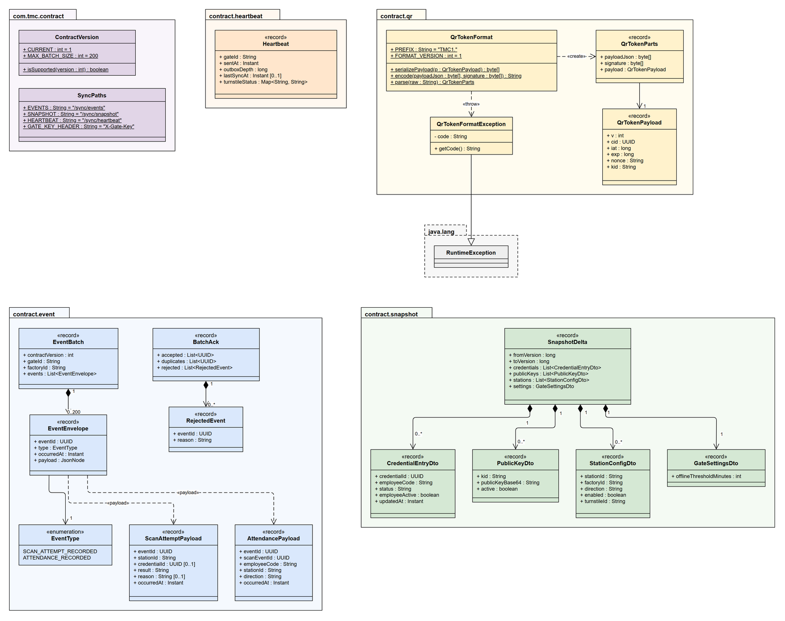

# SRS – `sync-contract` (hợp đồng dữ liệu Q1 ↔ Q2)

> Trạng thái: Draft · Người viết: BE-2 · Người duyệt: BE-1 · Ngày: 17/11/2026
> Hợp đồng API: [../api/sync.md](../api/sync.md) (OpenAPI: [../api/sync.openapi.yaml](../api/sync.openapi.yaml))

## 1. Giới thiệu

### 1.1. Mục đích
Đặc tả thư viện Java `sync-contract`: tập DTO và quy ước dùng chung giữa **Q1 Gate Quantum** (`gate-agent`) và **Q2 Central Quantum** (`central`), gồm (a) lô sự kiện chiều lên, (b) bản sao dữ liệu tham chiếu chiều xuống, (c) heartbeat, (d) định dạng mã QR động. Đây là **điểm phụ thuộc duy nhất** giữa hai quantum (DP-05, DP-15).

### 1.2. Phạm vi
- Có: record DTO, enum, hằng số đường dẫn và phiên bản, bộ mã hóa/giải mã chuỗi QR `TMC1.<payload>.<signature>`, bộ vector kiểm thử dùng chung.
- Không có: logic nghiệp vụ, truy cập mạng, khóa bí mật, thuật toán ký (thuộc C2 và G1).

### 1.3. Tài liệu tham chiếu
Báo cáo mục 6.2 (connector Q1↔Q2), 6.4 (Implementation view), ADR-02, ADR-03, ADR-05, DP-03, DP-11, DP-14; đặc tả triển khai M2 mục 6.

### 1.4. Thuật ngữ
| Thuật ngữ | Nghĩa |
|---|---|
| Sự kiện (event) | Bản ghi phát sinh tại cổng (lượt quét, giao dịch) được gửi lên trung tâm, định danh bằng `eventId` |
| Snapshot / delta | Phần thay đổi của dữ liệu tham chiếu (credential, khóa công khai, cấu hình trạm) kể từ một `version` |
| `contractVersion` | Phiên bản hợp đồng; hiện tại `1` |

## 2. Mô tả tổng quan

### 2.1. Vị trí trong kiến trúc
`gate-agent → sync-contract ← central`. Thư viện là artifact Maven `com.tmc:sync-contract`, không phụ thuộc Spring. Phụ thuộc duy nhất: `jackson-databind` (cho `JsonNode` và tuần tự hóa payload QR).

### 2.2. Người dùng thư viện
| Bên dùng | Dùng gì |
|---|---|
| G4 `RestSyncClient`, `OutboxPusher`, `HeartbeatSender`, `SnapshotPuller` | `EventBatch`, `BatchAck`, `SnapshotDelta`, `Heartbeat`, `SyncPaths` |
| G3 `OutboxPayloadMapper`, `SqliteCredentialStore` | `ScanAttemptPayload`, `AttendancePayload`, `SnapshotDelta` |
| G1 `Ed25519TokenVerifier` | `QrTokenFormat.parse` |
| C1 `SyncController`, các use case | Toàn bộ DTO đồng bộ |
| C2 `Ed25519QrTokenSigner` | `QrTokenFormat.serializePayload`, `encode` |

### 2.3. Ràng buộc
- Java 21, chỉ `record`/`enum`/lớp `final` không trạng thái; không annotation Spring.
- Mọi thời điểm là `Instant` (ISO-8601 UTC khi tuần tự hóa).
- **Đóng băng** từ cuối Tuần 0 (tag `contract-v1`); thay đổi phải qua PR được cả BE-1 và BE-2 duyệt và tăng `contractVersion` nếu không tương thích ngược.

### 2.4. Giả định
- Hai quantum dùng cùng cấu hình Jackson: `JavaTimeModule`, `WRITE_DATES_AS_TIMESTAMPS=false`, bỏ trường `null`.
- Thêm trường mới (tùy chọn) vào record là thay đổi tương thích ngược; bên nhận cấu hình `FAIL_ON_UNKNOWN_PROPERTIES=false`.

## 3. Yêu cầu chức năng

| Mã | Yêu cầu | Mức | Truy vết |
|---|---|---|---|
| SRS-SC-FR-01 | Cung cấp `EventBatch` gồm `contractVersion`, `gateId`, `factoryId` và danh sách `EventEnvelope` (tối đa `ContractVersion.MAX_BATCH_SIZE = 200`). | Must | ADR-03, ADR-05 |
| SRS-SC-FR-02 | Mỗi `EventEnvelope` có `eventId` (UUID sinh tại cổng), `type`, `occurredAt`, `payload` dạng JSON; `payload.eventId` phải bằng `envelope.eventId`. | Must | INV-06, NFR-DIN-02 |
| SRS-SC-FR-03 | Định nghĩa hai loại sự kiện `SCAN_ATTEMPT_RECORDED` (payload `ScanAttemptPayload`) và `ATTENDANCE_RECORDED` (payload `AttendancePayload`). | Must | FR-13, FR-15 |
| SRS-SC-FR-04 | `BatchAck` phân loại từng `eventId` vào đúng một trong ba danh sách `accepted`, `duplicates`, `rejected` (kèm lý do). | Must | INV-06, DP-03 |
| SRS-SC-FR-05 | `SnapshotDelta` mang `fromVersion`, `toVersion` và các danh sách thay đổi credential, khóa công khai, cấu hình trạm, cùng `GateSettingsDto` (ngưỡng mất kết nối). `since=0` nghĩa là toàn bộ. | Must | FR-05, NFR-SEC-06, FR-17 |
| SRS-SC-FR-06 | `CredentialEntryDto` chỉ chứa `credentialId`, `employeeCode`, `status`, `employeeActive`, `updatedAt` – **không** chứa họ tên. | Must | DP-12, ADR-08 |
| SRS-SC-FR-07 | `Heartbeat` mang `gateId`, `sentAt`, `outboxDepth`, `lastSyncAt`, trạng thái từng cổng xoay (`UP`/`DOWN`/`CIRCUIT_OPEN`). | Must | FR-09, DP-09 |
| SRS-SC-FR-08 | `QrTokenFormat` mã hóa chuỗi QR theo dạng `TMC1.` + base64url(payloadJson) + `.` + base64url(chữ ký Ed25519 trên **đúng các byte** payloadJson), không padding. | Must | ADR-02, NFR-SEC-05 |
| SRS-SC-FR-09 | `QrTokenFormat.parse` tách và giải mã chuỗi; chuỗi sai tiền tố, sai số phần, base64 hỏng hoặc JSON hỏng → `QrTokenFormatException(code="INVALID_FORMAT")`; `v ≠ 1` → `code="UNSUPPORTED_VERSION"`. Không kiểm tra chữ ký, thời hạn. | Must | NFR-SEC-02, DP-11 |
| SRS-SC-FR-10 | Payload QR gồm `v`, `cid`, `iat`, `exp` (epoch giây), `nonce` (base64url 16 byte), `kid`; **không** chứa mã nhân viên hay họ tên. | Must | ADR-02, DP-12 |
| SRS-SC-FR-11 | Hằng số đường dẫn `/sync/events`, `/sync/snapshot`, `/sync/heartbeat` và header `X-Gate-Key` được định nghĩa một lần trong `SyncPaths`. | Must | DP-17 (giá trị gắn với định dạng) |
| SRS-SC-FR-12 | Có bộ vector kiểm thử cố định trong `src/test/resources/vectors/` (cặp khóa Ed25519 mẫu, payload, token hợp lệ, token sửa payload, token ký bằng khóa khác) để C2 và G1 cùng kiểm thử. | Must | T4, mục 13.3 đặc tả M2 |

## 4. Yêu cầu phi chức năng

| Mã | Yêu cầu | Truy vết |
|---|---|---|
| SRS-SC-NFR-01 | Thư viện không phụ thuộc `org.springframework.*`, không có trạng thái toàn cục khả biến (ArchUnit). | DP-16, A1 |
| SRS-SC-NFR-02 | Tuần tự hóa round-trip (object → JSON → object) cho mọi record giữ nguyên giá trị (test). | DP-03 |
| SRS-SC-NFR-03 | Chuỗi QR của payload điển hình ≤ 300 ký tự để QR mức sửa lỗi M vẫn quét được trên điện thoại. | NFR-PER-01 |
| SRS-SC-NFR-04 | `QrTokenFormat.parse` chạy ≤ 1 ms/lần (không I/O). | Ngân sách 50 ms xác thực, mục 6.3 báo cáo |

## 5. Giao diện ngoài

### 5.1. JSON mẫu
```json
// POST /sync/events  (EventBatch)
{ "contractVersion": 1, "gateId": "gate-bd", "factoryId": "BD",
  "events": [ { "eventId": "0b9d…", "type": "SCAN_ATTEMPT_RECORDED", "occurredAt": "2026-11-20T07:58:01.120Z",
                "payload": { "eventId": "0b9d…", "stationId": "BD-IN-01", "credentialId": "6f1c…",
                             "result": "ACCEPTED", "occurredAt": "2026-11-20T07:58:01.120Z" } },
              { "eventId": "5e21…", "type": "ATTENDANCE_RECORDED", "occurredAt": "2026-11-20T07:58:01.731Z",
                "payload": { "eventId": "5e21…", "scanEventId": "0b9d…", "employeeCode": "E0012",
                             "stationId": "BD-IN-01", "direction": "IN", "occurredAt": "2026-11-20T07:58:01.731Z" } } ] }

// BatchAck
{ "accepted": ["0b9d…"], "duplicates": ["5e21…"], "rejected": [ { "eventId": "…", "reason": "STATION_NOT_IN_FACTORY" } ] }

// GET /sync/snapshot?since=41  (SnapshotDelta)
{ "fromVersion": 41, "toVersion": 44,
  "credentials": [ { "credentialId": "6f1c…", "employeeCode": "E0020", "status": "REVOKED", "employeeActive": true,
                     "updatedAt": "2026-11-20T08:00:00Z" } ],
  "publicKeys":  [ { "kid": "k-demo", "publicKeyBase64": "MCowBQYDK2VwAyEA…", "active": true } ],
  "stations":    [ { "stationId": "BD-IN-01", "factoryId": "BD", "direction": "IN", "enabled": true, "turnstileId": "TS-BD-IN-01" } ],
  "settings":    { "offlineThresholdMinutes": 480 } }

// POST /sync/heartbeat
{ "gateId": "gate-bd", "sentAt": "2026-11-20T08:00:10Z", "outboxDepth": 0, "lastSyncAt": "2026-11-20T08:00:02Z",
  "turnstileStatus": { "BD-IN-01": "UP", "BD-OUT-01": "CIRCUIT_OPEN" } }
```

### 5.2. Giá trị hợp lệ của các trường kiểu `String`
| Trường | Giá trị |
|---|---|
| `ScanAttemptPayload.result` | `ACCEPTED`, `REJECTED`, `GATE_FAILED` (lượt `PENDING` không được gửi) |
| `ScanAttemptPayload.reason` | Tên hằng của `RejectReason` (G1), `null` khi `ACCEPTED` |
| `AttendancePayload.direction`, `StationConfigDto.direction` | `IN`, `OUT` |
| `CredentialEntryDto.status` | `ACTIVE`, `REVOKED` |
| `Heartbeat.turnstileStatus` (giá trị) | `UP`, `DOWN`, `CIRCUIT_OPEN` |
| `RejectedEvent.reason` | `INVALID_PAYLOAD`, `UNKNOWN_EVENT_TYPE`, `STATION_NOT_IN_FACTORY`, `UNKNOWN_STATION` |

## 6. Thiết kế

### 6.1. Mô tả thành phần
Thư viện không chia 4 tầng (không có nghiệp vụ); chia theo **package chủ đề**:

| Package | Thành phần | Vai trò |
|---|---|---|
| `com.tmc.contract` | `ContractVersion`, `SyncPaths` | Hằng số phiên bản, giới hạn lô, đường dẫn và header |
| `com.tmc.contract.event` | `EventBatch`, `EventEnvelope`, `EventType`, `ScanAttemptPayload`, `AttendancePayload`, `BatchAck`, `RejectedEvent` | Chiều lên G4 → C1 |
| `com.tmc.contract.snapshot` | `SnapshotDelta`, `CredentialEntryDto`, `PublicKeyDto`, `StationConfigDto`, `GateSettingsDto` | Chiều xuống C1 → G4 |
| `com.tmc.contract.heartbeat` | `Heartbeat` | Giám sát trạm (C3) |
| `com.tmc.contract.qr` | `QrTokenFormat`, `QrTokenPayload`, `QrTokenParts`, `QrTokenFormatException` | Định dạng mã QR động dùng chung giữa C2 (ký) và G1 (kiểm tra) |

### 6.2. Danh sách lớp

| Lớp | Loại | Trách nhiệm | Ghi chú |
|---|---|---|---|
| `ContractVersion` | final class | `CURRENT=1`, `MAX_BATCH_SIZE=200`, `isSupported(v)` | |
| `SyncPaths` | final class | Hằng số đường dẫn REST và tên header `X-Gate-Key` | bổ sung |
| `EventBatch` | record | Lô sự kiện gửi lên | |
| `EventEnvelope` | record | Vỏ một sự kiện; `payload` là `JsonNode` để C1 phân loại theo `type` | |
| `EventType` | enum | `SCAN_ATTEMPT_RECORDED`, `ATTENDANCE_RECORDED` | |
| `ScanAttemptPayload` | record | Lượt quét đã chốt kết quả | `credentialId` có thể null (INV-07) |
| `AttendancePayload` | record | Giao dịch chấm công; `scanEventId` tham chiếu lượt quét | |
| `BatchAck` | record | Kết quả xử lý lô | |
| `RejectedEvent` | record | `eventId` + lý do không nhận | G4 không gửi lại |
| `SnapshotDelta` | record | Delta dữ liệu tham chiếu | |
| `CredentialEntryDto` | record | Một credential trong bản sao tại cổng | |
| `PublicKeyDto` | record | Khóa công khai Ed25519 dạng X.509 SubjectPublicKeyInfo, base64 | |
| `StationConfigDto` | record | Cấu hình trạm | |
| `GateSettingsDto` | record | Tham số vận hành gửi xuống cổng (thay C9) | |
| `Heartbeat` | record | Nhịp tim của gate | |
| `QrTokenFormat` | final class | `serializePayload`, `encode`, `parse` | bổ sung (đặc tả M2 nhắc tên) |
| `QrTokenPayload` | record | Payload QR | |
| `QrTokenParts` | record | Kết quả `parse`: byte payload, byte chữ ký, payload đã giải mã | |
| `QrTokenFormatException` | exception | Lỗi định dạng; `code` = `INVALID_FORMAT` \| `UNSUPPORTED_VERSION` | |

### 6.3. Sơ đồ lớp
Nguồn: [class-diagram.drawio](../drawio/class-diagram.drawio), tab `sync-contract`. Lớp được tô màu theo tầng (api xanh dương, application xanh lá, domain vàng, infrastructure cam, module/thư viện khác xám); riêng module này giữ lại record vì toàn bộ nội dung là DTO.



### 6.4. Thuật toán `QrTokenFormat`
```
encode(payloadJson, signature):
    return "TMC1." + b64url(payloadJson) + "." + b64url(signature)          // không padding

parse(raw):
    nếu raw == null hoặc không bắt đầu bằng "TMC1."         → INVALID_FORMAT
    parts = raw.substring(5).split(".", -1); nếu parts.length != 2 → INVALID_FORMAT
    payloadJson = b64urlDecode(parts[0]); signature = b64urlDecode(parts[1])   // lỗi → INVALID_FORMAT
    nếu signature.length != 64                               → INVALID_FORMAT
    payload = MAPPER.readValue(payloadJson, QrTokenPayload)  // lỗi/thiếu trường → INVALID_FORMAT
    nếu payload.v != FORMAT_VERSION                           → UNSUPPORTED_VERSION
    return QrTokenParts(payloadJson, signature, payload)
```
- Bên ký (C2) phải ký trên **chính mảng byte** đưa vào `encode`; bên kiểm tra (G1) kiểm chữ ký trên `parts.payloadJson()` — không tuần tự hóa lại, nên không phụ thuộc thứ tự trường JSON.
- Giới hạn độ dài `raw` ≤ 1024 ký tự trước khi giải mã (chống chuỗi rác quá dài).

### 6.5. Dữ liệu
Không lưu trữ. Vector kiểm thử: `src/test/resources/vectors/qr-vectors.json` gồm `privateKeyPkcs8Base64`, `publicKeyX509Base64`, `kid`, `fixedNow`, và danh sách `{name, raw, expected}` (`VALID`, `BAD_SIGNATURE`, `TAMPERED_PAYLOAD`, `OTHER_KEY`, `EXPIRED`, `INVALID_FORMAT`).

### 6.6. Cấu hình
Không có. Mọi hằng số ở đây là giá trị gắn với định dạng (ngoại lệ được phép của DP-17).

### 6.7. Xử lý lỗi
Chỉ `QrTokenFormatException` (unchecked). DTO không tự kiểm tra hợp lệ; việc kiểm tra thuộc bên nhận (C1 kiểm `EventBatch`, G4 kiểm `SnapshotDelta`).

## 7. Quyết định thiết kế và độ lệch

| # | Quyết định | Lý do |
|---|---|---|
| D1 | Các trường trạng thái (`result`, `direction`, `status`) để kiểu `String`, giá trị hợp lệ liệt kê ở mục 5.2 | Giữ nguyên DTO đã chốt ở đặc tả M2 mục 6.2; tránh vỡ tương thích khi một phía thêm giá trị enum |
| D2 | `payload` là `JsonNode`, không dùng kiểu đa hình | C1 xử lý từng sự kiện độc lập, sự kiện lạ vào `rejected` thay vì làm hỏng cả lô |
| D3 | Thêm `SyncPaths`, `QrTokenParts`, `QrTokenFormatException` | Báo cáo chưa liệt kê; cần để hai bên dùng chung một định nghĩa |
| D4 | Không có trường `contractVersion` trong `SnapshotDelta`/`Heartbeat` | Phiên bản được kiểm ở lô sự kiện; endpoint snapshot/heartbeat cùng phiên bản với `/sync/events` |

## 8. Tiêu chí chấp nhận

| Yêu cầu | Test case |
|---|---|
| SRS-SC-FR-01…07, NFR-02 | `TC-SC-01` round-trip JSON mọi record; `TC-SC-02` JSON mẫu mục 5.1 đọc được |
| SRS-SC-FR-08, 09 | `TC-SC-03` encode → parse giữ nguyên byte; `TC-SC-04` các chuỗi sai định dạng ra đúng `code` |
| SRS-SC-FR-10, 12 | `TC-SC-05` vector `VALID` kiểm chữ ký đúng bằng `publicKeyX509Base64`; dùng lại trong test của C2 và G1 (T4) |
| SRS-SC-NFR-01 | `TC-SC-06` ArchUnit: không import `org.springframework` |
