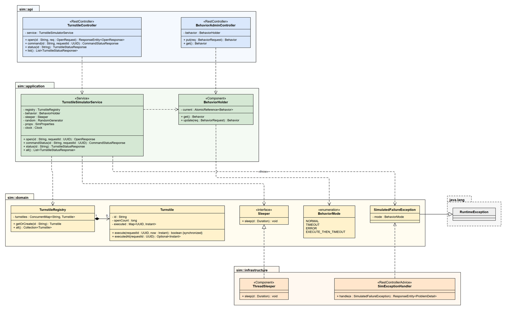

# SRS – `simulators/turnstile-sim` (bộ giả lập cổng xoay)

> Trạng thái: Draft · Người viết: BE-2 · Người duyệt: BE-1 · Ngày: 17/11/2026
> Hợp đồng API: [../api/turnstile-sim.md](../api/turnstile-sim.md) (OpenAPI: [../api/turnstile-sim.openapi.yaml](../api/turnstile-sim.openapi.yaml))

## 1. Giới thiệu

### 1.1. Mục đích
Đặc tả ứng dụng Spring Boot `turnstile-sim` (package `com.tmc.sim.turnstile`) thay cho **Turnstile Controller** thật của nhà cung cấp trong demo: mở cổng theo lệnh, idempotent theo `requestId`, cho tra cứu lệnh đã thực hiện, và cho phép đổi hành vi lúc chạy để tái hiện sự cố (D5, T7).

### 1.2. Phạm vi
- Có: 4 endpoint (mục 5), bốn chế độ `NORMAL`, `TIMEOUT`, `ERROR`, `EXECUTE_THEN_TIMEOUT`, độ trễ ngẫu nhiên trong khoảng, tỷ lệ lỗi ngẫu nhiên. Dữ liệu trong bộ nhớ.
- Không có: lưu bền vững, xác thực, mô phỏng phần cứng (cảm biến người đi qua).

### 1.3. Tài liệu tham chiếu
FR-12, NFR-INT-01, NFR-AVL-03, NFR-REL-02; A-04 (độ trễ 300 – 500 ms); ADR-06; R-05; đặc tả M2 mục 9, 11 (`sim.sh`), 12 (T7, T9); [gate-agent-turnstile.md](gate-agent-turnstile.md).

## 2. Mô tả tổng quan

### 2.1. Vị trí
Mỗi nhà máy một container (`turnstile-sim-bd` :9001, `turnstile-sim-la` :9002) trên mạng `lan-<nhà máy>`, chỉ G2 của gate cùng nhà máy gọi tới.

### 2.2. Tác nhân
| Tác nhân | Thao tác |
|---|---|
| G2 `HttpTurnstileAdapter` | `open`, `commands/{requestId}` |
| Người trình diễn (`deploy/scripts/sim.sh`) | `PUT /admin/behavior`, `GET /turnstiles` |

### 2.3. Ràng buộc
Dùng cùng quy ước 4 tầng như các module khác (để minh họa SOLID nhất quán); không phụ thuộc `gate-agent`, `central`, `sync-contract`.

## 3. Yêu cầu chức năng

| Mã | Yêu cầu | Mức | Truy vết |
|---|---|---|---|
| SRS-SIM-TS-FR-01 | `POST /turnstiles/{id}/open {requestId}`: sau độ trễ ngẫu nhiên trong `[latencyMin, latencyMax]`, mở cổng (ghi `requestId` đã thực hiện, tăng `openCount`) và trả `200 {requestId, executed:true, duplicate:false, at}`. Cổng chưa biết được tự đăng ký khi gặp lần đầu. | Must | FR-12 |
| SRS-SIM-TS-FR-02 | Idempotent: `requestId` đã thực hiện → trả ngay `200 {executed:true, duplicate:true, at=lần đầu}`, không mở lần 2, không tăng `openCount`. | Must | NFR-REL-02, DP-03 |
| SRS-SIM-TS-FR-03 | Chế độ `TIMEOUT`: không mở, chờ `timeoutDelay` (5 s) rồi trả `504`. | Must | T7, D5 |
| SRS-SIM-TS-FR-04 | Chế độ `ERROR`: không mở, trả ngay `500`. Ở chế độ `NORMAL`, với xác suất `failureRate` cũng trả `500` không mở. | Must | T7 |
| SRS-SIM-TS-FR-05 | Chế độ `EXECUTE_THEN_TIMEOUT`: mở cổng (ghi đã thực hiện) rồi chờ `timeoutDelay` trước khi trả `200` – adapter phía gate sẽ timeout trước. | Must | NFR-REL-02, T7 |
| SRS-SIM-TS-FR-06 | `GET /turnstiles/{id}/commands/{requestId}` trả `{executed, at}` **ngay**, không chịu ảnh hưởng của chế độ/độ trễ. | Must | NFR-REL-02 |
| SRS-SIM-TS-FR-07 | `GET /turnstiles/{id}/status` trả `{turnstileId, status, openCount}`; `status = DOWN` khi chế độ `ERROR`, ngược lại `UP`. `GET /turnstiles` trả danh sách. | Should | FR-09 |
| SRS-SIM-TS-FR-08 | `PUT /admin/behavior {latencyMs:[min,max], failureRate, mode}` cập nhật từng phần (trường bỏ trống giữ nguyên), có hiệu lực với yêu cầu tiếp theo; `GET /admin/behavior` trả hành vi hiện tại. | Must | D5, `sim.sh` |

## 4. Yêu cầu phi chức năng

| Mã | Yêu cầu | Truy vết |
|---|---|---|
| SRS-SIM-TS-NFR-01 | Phục vụ ≥ 20 yêu cầu đồng thời (k6 T9) – dùng luồng ảo của Java 21 (`spring.threads.virtual.enabled=true`) để `sleep` không chiếm luồng nền tảng. | T9 |
| SRS-SIM-TS-NFR-02 | An toàn luồng: `execute` cùng `requestId` đồng thời chỉ mở một lần. | NFR-REL-02 |
| SRS-SIM-TS-NFR-03 | Có thể thay `Sleeper`, `Clock`, `RandomGenerator` khi test để kết quả xác định. | LSP |

## 5. Giao diện ngoài

| Method | Path | Request | Response |
|---|---|---|---|
| POST | `/turnstiles/{id}/open` | `{ "requestId": "uuid" }` | `200 { "requestId", "executed": true, "duplicate": false, "at" }` · `500` · `504` |
| GET | `/turnstiles/{id}/commands/{requestId}` | — | `200 { "executed": true, "at": "…" }` / `{ "executed": false }` |
| GET | `/turnstiles/{id}/status` | — | `200 { "turnstileId": "TS-BD-IN-01", "status": "UP", "openCount": 42 }` |
| GET | `/turnstiles` | — | `200 [ … ]` |
| PUT | `/admin/behavior` | `{ "latencyMs": [300, 500], "failureRate": 0.0, "mode": "NORMAL" }` | `200 Behavior` · `400` khi `min > max`, `failureRate ∉ [0,1]`, `mode` lạ |
| GET | `/admin/behavior` | — | `200 Behavior` |

## 6. Thiết kế

### 6.1. Mô tả thành phần

| Tầng | Thành phần | Mô tả |
|---|---|---|
| `api` | `TurnstileController`, `BehaviorAdminController` + DTO | HTTP ↔ service |
| `application` | `TurnstileSimulatorService` | Áp hành vi hiện tại cho mỗi lệnh mở; tra lệnh; trạng thái |
| | `BehaviorHolder` | `AtomicReference<Behavior>`, cập nhật từng phần có kiểm tra |
| | `SimProperties` | `tmc.sim.*` |
| `domain` | `Turnstile` | Cổng: `openCount`, bảng `requestId → at`; `execute` là `synchronized` |
| | `TurnstileRegistry` | `ConcurrentHashMap` tự đăng ký cổng |
| | `Behavior`, `BehaviorMode` | Hành vi (record bất biến) |
| | `Sleeper` | Port để tiêm cách chờ |
| | `SimulatedFailureException` | Ném khi chế độ yêu cầu trả lỗi |
| `infrastructure` | `ThreadSleeper` | `Thread.sleep` |
| | `SimExceptionHandler` | `SimulatedFailureException` → `500`/`504` + `ProblemDetail` |

### 6.2. Danh sách lớp

| Lớp | Tầng | Loại |
|---|---|---|
| `TurnstileController`, `BehaviorAdminController` | api | `@RestController` |
| `OpenRequest`, `OpenResponse`, `CommandStatusResponse`, `TurnstileStatusResponse`, `BehaviorRequest` | api | record |
| `TurnstileSimulatorService`, `BehaviorHolder` | application | `@Service`, `@Component` |
| `SimProperties` | application | record |
| `Turnstile`, `TurnstileRegistry` | domain | class |
| `Behavior` | domain | record |
| `BehaviorMode` | domain | enum |
| `Sleeper` | domain | interface |
| `SimulatedFailureException` | domain | exception |
| `ThreadSleeper` | infrastructure | `@Component` |
| `SimExceptionHandler` | infrastructure | `@RestControllerAdvice` |

### 6.3. Sơ đồ lớp
Nguồn: [class-diagram.drawio](../drawio/class-diagram.drawio), tab `turnstile-sim`. Lớp được tô màu theo tầng (api xanh dương, application xanh lá, domain vàng, infrastructure cam, module/thư viện khác xám); record/DTO không vẽ, chỉ xuất hiện làm kiểu trong chữ ký.



### 6.4. Luồng `TurnstileSimulatorService.open`
```
open(id, requestId):
  t = registry.getOrCreate(id); b = behavior.get()
  if t.executedAt(requestId) present: return OpenResponse(requestId, true, true, at)     // idempotent, bỏ qua chế độ
  switch b.mode:
    ERROR:                 throw SimulatedFailure(ERROR)                                 // 500
    TIMEOUT:               sleeper.sleep(props.timeoutDelay); throw SimulatedFailure(TIMEOUT)   // 504
    EXECUTE_THEN_TIMEOUT:  t.execute(requestId, now); sleeper.sleep(props.timeoutDelay); return OpenResponse(..., false, at)
    NORMAL:
       sleeper.sleep(random latency in [min,max])
       if random < b.failureRate: throw SimulatedFailure(ERROR)
       firstTime = t.execute(requestId, now)
       return OpenResponse(requestId, true, !firstTime, t.executedAt(requestId))
```

### 6.5. Dữ liệu
Trong bộ nhớ; khởi động lại thì mất lịch sử lệnh (chấp nhận được – gate chỉ hỏi lệnh vừa gửi trong vòng 1 s).

### 6.6. Cấu hình
| Khóa | Mặc định |
|---|---|
| `server.port` | `9001` |
| `tmc.sim.default-latency-min-ms`, `default-latency-max-ms` | `300`, `500` (A-04) |
| `tmc.sim.timeout-delay` | `5s` |
| `spring.threads.virtual.enabled` | `true` |

### 6.7. Xử lý lỗi
`SimulatedFailureException(TIMEOUT)` → `504`, `(ERROR)` → `500`; dữ liệu `PUT /admin/behavior` sai → `400 VALIDATION_ERROR`; `requestId` thiếu → `400`.

## 7. Quyết định thiết kế

| # | Quyết định | Lý do |
|---|---|---|
| D1 | Lệnh trùng `requestId` trả kết quả cũ, không áp chế độ hiện tại | Đúng ngữ nghĩa idempotent mà G2 dựa vào |
| D2 | Tra lệnh (`commands/{requestId}`) không chịu độ trễ | Phản ánh API kiểm tra trạng thái nhanh của nhà cung cấp; giữ ngân sách 200 ms |
| D3 | Tự đăng ký cổng khi gặp lần đầu | Thêm trạm không cần cấu hình simulator (NFR-SCA-01 cho demo) |
| D4 | Có `Sleeper` làm port | Unit test không phải chờ thật |

## 8. Tiêu chí chấp nhận

| Yêu cầu | Test case |
|---|---|
| FR-01, FR-02 | `TC-SIM-TS-01` mở rồi mở lại cùng `requestId` → `duplicate=true`, `openCount=1` |
| FR-03 … FR-05 | `TC-SIM-TS-02..04` từng chế độ với `Sleeper` giả; `EXECUTE_THEN_TIMEOUT` → `commands` trả `executed=true` |
| FR-08 | `TC-SIM-TS-05` cập nhật từng phần, dữ liệu sai → 400 |
| NFR-02 | `TC-SIM-TS-06` 50 luồng cùng `requestId` → `openCount=1` |
