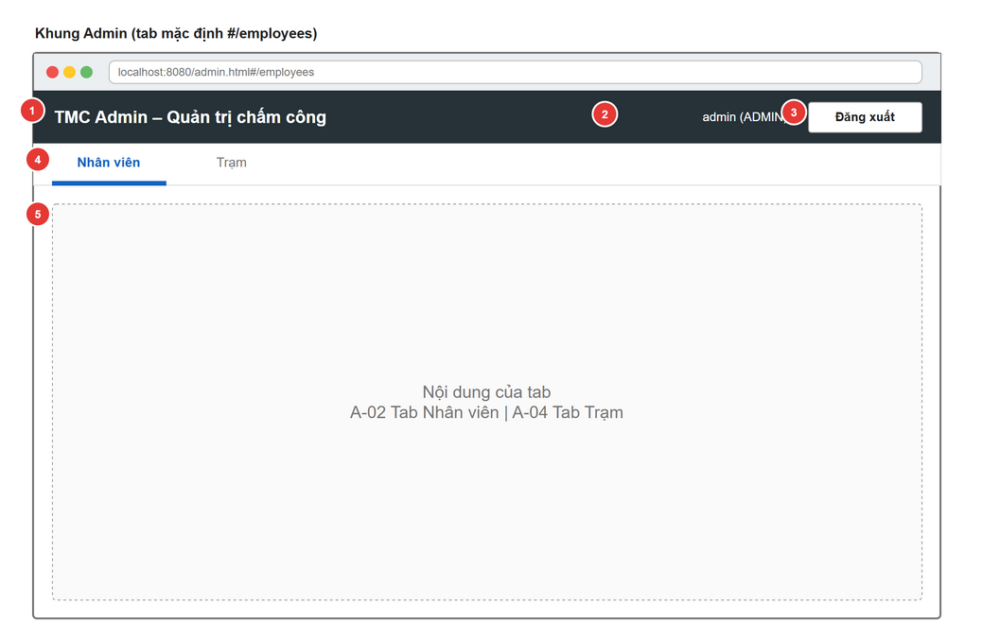

# A-01 – Khung trang quản trị

> Trạng thái: **Đã thiết kế (wireframe) · chờ duyệt** · Người viết: FE-2 · Ngày: 17/11/2026
>
> Vị trí trong sitemap: [sitemap.md § 4 – A-01](../sitemap.md#4-danh-mục-màn-hình-ánh-xạ-sitemap--thiết-kế) · Màn hình cha: admin.html

| Thuộc tính | Giá trị |
|---|---|
| Mã | A-01 |
| Trang / route | `admin.html` |
| Loại | layout |
| Mức | Should |
| Người dùng | Quản trị viên |
| Thành phần code | `features/admin` – `AdminShell` |
| Yêu cầu, kịch bản demo | FR-25 |

## 1. Mục đích

Khung chung của Admin: tiêu đề, người đang đăng nhập, thanh tab Nhân viên / Trạm, nút Đăng xuất.

## 2. Điều hướng

| Vào màn hình khi | Rời màn hình khi |
|---|---|
| Đăng nhập thành công với vai trò ADMIN | Chọn tab → A-02 / A-04 |
|  | Đăng xuất / 401 → AU-01 |

## 3. API sử dụng

- [`GET /auth/me`](../../api/central.md#2-get-authme)

## 4. Trạng thái màn hình

| Trạng thái | Nội dung chính |
|---|---|
| Mặc định | Tab theo hash; không có hash → `#/employees`. |

## 5. Dữ liệu hiển thị

- `username`

## 6. Quy tắc hành vi

- Hash routing `#/employees`, `#/stations`; tải lại trang giữ nguyên tab.

## 7. Thiết kế màn hình

### 7.1. Wireframe

Nguồn: [wireframes.drawio](../../drawio/wireframes.drawio), tab `A-01 Khung trang quản trị`. Số đỏ trên hình ứng với cột **#** ở mục 7.2.

### 7.2. Thành phần giao diện

| # | Thành phần | Loại | Dữ liệu (nguồn) | Cách hiển thị |
|---|---|---|---|---|
| 1 | Tiêu đề ứng dụng | App bar text | Tĩnh | Nền tối, chữ trắng 17 px đậm cạnh ô logo: "TMC Admin – Quản trị chấm công". Màn hình hẹp (≤ 640 px): thanh tiêu đề xuống hai hàng, nút Đăng xuất chỉ còn icon. |
| 2 | Người dùng | Text | `GET /auth/me`: `username`, `role` | "admin (ADMIN)" chữ trắng 13 px, bên phải. |
| 3 | Nút Đăng xuất | Button ghost | – | Góc phải thanh tiêu đề. |
| 4 | Thanh tab | Tabs (link hash) | `location.hash` | Hai tab "Nhân viên" và "Trạm"; tab hiện tại chữ xanh đậm và gạch chân xanh 4 px. |
| 5 | Vùng nội dung | Router outlet | Route hiện tại | Hiện A-02 (`#/employees`) hoặc A-04 (`#/stations`). |
| 6 | Nút đổi giao diện | Nhóm 3 nút (Sáng / Tối / Theo hệ thống) | `localStorage` khóa `tmc.theme` | Trên thanh tiêu đề, cạnh nút Đăng xuất; mặc định theo hệ điều hành, lựa chọn được lưu và áp ngay khi tải trang (không nhấp nháy). Mã QR luôn đen trên nền trắng ở cả hai chế độ. |

### 7.3. Hành động (input → output)

| Mã | Hành động | Input | Xử lý / API | Output |
|---|---|---|---|---|
| A01-A1 | Mở trang | URL `admin.html[#/…]` | Guard: token → `GET /auth/me` → `role = ADMIN` | Không có hash → đặt `#/employees`; hiện tab tương ứng |
| A01-A2 | Chuyển tab | Bấm [4] | Đổi `location.hash` | Hiện A-02 / A-04; tải lại trang giữ tab |
| A01-A3 | Đăng xuất / hết phiên | Bấm [3] hoặc API trả 401 | Xóa token | Chuyển AU-01 |

## 8. Tiêu chí chấp nhận

- [ ] Mở `admin.html` sau khi đăng nhập ADMIN → `#/employees` được chọn.
- [ ] Mở trực tiếp `admin.html#/stations` → tab Trạm được chọn.
- [ ] Token hết hạn khi đang ở bất kỳ tab nào → về AU-01.
