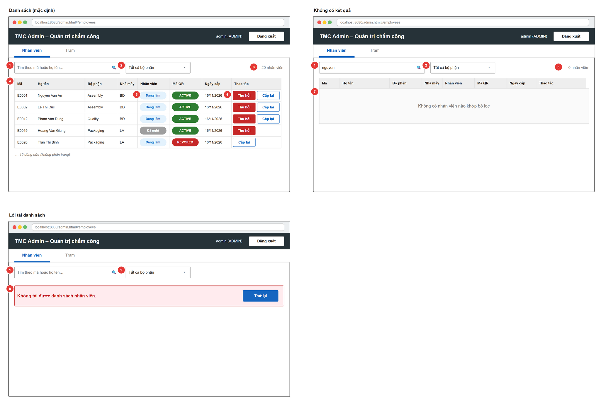

# A-02 – Tab Nhân viên

> Trạng thái: **Đã thiết kế (wireframe) · chờ duyệt** · Người viết: FE-2 · Ngày: 17/11/2026
>
> Vị trí trong sitemap: [sitemap.md § 4 – A-02](../sitemap.md#4-danh-mục-màn-hình-ánh-xạ-sitemap--thiết-kế) · Màn hình cha: A-01 Khung trang quản trị

| Thuộc tính | Giá trị |
|---|---|
| Mã | A-02 |
| Trang / route | `admin.html#/employees` |
| Loại | tab |
| Mức | Should |
| Người dùng | Quản trị viên |
| Thành phần code | `features/admin` – `EmployeesTab` |
| Yêu cầu, kịch bản demo | FR-02, FR-04; demo D3 |

## 1. Mục đích

Xem nhân viên và trạng thái QR credential; khởi động thao tác thu hồi / cấp lại (demo D3).

## 2. Điều hướng

| Vào màn hình khi | Rời màn hình khi |
|---|---|
| Mặc định khi mở Admin | Thu hồi / Cấp lại → A-03 |
| Chọn tab Nhân viên |  |
|  | Thu hồi mã / Cấp lại mã hàng loạt (từ khung "Đã chọn") → A-05 |

## 3. API sử dụng

- [`GET /employees`](../../api/central.md#4-get-employees)

## 4. Trạng thái màn hình

| Trạng thái | Nội dung chính |
|---|---|
| Đang tải | Lần tải đầu. |
| Danh sách | Mã, họ tên, bộ phận, nhà máy, trạng thái nhân viên, trạng thái credential, ngày cấp, nút thao tác. |
| Không có kết quả | Bộ lọc không khớp nhân viên nào. |
| Lỗi tải | Thông báo + nút Thử lại. |

## 5. Dữ liệu hiển thị

- `EmployeeView[]`
- Bộ lọc bộ phận lấy từ danh sách chưa lọc

## 6. Quy tắc hành vi

- Tìm kiếm debounce 300 ms (`q`), lọc theo `department`.
- Nút **Thu hồi** khi `credentialStatus = ACTIVE`; **Cấp lại** khi nhân viên `active`.
- Sau A-03 thành công, thay dòng bằng `EmployeeView` trả về.
- Chọn nhiều dòng: ô chọn ở từng dòng và ô chọn tất cả ở đầu bảng (nửa chọn khi mới chọn một phần). Giữ **Shift** khi bấm để chọn/bỏ chọn cả dải liền nhau.
- Lựa chọn lưu theo mã nhân viên nên **giữ nguyên khi tìm kiếm / lọc bộ phận**; người đang bị lọc ẩn vẫn hiện trong khung "Đã chọn" và được báo riêng. Lựa chọn mất khi rời tab hoặc tải lại trang.
- Thao tác Thu hồi / Cấp lại ở từng dòng không làm mất lựa chọn; thống kê trong khung cập nhật theo dữ liệu mới.
- Khung "Đã chọn" dính ở đầu màn hình khi cuộn; có công tắc **Chỉ xem người đã chọn** (bảng chỉ còn những người đã chọn, ô tìm kiếm và bộ lọc tạm không áp dụng; bỏ tick không làm dòng biến mất; bỏ chọn hết thì tự thoát chế độ này).
- Nút **Thu hồi mã (k)** / **Cấp lại mã (m)** ghi rõ số người đủ điều kiện (cùng luật với nút ở từng dòng) và bị khóa khi bằng 0; bấm để mở [A-05](A-05-bulk-action-dialog.md). Xong thì người đã xử lý được bỏ khỏi lựa chọn, người lỗi vẫn được chọn.

## 7. Thiết kế màn hình

### 7.1. Wireframe

Nguồn: [wireframes.drawio](../../drawio/wireframes.drawio), tab `A-02 Tab Nhân viên`. Số đỏ trên hình ứng với cột **#** ở mục 7.2.

### 7.2. Thành phần giao diện

| # | Thành phần | Loại | Dữ liệu (nguồn) | Cách hiển thị |
|---|---|---|---|---|
| 1 | Ô tìm kiếm | Input search | Người dùng nhập → tham số `q` | Placeholder "Tìm theo mã hoặc họ tên…", icon kính lúp (Search), rộng 360 px; tối đa 100 ký tự. |
| 2 | Lọc bộ phận | Select (dropdown) | Các cặp `departmentId`/`departmentName` khác nhau từ danh sách chưa lọc | Mục đầu "Tất cả bộ phận"; các mục sắp theo tên. |
| 3 | Số kết quả | Text | Độ dài danh sách trả về | 13 px xám, bên phải: "{n} nhân viên". |
| 4 | Bảng nhân viên | Table | `GET /employees` → `EmployeeView[]` | Cột: Mã · Họ tên · Bộ phận (`departmentName`) · Nhà máy · Nhân viên · Mã QR · Ngày cấp (`issuedAt`, dd/MM/yyyy giờ VN; trống nếu chưa cấp) · Thao tác. Sắp theo mã. Không phân trang. |
| 5 | Nhãn trạng thái | Badge | `active`; `credentialStatus` | Cột Nhân viên: "Đang làm" (xanh nhạt) / "Đã nghỉ" (xám). Cột Mã QR: "ACTIVE" (xanh) / "REVOKED" (đỏ) / "Chưa cấp" (xám, khi không có credential). |
| 6 | Nút thao tác theo dòng | Button danger / secondary | `credentialStatus`, `active` | "Thu hồi" (đỏ) khi `credentialStatus = ACTIVE`; "Cấp lại" (viền xanh) khi `active = true`. |
| 7 | Trạng thái rỗng | Empty state | Danh sách rỗng | Hộp xám dưới tiêu đề bảng: "Không có nhân viên nào khớp bộ lọc". |
| 8 | Lỗi tải | Alert lỗi + button | Lỗi `GET /employees` | Hộp đỏ "Không tải được danh sách nhân viên." và nút "Thử lại"; thay chỗ bảng. |
| 9 | Ô chọn dòng | Checkbox | Trạng thái chọn theo mã | Cột đầu tiên mỗi dòng; dòng được chọn có nền xanh nhạt; `aria-label` "Chọn {code}". |
| 10 | Ô chọn tất cả | Checkbox 3 trạng thái | Các dòng đang hiển thị | Ở đầu cột chọn; chọn hết / nửa chọn / không chọn; chỉ tác động các dòng đang hiển thị. |
| 11 | Khung "Đã chọn" | Panel dính đầu màn hình + chip | Các nhân viên đang chọn (từ danh sách chưa lọc) | Chỉ hiện khi có người được chọn; nền xanh nhạt, viền trái đậm, dính ở đầu màn hình khi cuộn. Gồm: vòng tròn số lượng, "Đã chọn {N} nhân viên", nhãn màu thống kê ("{a} mã ACTIVE" xanh, "{b} mã REVOKED" đỏ, "{c} chưa cấp mã" và "{d} đã nghỉ" xám), nút "Thu hồi mã ({k})" / "Cấp lại mã ({m})", công tắc "Chỉ xem người đã chọn", nút "Chọn thêm {x} kết quả đang hiển thị" và "Bỏ chọn tất cả", ghi chú "{h} người đã chọn đang nằm ngoài bộ lọc hiện tại.", và chip "{code} – {fullName}" có chấm màu (xanh = mã ACTIVE, đỏ = REVOKED, xám = chưa cấp hoặc đã nghỉ) kèm nút ✕ bỏ chọn. Dòng được chọn trong bảng có nền xanh nhạt và vạch xanh bên trái. |

### 7.3. Hành động (input → output)

| Mã | Hành động | Input | Xử lý / API | Output |
|---|---|---|---|---|
| A02-A1 | Tải danh sách | Mở tab | `GET /employees` (không tham số) | Hiện [4]; dựng [2] từ kết quả |
| A02-A2 | Tìm kiếm | Gõ vào [1] | Debounce 300 ms → `GET /employees?q=&department=` | Cập nhật [3] [4] hoặc [7] |
| A02-A3 | Lọc bộ phận | Chọn ở [2] | `GET /employees?department=&q=` | Cập nhật [3] [4] hoặc [7] |
| A02-A4 | Thu hồi / Cấp lại | Bấm [6] | – | Mở A-03 với dòng đã chọn |
| A02-A5 | Thử lại | Bấm nút ở [8] | Gọi lại request cuối | Hiện [4] hoặc giữ [8] |
| A02-A6 | Cập nhật sau thao tác | A-03 trả `EmployeeView` | Thay dòng tương ứng | Dòng hiển thị trạng thái mới, không tải lại cả bảng |
| A02-A7 | Chọn / bỏ chọn một dòng | Bấm ô [9] | Bật/tắt mã trong tập đã chọn | Cập nhật nền dòng, [10] và [11] |
| A02-A8 | Chọn dải | Shift + bấm ô [9] | Chọn/bỏ chọn mọi dòng đang hiển thị từ dòng bấm lần trước tới dòng này | Cập nhật [10] và [11] |
| A02-A9 | Chọn tất cả | Bấm ô [10] | Chọn mọi dòng đang hiển thị; nếu đã chọn hết thì bỏ chọn các dòng đó | Cập nhật [11]; người đang bị lọc ẩn giữ nguyên |
| A02-A10 | Bỏ chọn | Bấm ✕ của chip, "Bỏ chọn tất cả" | Bỏ người đó / bỏ tất cả | Chip biến mất; hết người chọn thì ẩn [11] |
| A02-A11 | Thao tác hàng loạt | Bấm "Thu hồi mã (k)" / "Cấp lại mã (m)" ở [11] | Mở A-05 với những người đang chọn | Xong: bỏ người đã xử lý khỏi lựa chọn, giữ người lỗi |
| A02-A12 | Chỉ xem người đã chọn | Bật/tắt công tắc ở [11] | Cố định danh sách đang chọn làm nội dung bảng | Bảng chỉ còn những người đã chọn (hoặc về danh sách đầy đủ) |

## 8. Tiêu chí chấp nhận

- [ ] Mở tab → 20 dòng, E0019 có nhãn "Đã nghỉ" và không có nút Cấp lại; E0020 có "REVOKED" và chỉ có nút Cấp lại.
- [ ] Gõ "nguyen" → chỉ một request sau khi ngừng gõ 300 ms; kết quả rỗng → [7].
- [ ] Backend lỗi → [8]; Thử lại thành công → bảng hiện lại.
- [ ] Chọn 4 người gồm E0001, E0002, E0019, E0020 → khung hiện "Đã chọn 4 nhân viên", các nhãn "3 mã ACTIVE", "1 mã REVOKED", "1 đã nghỉ", đủ 4 chip, và hai nút "Thu hồi mã (3)" / "Cấp lại mã (3)".
- [ ] Chọn E0002 rồi Shift + bấm E0005 → chọn đủ 4 dòng E0002…E0005.
- [ ] Chọn E0001 rồi tìm "khanh" → E0001 vẫn nằm trong khung kèm ghi chú "1 người đã chọn đang nằm ngoài bộ lọc hiện tại."; xóa ô tìm → ghi chú biến mất.
- [ ] Ô chọn tất cả: nửa chọn khi mới chọn một phần; bấm → chọn hết; bấm lại → bỏ chọn hết và ẩn khung.

- [ ] Công tắc "Chỉ xem người đã chọn": bảng còn đúng những người đã chọn, bỏ tick một người thì dòng vẫn còn (bỏ chọn); tắt công tắc hoặc bỏ chọn hết → về 20 dòng.
- [ ] Cuộn trang khi đang chọn: khung "Đã chọn" vẫn nằm ở đầu màn hình.