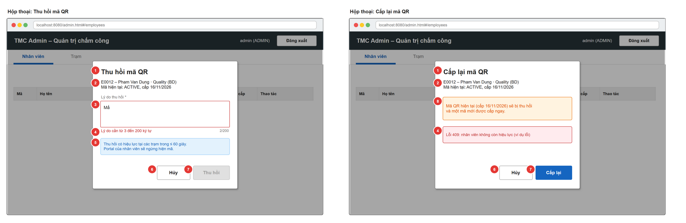

# A-03 – Hộp thoại thao tác QR

> Trạng thái: **Đã thiết kế (wireframe) · chờ duyệt** · Người viết: FE-2 · Ngày: 17/11/2026
>
> Vị trí trong sitemap: [sitemap.md § 4 – A-03](../sitemap.md#4-danh-mục-màn-hình-ánh-xạ-sitemap--thiết-kế) · Màn hình cha: A-02 Tab Nhân viên

| Thuộc tính | Giá trị |
|---|---|
| Mã | A-03 |
| Trang / route | dialog trên `admin.html#/employees` |
| Loại | dialog |
| Mức | Should |
| Người dùng | Quản trị viên |
| Thành phần code | `features/admin` – `QrActionDialog` |
| Yêu cầu, kịch bản demo | FR-04, INV-01, NFR-SEC-06; demo D3, T2 |

## 1. Mục đích

Xác nhận trước khi thu hồi (bắt buộc nhập lý do) hoặc cấp lại QR credential của một nhân viên.

## 2. Điều hướng

| Vào màn hình khi | Rời màn hình khi |
|---|---|
| Bấm Thu hồi hoặc Cấp lại trên một dòng của A-02 | Thành công / Hủy → A-02 |

## 3. API sử dụng

- [`POST /employees/{code}/qr/revoke`](../../api/central.md#6-post-employeescodeqrrevoke)
- [`POST /employees/{code}/qr/issue`](../../api/central.md#5-post-employeescodeqrissue)

## 4. Trạng thái màn hình

| Trạng thái | Nội dung chính |
|---|---|
| Thu hồi | Mã + tên nhân viên, ô lý do 3–200 ký tự (bắt buộc), nút Xác nhận / Hủy. |
| Cấp lại | Cảnh báo mã hiện tại (nếu có) sẽ bị thu hồi; nút Xác nhận / Hủy. |
| Đang gửi | Khóa nút. |
| Lỗi | 404/409: câu theo `code` (`NO_ACTIVE_CREDENTIAL`, `EMPLOYEE_INACTIVE`; `CONCURRENT_UPDATE` → tải lại). |

## 5. Dữ liệu hiển thị

- Dòng `EmployeeView` đang chọn

## 6. Quy tắc hành vi

- Sau khi thu hồi thành công: "Thu hồi có hiệu lực tại các trạm trong ≤ 60 giây".

## 7. Thiết kế màn hình

### 7.1. Wireframe

Nguồn: [wireframes.drawio](../../drawio/wireframes.drawio), tab `A-03 Hộp thoại thao tác QR`. Số đỏ trên hình ứng với cột **#** ở mục 7.2.

### 7.2. Thành phần giao diện

| # | Thành phần | Loại | Dữ liệu (nguồn) | Cách hiển thị |
|---|---|---|---|---|
| 1 | Tiêu đề hộp thoại | Dialog title | Loại thao tác | 20 px đậm: "Thu hồi mã QR" / "Cấp lại mã QR". Nền phía sau tối 35 %. |
| 2 | Thông tin nhân viên | Text | Dòng `EmployeeView` đã chọn | "{code} – {fullName} · {departmentName} ({factoryId})"; dòng dưới "Mã hiện tại: {credentialStatus}, cấp {issuedAt}". |
| 3 | Lý do thu hồi | Textarea (bắt buộc) + bộ đếm | Người dùng nhập → `reason` | Chỉ ở chế độ Thu hồi; nhãn "Lý do thu hồi *"; 3–200 ký tự sau khi trim; bộ đếm "{n}/200"; viền đỏ khi không hợp lệ. |
| 4 | Thông báo lỗi | Inline error / alert | Kiểm tra form; Problem `code` từ API | Chữ đỏ dưới ô lý do ("Lý do cần từ 3 đến 200 ký tự") hoặc hộp đỏ với câu theo `code` (`NO_ACTIVE_CREDENTIAL`, `EMPLOYEE_INACTIVE`, `EMPLOYEE_NOT_FOUND`, `CONCURRENT_UPDATE`). |
| 5 | Ghi chú hiệu lực | Info box | Tĩnh | Chỉ ở chế độ Thu hồi; hộp xanh nhạt: "Thu hồi có hiệu lực tại các trạm trong ≤ 60 giây. Portal của nhân viên sẽ ngừng hiện mã." |
| 6 | Nút Hủy | Button ghost | – | Đóng hộp thoại, không gọi API. |
| 7 | Nút xác nhận | Button danger / primary | Trạng thái form | "Thu hồi" (đỏ, khóa khi lý do không hợp lệ) / "Cấp lại" (xanh); khóa và hiện vòng quay khi đang gửi. |
| 8 | Cảnh báo cấp lại | Alert cảnh báo | `credentialStatus`, `issuedAt` | Chỉ ở chế độ Cấp lại khi đang có mã ACTIVE; hộp cam: "Mã QR hiện tại (cấp {issuedAt}) sẽ bị thu hồi và một mã mới được cấp ngay." |

### 7.3. Hành động (input → output)

| Mã | Hành động | Input | Xử lý / API | Output |
|---|---|---|---|---|
| A03-A1 | Nhập lý do | Gõ vào [3] | Trim, kiểm tra 3–200 ký tự | Cập nhật bộ đếm; hợp lệ → mở khóa [7], không → [4] |
| A03-A2 | Xác nhận thu hồi | Bấm [7] (Thu hồi) | `POST /employees/{code}/qr/revoke {reason}` | 200 → đóng, thay dòng ở A-02, toast "Đã thu hồi mã QR của {code}" |
| A03-A3 | Xác nhận cấp lại | Bấm [7] (Cấp lại) | `POST /employees/{code}/qr/issue` | 200 → đóng, thay dòng ở A-02, toast "Đã cấp mã QR mới cho {code}" |
| A03-A4 | Lỗi nghiệp vụ | 404 / 409 | Đọc `code` | Hiện [4]; `CONCURRENT_UPDATE` / `EMPLOYEE_NOT_FOUND` → đóng và tải lại A-02 |
| A03-A5 | Hủy | Bấm [6], phím Esc, bấm ra ngoài | – | Đóng, không thay đổi gì (bị khóa khi đang gửi) |

## 8. Tiêu chí chấp nhận

- [ ] Thu hồi E0012 với lý do hợp lệ → dòng đổi sang REVOKED; Portal của e0012 chuyển P-02; kiosk từ chối trong ≤ 60 s (D3, T2).
- [ ] Lý do 2 ký tự → nút Thu hồi bị khóa, có thông báo [4].
- [ ] Cấp lại cho E0020 → dòng đổi sang ACTIVE với ngày cấp mới.
