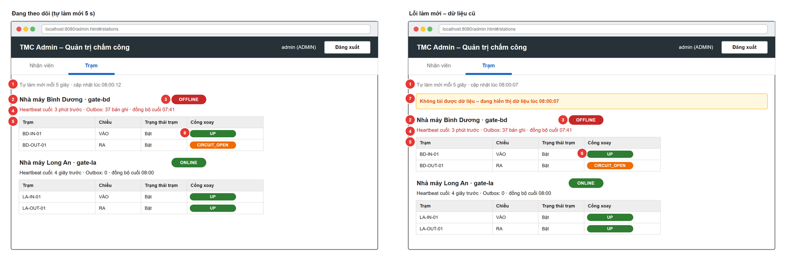

# A-04 – Tab Trạm

> Trạng thái: **Đã thiết kế (wireframe) · chờ duyệt** · Người viết: FE-2 · Ngày: 17/11/2026
>
> Vị trí trong sitemap: [sitemap.md § 4 – A-04](../sitemap.md#4-danh-mục-màn-hình-ánh-xạ-sitemap--thiết-kế) · Màn hình cha: A-01 Khung trang quản trị

| Thuộc tính | Giá trị |
|---|---|
| Mã | A-04 |
| Trang / route | `admin.html#/stations` |
| Loại | tab |
| Mức | Should |
| Người dùng | Quản trị viên |
| Thành phần code | `features/admin` – `StationsTab` |
| Yêu cầu, kịch bản demo | FR-09, NFR-AVL-04; demo D4 |

## 1. Mục đích

Theo dõi online/offline và số bản ghi chờ đồng bộ của từng nhà máy (demo D4: outbox tăng khi mất kết nối, về 0 khi nối lại).

## 2. Điều hướng

| Vào màn hình khi | Rời màn hình khi |
|---|---|
| Chọn tab Trạm | Chọn tab khác |

## 3. API sử dụng

- [`GET /stations`](../../api/central.md#7-get-stations)

## 4. Trạng thái màn hình

| Trạng thái | Nội dung chính |
|---|---|
| Đang tải | Lần tải đầu. |
| Danh sách | Trạm, nhà máy, chiều, gate, online/offline, heartbeat cuối (thời gian tương đối), outbox, trạng thái cổng xoay. |
| Lỗi tải | Giữ dữ liệu cũ, đánh dấu "dữ liệu có thể đã cũ". |

## 5. Dữ liệu hiển thị

- `StationView[]`

## 6. Quy tắc hành vi

- Tự làm mới mỗi 5 s.
- Nhóm theo nhà máy (các trạm cùng nhà máy dùng chung số liệu heartbeat).

## 7. Thiết kế màn hình

### 7.1. Wireframe

Nguồn: [wireframes.drawio](../../drawio/wireframes.drawio), tab `A-04 Tab Trạm`. Số đỏ trên hình ứng với cột **#** ở mục 7.2.

### 7.2. Thành phần giao diện

| # | Thành phần | Loại | Dữ liệu (nguồn) | Cách hiển thị |
|---|---|---|---|---|
| 1 | Chỉ báo làm mới | Text | Thời điểm tải thành công gần nhất | 13 px xám: "Tự làm mới mỗi 5 giây · cập nhật lúc {HH:mm:ss}". |
| 2 | Tiêu đề nhóm nhà máy | Group header | `factoryId`, `gateId` | 16 px đậm: "Nhà máy Bình Dương · gate-bd" (BD → Bình Dương, LA → Long An). |
| 3 | Trạng thái gate | Badge | `online` (chung cho cả nhóm) | Xanh "ONLINE" / đỏ "OFFLINE". |
| 4 | Thông tin đồng bộ | Text | `lastHeartbeatAt`, `outboxDepth`, `lastSyncAt` | "Heartbeat cuối: {thời gian tương đối} · Outbox: {n} bản ghi · đồng bộ cuối {HH:mm}"; đỏ khi OFFLINE; "chưa có heartbeat" khi trống. |
| 5 | Bảng trạm | Table | `StationView[]` của nhóm | Cột: Trạm · Chiều (VÀO/RA) · Trạng thái trạm (`enabled`: Bật/Tắt) · Cổng xoay. Sắp theo mã trạm. |
| 6 | Trạng thái cổng xoay | Badge | `turnstileStatus` | Xanh "UP" / đỏ "DOWN" / cam "CIRCUIT_OPEN" / xám "—" khi chưa có. |
| 7 | Cảnh báo dữ liệu cũ | Alert cảnh báo | Lỗi lần làm mới gần nhất | Hộp vàng: "Không tải được dữ liệu – đang hiển thị dữ liệu lúc {HH:mm:ss}". |

### 7.3. Hành động (input → output)

| Mã | Hành động | Input | Xử lý / API | Output |
|---|---|---|---|---|
| A04-A1 | Tải và làm mới | Mở tab; bộ hẹn giờ mỗi 5 s (chỉ khi tab đang hiện) | `GET /stations`; nhóm theo `factoryId` | Cập nhật [1]–[6]; ẩn [7] |
| A04-A2 | Lỗi làm mới | Lỗi mạng / 5xx | Giữ dữ liệu cũ | Hiện [7] |
| A04-A3 | Cập nhật thời gian tương đối | Mỗi giây | Tính lại từ `lastHeartbeatAt` | [4] "3 giây trước" → "4 giây trước"… |

## 8. Tiêu chí chấp nhận

- [ ] Ngắt mạng gate-bd → trong ≤ 35 s nhóm BD chuyển OFFLINE, outbox tăng theo số lượt quét (D4).
- [ ] Nối lại → nhóm BD ONLINE và outbox về 0.
- [ ] Bộ giả lập ở chế độ ERROR nhiều lần → cổng xoay của trạm hiện CIRCUIT_OPEN.
