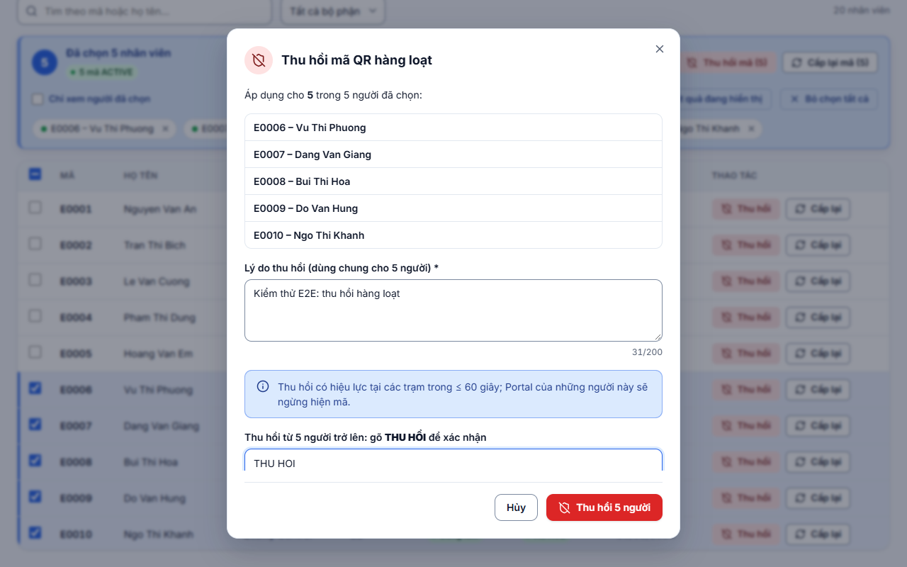

# A-05 – Hộp thoại thao tác hàng loạt

> Trạng thái: **Đã hiện thực · chờ duyệt** · Người viết: FE-2 · Ngày: 23/11/2026
>
> Vị trí trong sitemap: [sitemap.md § 4 – A-05](../sitemap.md#4-danh-mục-màn-hình-ánh-xạ-sitemap--thiết-kế) · Màn hình cha: A-02 Tab Nhân viên

| Thuộc tính | Giá trị |
|---|---|
| Mã | A-05 |
| Trang / route | dialog trên `admin.html#/employees` |
| Loại | dialog |
| Mức | Could |
| Người dùng | Quản trị viên |
| Thành phần code | `features/admin` – `BulkActionDialog`, `bulkPlan`, `bulkRunner` |
| Yêu cầu, kịch bản demo | FR-04, INV-01, NFR-SEC-06; demo D3 |

## 1. Mục đích

Thu hồi hoặc cấp lại mã QR cho **nhiều nhân viên đã chọn** ở A-02 trong một thao tác, với xem trước người bị tác động, xác nhận an toàn và báo kết quả từng người.

## 2. Điều hướng

| Vào màn hình khi | Rời màn hình khi |
|---|---|
| Bấm **Thu hồi mã (k)** hoặc **Cấp lại mã (m)** trong khung "Đã chọn" của A-02 | Bấm Hủy / Đóng → A-02 |
|  | Đăng xuất / 401 → AU-01 |

## 3. API sử dụng

Central chưa có API hàng loạt nên gọi **lần lượt từng người** (không song song):
- [`POST /employees/{code}/qr/revoke`](../../api/central.md#6-post-employeescodeqrrevoke)
- [`POST /employees/{code}/qr/issue`](../../api/central.md#5-post-employeescodeqrissue)

## 4. Trạng thái màn hình

| Giai đoạn | Nội dung chính |
|---|---|
| Xác nhận | Danh sách người sẽ được xử lý, danh sách người bị bỏ qua kèm lý do; thu hồi: ô lý do chung (3–200 ký tự) và ô gõ chữ xác nhận khi từ 5 người; cấp lại: cảnh báo số người đang có mã ACTIVE. |
| Đang chạy | Thanh tiến trình "Đang xử lý n/N…", từng người: đang chờ / đang xử lý / thành công / lỗi; nút **Dừng**; hộp thoại bị khóa (Esc, ✕, bấm ngoài đều không đóng được). |
| Hoàn tất | "Hoàn tất: x thành công, y lỗi, z chưa xử lý"; nút **Thử lại y lỗi** / **Xử lý tiếp z người** và **Đóng**. |

## 5. Dữ liệu hiển thị

- Các nhân viên đang chọn tại lúc mở hộp thoại (ảnh chụp, không đổi khi dữ liệu cập nhật giữa chừng).
- Trạng thái và câu lỗi từng người (câu tiếng Việt theo `code`, như A-03).

## 6. Quy tắc hành vi

- **Ai đủ điều kiện** (cùng luật với nút ở từng dòng của A-02): thu hồi chỉ áp dụng cho người có mã `ACTIVE` (kể cả người đã nghỉ còn mã ACTIVE); cấp lại chỉ cho người đang làm việc. Người còn lại bị bỏ qua, kèm lý do: "Chưa được cấp mã", "Mã đã bị thu hồi", "Đã nghỉ việc".
- Thu hồi từ **5 người** trở lên phải gõ **THU HỒI** để mở khóa nút (bỏ qua hoa/thường, dấu, khoảng trắng thừa: "thu hoi" cũng được). Cấp lại không cần lý do.
- Chạy **tuần tự**: lỗi một người không làm hỏng cả lô. Gặp 401/403 thì dừng cả lô (các người còn lại là "chưa xử lý").
- **Dừng**: người đang xử lý được làm xong, các người sau chuyển "chưa xử lý"; có thể xử lý tiếp sau đó.
- Mỗi người thành công cập nhật dòng ở A-02 ngay; cuối lô tải lại danh sách một lần.
- Khi đóng: người đã xử lý xong được **bỏ khỏi lựa chọn**, người lỗi hoặc chưa xử lý **vẫn được chọn** để xử lý lại sau; toast "Đã thu hồi mã QR của {n} người" / "Đã cấp mã QR mới cho {n} người".
- Chân hộp thoại (nút xác nhận) luôn nhìn thấy; chỉ phần thân cuộn.

## 7. Thiết kế màn hình

### 7.1. Ảnh minh họa

Chưa vẽ wireframe trong `wireframes.drawio`; ảnh dưới là ảnh chụp giao diện đã hiện thực (backend thật).

### 7.2. Thành phần giao diện

| # | Thành phần | Loại | Dữ liệu (nguồn) | Cách hiển thị |
|---|---|---|---|---|
| 1 | Tiêu đề | Dialog title + icon | Loại thao tác | "Thu hồi mã QR hàng loạt" (icon đỏ) / "Cấp lại mã QR hàng loạt". Hộp rộng 640 px. |
| 2 | Người sẽ được xử lý | List | Người đủ điều kiện | "Áp dụng cho {k} trong {N} người đã chọn:" và danh sách "{code} – {fullName}" (cuộn khi dài). |
| 3 | Người bị bỏ qua | List + lý do | Người không đủ điều kiện | "Bỏ qua {s} người (không đủ điều kiện):" mỗi dòng kèm lý do; ẩn nếu không có ai. |
| 4 | Lý do thu hồi | Textarea + bộ đếm | Người dùng nhập → `reason` | Chỉ khi thu hồi; dùng chung cho cả lô; 3–200 ký tự sau trim; viền đỏ và thông báo khi không hợp lệ. |
| 5 | Ô gõ xác nhận | Input | Người dùng nhập | Chỉ khi thu hồi từ 5 người: "gõ THU HỒI để xác nhận". |
| 6 | Cảnh báo cấp lại | Alert cam | Số người đang có mã ACTIVE | "{m} người đang có mã ACTIVE: mã hiện tại sẽ bị thu hồi và một mã mới được cấp ngay." |
| 7 | Tiến trình | Progress bar + text | Số người đã xong / tổng | "Đang xử lý n/N…" rồi "Hoàn tất: …". |
| 8 | Kết quả từng người | List + biểu tượng | Trạng thái từng người | Chờ (đồng hồ), đang xử lý (vòng quay), thành công (✓ xanh, "Đã thu hồi" / "Đã cấp mã mới"), lỗi (✕ đỏ + câu lỗi), chưa xử lý (gạch ngang). |
| 9 | Nút | Button | Giai đoạn | Xác nhận: **Hủy** + **Thu hồi k người** / **Cấp lại k người** (khóa tới khi hợp lệ). Đang chạy: **Dừng**. Hoàn tất: **Thử lại / Xử lý tiếp** + **Đóng**. |

### 7.3. Hành động (input → output)

| Mã | Hành động | Input | Xử lý / API | Output |
|---|---|---|---|---|
| A05-A1 | Xem trước | Mở hộp thoại | Lập kế hoạch: người đủ điều kiện / bị bỏ qua | Hiện [2] [3] [4]–[6] |
| A05-A2 | Xác nhận | Bấm [9] "Thu hồi k người" / "Cấp lại k người" | Lần lượt `POST …/qr/revoke` hoặc `…/qr/issue` cho từng người | Chuyển sang đang chạy; cập nhật [7] [8] và dòng ở A-02 |
| A05-A3 | Dừng | Bấm **Dừng** | Không gọi người tiếp theo | Người còn lại "chưa xử lý" |
| A05-A4 | Thử lại / xử lý tiếp | Bấm [9] | Chạy lại những người lỗi hoặc chưa xử lý | Cập nhật [7] [8] |
| A05-A5 | Đóng | Bấm **Đóng** / Hủy / Esc / ✕ / bấm ngoài (không đóng được khi đang chạy) | Bỏ người đã xử lý xong khỏi lựa chọn | Về A-02, toast tóm tắt |

## 8. Tiêu chí chấp nhận

- [ ] Chọn E0001, E0002, E0020 rồi "Thu hồi mã (2)": E0020 nằm trong danh sách bị bỏ qua với lý do "Mã đã bị thu hồi".
- [ ] Thu hồi 2 người: nhập lý do 2 ký tự → nút khóa và có thông báo; lý do hợp lệ → thu hồi được, kết quả "Hoàn tất: 2 thành công", hai dòng thành REVOKED, hai người bị bỏ khỏi lựa chọn.
- [ ] Thu hồi 5 người (E0006…E0010): có lý do vẫn khóa nút cho tới khi gõ "thu hoi" hoặc "THU HỒI".
- [ ] Một người lỗi (vd. 500): báo lỗi đúng người đó, những người khác vẫn thành công; "Thử lại 1 lỗi" thành công; đóng khi còn lỗi → người lỗi vẫn được chọn.
- [ ] Bấm Dừng khi đang chạy → người còn lại "Chưa xử lý" và "Xử lý tiếp" hoàn tất lô; đang chạy thì Esc không đóng được hộp thoại.
- [ ] Cấp lại cho E0001 (ACTIVE), E0020 (REVOKED), E0019 (đã nghỉ): cảnh báo "1 người đang có mã ACTIVE…", E0019 bị bỏ qua ("Đã nghỉ việc"), hai người còn lại thành ACTIVE với ngày cấp mới.
- [ ] Nút xác nhận luôn nằm trong màn hình ngay cả khi danh sách dài (hộp thoại thu hồi 5 người ở màn 1280×800).
