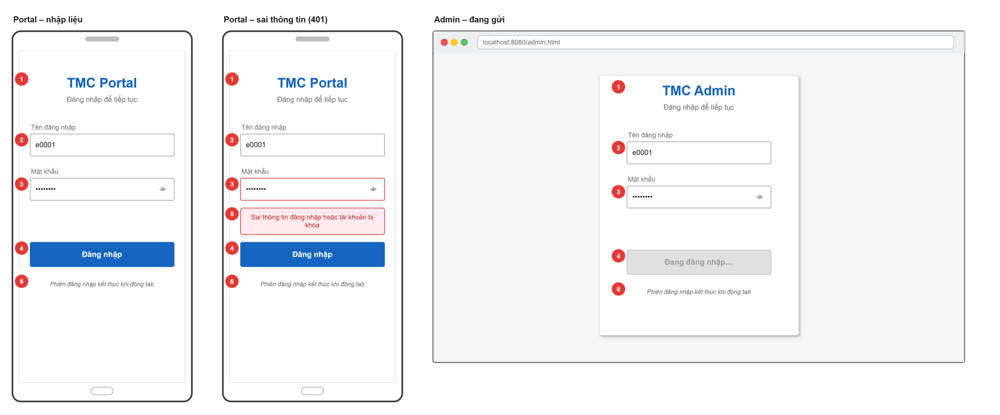

# AU-01 – Đăng nhập

> Trạng thái: **Đã thiết kế (wireframe) · chờ duyệt** · Người viết: FE-2 · Ngày: 17/11/2026
>
> Vị trí trong sitemap: [sitemap.md § 4 – AU-01](../sitemap.md#4-danh-mục-màn-hình-ánh-xạ-sitemap--thiết-kế) · Màn hình cha: portal.html, admin.html

| Thuộc tính | Giá trị |
|---|---|
| Mã | AU-01 |
| Trang / route | `portal.html`, `admin.html` |
| Loại | screen |
| Mức | Must |
| Người dùng | Nhân viên, quản trị viên |
| Thành phần code | `features/auth` – `LoginForm`; `shared/api/authSession` |
| Yêu cầu, kịch bản demo | FR-25, NFR-SEC-04; kịch bản S2 |

## 1. Mục đích

Xác thực người dùng trước khi vào Portal hoặc Admin; một component dùng chung cho cả hai trang.

## 2. Điều hướng

| Vào màn hình khi | Rời màn hình khi |
|---|---|
| Chưa có token | Đăng nhập thành công, đúng vai trò → P-01 / A-02 |
| API trả 401 | Sai vai trò → AU-02 |
| Bấm Đăng xuất |  |

## 3. API sử dụng

- [`POST /auth/login`](../../api/central.md#1-post-authlogin)
- [`GET /auth/me`](../../api/central.md#2-get-authme)

## 4. Trạng thái màn hình

| Trạng thái | Nội dung chính |
|---|---|
| Nhập liệu | Tên đăng nhập, mật khẩu, nút Đăng nhập (vô hiệu khi trống). |
| Đang gửi | Khóa nút, chặn gửi lặp. |
| Sai thông tin | 401 `INVALID_CREDENTIALS`: "Sai thông tin đăng nhập hoặc tài khoản bị khóa" (một câu cho mọi trường hợp). |
| Lỗi mạng / 5xx | "Không kết nối được máy chủ, thử lại". |

## 5. Dữ liệu hiển thị

- Tên trang (Portal / Admin) để hiển thị tiêu đề

## 6. Quy tắc hành vi

- Mặc định token lưu trong `sessionStorage` (mất khi đóng tab). Khi tick **Ghi nhớ đăng nhập**: token + `expiresAt` lưu trong `localStorage` (khóa `tmc.rememberedSession`), giữ qua việc đóng tab đến khi token hết hạn (tối đa 8 giờ, Central không có refresh token) hoặc khi đăng xuất / nhận 401.
- Ô Ghi nhớ mặc định **không tick**; không bật trên máy dùng chung. Đăng xuất ở một tab cũng đưa các tab khác về màn hình đăng nhập.
- Không lưu, không log mật khẩu.

## 7. Thiết kế màn hình

### 7.1. Wireframe

Nguồn: [wireframes.drawio](../../drawio/wireframes.drawio), tab `AU-01 Đăng nhập`. Số đỏ trên hình ứng với cột **#** ở mục 7.2.

### 7.2. Thành phần giao diện

| # | Thành phần | Loại | Dữ liệu (nguồn) | Cách hiển thị |
|---|---|---|---|---|
| 1 | Tiêu đề | Heading + text | Trang hiện tại | "TMC Portal" hoặc "TMC Admin" 22 px đậm cạnh ô logo (icon QrCode nền xanh); dòng phụ "Đăng nhập để tiếp tục". |
| 2 | Tên đăng nhập | Input text | Người dùng nhập | Nhãn phía trên; `autocomplete=username`, tối đa 32 ký tự, tự focus khi mở. |
| 3 | Mật khẩu | Input password + nút hiện/ẩn | Người dùng nhập | Ký tự ẩn `••••`; nút mắt (Eye/EyeOff) trong ô bật/tắt hiển thị; tối đa 128 ký tự; viền đỏ khi sai. |
| 4 | Nút Đăng nhập | Button primary (submit) | Trạng thái form | Toàn chiều rộng; khóa khi một trong hai ô trống; khi đang gửi: xám, chữ "Đang đăng nhập…". |
| 5 | Thông báo lỗi | Alert lỗi | Kết quả `POST /auth/login` | Hộp đỏ: "Sai thông tin đăng nhập hoặc tài khoản bị khóa" (401) hoặc "Không kết nối được máy chủ, thử lại" (mạng/5xx). |
| 6 | Ghi chú phiên | Text | Tĩnh | 12 px xám kèm icon ổ khóa: "Phiên đăng nhập kết thúc khi đóng tab". |
| 7 | Nút đổi giao diện | Nhóm 3 nút (Sáng / Tối / Theo hệ thống) | `localStorage` khóa `tmc.theme` | Góc trên bên phải trang; mặc định theo hệ điều hành, lựa chọn được lưu và áp ngay khi tải trang (không nhấp nháy). Mã QR luôn đen trên nền trắng ở cả hai chế độ. |
| 8 | Ô Ghi nhớ đăng nhập | Checkbox + ghi chú | Người dùng chọn | Dưới ô mật khẩu, mặc định không tick. Khi tick hiện ghi chú "Giữ đăng nhập trên thiết bị này tối đa 8 giờ, cho tới khi bạn đăng xuất. Không nên bật trên máy dùng chung." và [6] đổi thành "Phiên được giữ khi đóng tab". |

### 7.3. Hành động (input → output)

| Mã | Hành động | Input | Xử lý / API | Output |
|---|---|---|---|---|
| AU01-A1 | Nhập liệu | Gõ vào [2] [3] | Kiểm tra không rỗng | Mở khóa [4]; ẩn [5] |
| AU01-A2 | Đăng nhập | Bấm [4] hoặc Enter | `POST /auth/login {username, password}`; khóa form | 200 → lưu `accessToken` vào `sessionStorage`; `role` đúng trang → P-01 / A-02, sai → AU-02 |
| AU01-A3 | Đăng nhập thất bại | 401 `INVALID_CREDENTIALS` | Xóa [3] | Hiện [5], focus [3], mở khóa form |
| AU01-A4 | Lỗi mạng | Lỗi kết nối / 5xx | – | Hiện [5] với câu lỗi kết nối, giữ nguyên dữ liệu đã nhập |
| AU01-A5 | Hiện/ẩn mật khẩu | Bấm nút mắt trong [3] | Đổi kiểu input | Mật khẩu hiện chữ / ẩn lại |
| AU01-A6 | Ghi nhớ đăng nhập | Tick ô [8] rồi đăng nhập | Lưu token + `expiresAt` vào `localStorage` thay cho `sessionStorage` | Đóng tab rồi mở lại vẫn vào thẳng P-01 / A-02 (qua `GET /auth/me`) cho đến khi hết hạn |

## 8. Tiêu chí chấp nhận

- [ ] `e0001` + mật khẩu demo trên Portal → vào P-01; `admin` trên Admin → vào A-02.
- [ ] Sai mật khẩu và tài khoản `e0019` (bị khóa) → cùng một câu ở [5] (S2).
- [ ] Bấm Đăng nhập liên tục khi đang gửi → chỉ một request.
- [ ] Không tick Ghi nhớ: đóng tab rồi mở lại → phải đăng nhập lại.
- [ ] Tick Ghi nhớ: đóng tab rồi mở lại → vào thẳng, không gọi `POST /auth/login`; Đăng xuất → mở lại phải đăng nhập.
- [ ] Token đã ghi nhớ hết hạn hoặc bị máy chủ từ chối (401) → bị xóa và hiện form đăng nhập.
