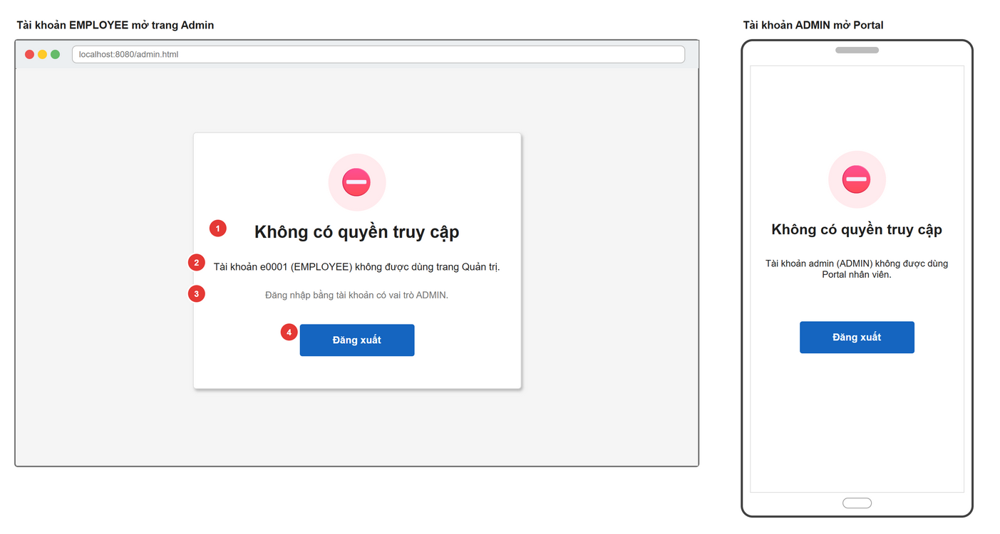

# AU-02 – Không có quyền truy cập

> Trạng thái: **Đã thiết kế (wireframe) · chờ duyệt** · Người viết: FE-2 · Ngày: 17/11/2026
>
> Vị trí trong sitemap: [sitemap.md § 4 – AU-02](../sitemap.md#4-danh-mục-màn-hình-ánh-xạ-sitemap--thiết-kế) · Màn hình cha: portal.html, admin.html

| Thuộc tính | Giá trị |
|---|---|
| Mã | AU-02 |
| Trang / route | `portal.html`, `admin.html` |
| Loại | screen |
| Mức | Must |
| Người dùng | Người dùng đăng nhập sai vai trò (vd. tài khoản EMPLOYEE mở Admin) |
| Thành phần code | `features/auth` – `Forbidden`, `RequireRole` |
| Yêu cầu, kịch bản demo | NFR-SEC-01, DP-10; kịch bản S1 |

## 1. Mục đích

Báo rõ tài khoản hiện tại không được dùng trang này và cho phép đăng xuất để đổi tài khoản.

## 2. Điều hướng

| Vào màn hình khi | Rời màn hình khi |
|---|---|
| `GET /auth/me` trả vai trò khác vai trò của trang | Đăng xuất → AU-01 |
| API trả 403 |  |

## 3. API sử dụng

- [`GET /auth/me`](../../api/central.md#2-get-authme)

## 4. Trạng thái màn hình

| Trạng thái | Nội dung chính |
|---|---|
| Mặc định | "Không có quyền truy cập", tên tài khoản và vai trò hiện tại, nút Đăng xuất. |

## 5. Dữ liệu hiển thị

- `username`, `role`

## 6. Quy tắc hành vi

- Không gọi API nghiệp vụ nào khi đang ở màn hình này.

## 7. Thiết kế màn hình

### 7.1. Wireframe

Nguồn: [wireframes.drawio](../../drawio/wireframes.drawio), tab `AU-02 Không có quyền truy cập`. Số đỏ trên hình ứng với cột **#** ở mục 7.2.

### 7.2. Thành phần giao diện

| # | Thành phần | Loại | Dữ liệu (nguồn) | Cách hiển thị |
|---|---|---|---|---|
| 1 | Tiêu đề | Icon ⛔ + heading | Tĩnh | 24 px đậm: "Không có quyền truy cập". |
| 2 | Thông tin tài khoản | Text | `GET /auth/me`: `username`, `role`; tên trang | "Tài khoản {username} ({role}) không được dùng trang {Quản trị / Portal nhân viên}." |
| 3 | Gợi ý | Text | Trang hiện tại | 13 px xám: "Đăng nhập bằng tài khoản có vai trò ADMIN" (Admin) / "EMPLOYEE" (Portal). |
| 4 | Nút Đăng xuất | Button primary | – | Căn giữa dưới nội dung. |

### 7.3. Hành động (input → output)

| Mã | Hành động | Input | Xử lý / API | Output |
|---|---|---|---|---|
| AU02-A1 | Đăng xuất | Bấm [4] | Xóa token trong `sessionStorage` | Chuyển AU-01 |

## 8. Tiêu chí chấp nhận

- [ ] Đăng nhập `e0001` trên `admin.html` → AU-02 với đúng tên tài khoản và vai trò (S1).
- [ ] Ở AU-02 không có request nào tới `/employees`, `/stations`, `/portal/qr-token`.
