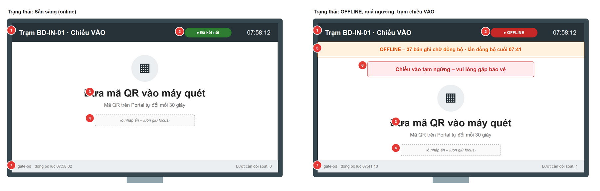

# K-01 – Chờ quét

> Trạng thái: **Đã thiết kế (wireframe) · chờ duyệt** · Người viết: FE-1 · Ngày: 17/11/2026
>
> Vị trí trong sitemap: [sitemap.md § 4 – K-01](../sitemap.md#4-danh-mục-màn-hình-ánh-xạ-sitemap--thiết-kế) · Màn hình cha: kiosk.html

| Thuộc tính | Giá trị |
|---|---|
| Mã | K-01 |
| Trang / route | `kiosk.html?station=<stationId>` |
| Loại | screen |
| Mức | Must |
| Người dùng | Người qua cổng (máy quét USB đặt tại trạm) |
| Thành phần code | `features/kiosk` – `KioskPage`, `ScanInput`, `OfflineBanner` |
| Yêu cầu, kịch bản demo | FR-11, FR-14, NFR-AVL-04, NFR-PER-01; demo D1, D4 |

## 1. Mục đích

Màn hình thường trực của kiosk: chờ máy quét gửi chuỗi QR, gửi `POST /scan`, và luôn cho biết tình trạng kết nối của gate (biểu ngữ OFFLINE).

## 2. Điều hướng

| Vào màn hình khi | Rời màn hình khi |
|---|---|
| Mở `kiosk.html?station=…` với trạm hợp lệ | Nhận chuỗi từ máy quét → K-02 |
| K-02 tự đóng sau 3 s | `stationId` không có trong `GET /status` → K-03 |

## 3. API sử dụng

- [`GET /status`](../../api/gate-agent.md#2-get-status)
- [`POST /scan`](../../api/gate-agent.md#1-post-scan)

## 4. Trạng thái màn hình

| Trạng thái | Nội dung chính |
|---|---|
| Sẵn sàng (online) | Hướng dẫn "Đưa mã QR vào máy quét", tên trạm và chiều (VÀO/RA). |
| Đang gửi | Đã nhận chuỗi, chờ phản hồi `POST /scan` (≤ 2 s); bỏ qua chuỗi mới (chặn quét đúp). |
| OFFLINE | `online = false`: biểu ngữ "OFFLINE – {outboxDepth} bản ghi chờ đồng bộ"; vẫn quét được. |
| Chiều vào tạm ngừng | `offlineThresholdExceeded = true` và trạm `IN`: thêm cảnh báo "Chiều vào tạm ngừng". |
| Mất liên lạc với gate | `GET /status` lỗi hoặc quá 2 s: giữ trạng thái cũ, hiện "Kiosk không kết nối được dịch vụ cổng". |

## 5. Dữ liệu hiển thị

- Mã trạm và chiều (từ URL và `GET /status`)
- `online`, `outboxDepth`, `offlineThresholdExceeded`, `turnstiles[stationId]`

## 6. Quy tắc hành vi

- Ô nhập ẩn **luôn giữ focus** (máy quét gõ chuỗi + Enter); trim, bỏ chuỗi rỗng.
- Hỏi `GET /status` mỗi 3 s.
- Một lượt quét tại một thời điểm; không tự gửi lại `/scan`.

## 7. Thiết kế màn hình

### 7.1. Wireframe

Nguồn: [wireframes.drawio](../../drawio/wireframes.drawio), tab `K-01 Chờ quét`. Số đỏ trên hình ứng với cột **#** ở mục 7.2.

### 7.2. Thành phần giao diện

| # | Thành phần | Loại | Dữ liệu (nguồn) | Cách hiển thị |
|---|---|---|---|---|
| 1 | Thanh tiêu đề trạm | Header (text + đồng hồ) | `stationId` từ URL; chiều suy từ mã trạm (`-IN-` → VÀO, `-OUT-` → RA); giờ máy | Nền tối `#263238`, chữ trắng 20 px đậm: "Trạm BD-IN-01 · Chiều VÀO"; bên phải đồng hồ `HH:mm:ss` giờ Việt Nam, cập nhật mỗi giây. |
| 2 | Chip kết nối | Status chip | `GET /status` → `online` | Viên thuốc: xanh "● Đã kết nối" khi `online = true`; đỏ "● OFFLINE" khi `false`; xám "● Mất liên lạc gate" khi chính `GET /status` lỗi. |
| 3 | Hướng dẫn quét | Icon + heading + text | Tĩnh | Biểu tượng QR, dòng chính "Đưa mã QR vào máy quét" 30 px đậm, dòng phụ "Mã QR trên Portal tự đổi mỗi 30 giây" 15 px xám; căn giữa. |
| 4 | Ô nhập quét ẩn | Input text (ẩn) | Chuỗi do máy quét USB gõ | Không nhìn thấy (opacity 0, vẫn nhận phím); luôn giữ focus. Viền nét đứt chỉ để minh họa trong wireframe. |
| 5 | Biểu ngữ OFFLINE | Banner cảnh báo | `online`, `outboxDepth`, `lastSyncAt` | Chỉ hiện khi `online = false`. Dải cam toàn chiều ngang ngay dưới thanh tiêu đề: "OFFLINE – {outboxDepth} bản ghi chờ đồng bộ · lần đồng bộ cuối {HH:mm}". |
| 6 | Cảnh báo chiều vào tạm ngừng | Alert lỗi | `offlineThresholdExceeded`, chiều của trạm | Chỉ hiện khi `offlineThresholdExceeded = true` **và** trạm chiều VÀO. Hộp đỏ, chữ đậm 16 px: "Chiều vào tạm ngừng – vui lòng gặp bảo vệ". |
| 7 | Thanh trạng thái | Footer text | `gateId`, `lastSyncAt`, `pendingReconcile` | Chữ xám 12 px: trái "{gateId} · đồng bộ lúc {HH:mm:ss}"; phải "Lượt cần đối soát: {pendingReconcile}". |

### 7.3. Hành động (input → output)

| Mã | Hành động | Input | Xử lý / API | Output |
|---|---|---|---|---|
| K01-A1 | Mở trang | URL `kiosk.html?station=…` | Kiểm tra định dạng `stationId`; gọi `GET /status`; kiểm tra `stationId` có trong `turnstiles` | Hợp lệ → hiện K-01 và focus [4]; không hợp lệ → K-03 |
| K01-A2 | Cập nhật trạng thái | Bộ hẹn giờ mỗi 3 s | `GET /status` (timeout 2 s) | Cập nhật [2] [5] [6] [7]; lỗi → giữ dữ liệu cũ, [2] chuyển xám "Mất liên lạc gate" |
| K01-A3 | Quét mã | Máy quét gõ chuỗi + Enter vào [4] | Trim; chuỗi rỗng hoặc đang có lượt chờ → bỏ qua; `POST /scan {stationId, raw}` với timeout 2000 ms | Mở K-02 với kết quả (hoặc trạng thái "Không xác định" nếu lỗi/timeout); xóa nội dung [4] |
| K01-A4 | Giữ focus | [4] mất focus (bấm ra ngoài, cửa sổ khác) | Đặt lại focus sau 100 ms | [4] luôn sẵn sàng nhận chuỗi |

## 8. Tiêu chí chấp nhận

- [ ] Mở `kiosk.html?station=BD-IN-01` khi gate online: hiện [1] [2] xanh [3], không có [5] [6].
- [ ] Giả lập offline quá ngưỡng (D4/T11): trong ≤ 3 s hiện [5] với đúng `outboxDepth` và [6] trên trạm VÀO; trạm RA không có [6].
- [ ] Gõ chuỗi + Enter hai lần liên tiếp nhanh: chỉ một `POST /scan` được gửi.
- [ ] Bấm chuột ra ngoài rồi quét: chuỗi vẫn vào [4] (focus được khôi phục).
