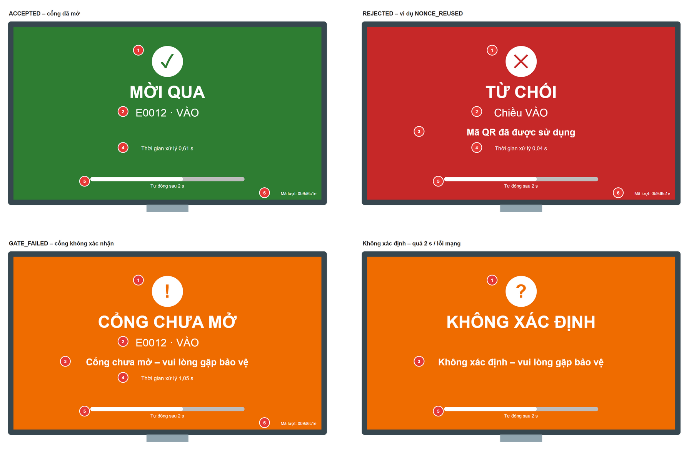

# K-02 – Kết quả quét

> Trạng thái: **Đã thiết kế (wireframe) · chờ duyệt** · Người viết: FE-1 · Ngày: 17/11/2026
>
> Vị trí trong sitemap: [sitemap.md § 4 – K-02](../sitemap.md#4-danh-mục-màn-hình-ánh-xạ-sitemap--thiết-kế) · Màn hình cha: K-01 Chờ quét

| Thuộc tính | Giá trị |
|---|---|
| Mã | K-02 |
| Trang / route | overlay trên K-01 |
| Loại | overlay |
| Mức | Must |
| Người dùng | Người qua cổng |
| Thành phần code | `features/kiosk` – `ResultOverlay`; `shared/ui` – `reasonTexts` |
| Yêu cầu, kịch bản demo | FR-14, NFR-PER-01, NFR-AVL-02, NFR-AVL-03, INV-05; demo D1, D2, D5 |

## 1. Mục đích

Hiển thị kết quả một lượt quét trong 3 s bằng màu và câu chữ dễ hiểu; không bao giờ báo xanh khi cổng chưa xác nhận mở.

## 2. Điều hướng

| Vào màn hình khi | Rời màn hình khi |
|---|---|
| K-01 nhận phản hồi `POST /scan`, lỗi mạng hoặc quá 2000 ms | Sau 3 s → K-01 |

## 3. API sử dụng

- [`POST /scan`](../../api/gate-agent.md#1-post-scan)

## 4. Trạng thái màn hình

| Trạng thái | Nội dung chính |
|---|---|
| ACCEPTED (xanh) | "Mời qua", `employeeCode`, chiều VÀO/RA, `elapsedMs`. |
| REJECTED (đỏ) | Câu theo `reason` (bảng ở [api/README § 5](../../api/README.md#5-scan-results-and-reject-reasons-shared-by-gate-agent-and-kiosk)). |
| GATE_FAILED (cam) | "Cổng chưa mở – vui lòng gặp bảo vệ". |
| Không xác định (cam) | Lỗi mạng, HTTP 5xx hoặc quá 2000 ms: "Không xác định – vui lòng gặp bảo vệ". |

## 5. Dữ liệu hiển thị

- `result`, `reason`, `employeeCode`, `direction`, `elapsedMs` (không có họ tên – DP-12)

## 6. Quy tắc hành vi

- Chỉ `result == ACCEPTED` mới hiện màu xanh.
- `reason` lạ: REJECTED → "Mã QR không hợp lệ", GATE_FAILED → câu của GATE_FAILED.
- Tự đóng sau 3 s; trong lúc hiện vẫn chặn lượt quét mới.

## 7. Thiết kế màn hình

### 7.1. Wireframe

Nguồn: [wireframes.drawio](../../drawio/wireframes.drawio), tab `K-02 Kết quả quét`. Số đỏ trên hình ứng với cột **#** ở mục 7.2.

### 7.2. Thành phần giao diện

| # | Thành phần | Loại | Dữ liệu (nguồn) | Cách hiển thị |
|---|---|---|---|---|
| 1 | Biểu tượng và tiêu đề kết quả | Icon + heading | `result` (hoặc lỗi/timeout) | Toàn màn hình đổi màu: ACCEPTED nền xanh `#2E7D32`, ✓, "MỜI QUA"; REJECTED nền đỏ `#C62828`, ✕, "TỪ CHỐI"; GATE_FAILED nền cam `#EF6C00`, !, "CỔNG CHƯA MỞ"; không xác định nền cam, ?, "KHÔNG XÁC ĐỊNH". Tiêu đề 44 px đậm trắng. |
| 2 | Nhân viên và chiều | Text | `employeeCode`, `direction` | 28 px trắng: "E0012 · VÀO"; chỉ có `direction` → "Chiều VÀO"; không có cả hai → ẩn. Không bao giờ hiện họ tên. |
| 3 | Lý do | Text | `reason` → bảng `reasonTexts` (docs/api/README § 5) | 24 px đậm trắng, tối đa 2 dòng. Ẩn khi ACCEPTED. `reason` lạ → câu dự phòng theo `result`. |
| 4 | Thời gian xử lý | Text | `elapsedMs` | 14 px trắng: "Thời gian xử lý 0,61 s" (giây, 2 chữ số thập phân, dấu phẩy). Ẩn khi không xác định. |
| 5 | Thanh đếm ngược | Progress bar + text | Bộ đếm 3 s phía client | Thanh trắng co dần trong 3 s, chữ "Tự đóng sau {n} s" bên dưới. |
| 6 | Mã lượt quét | Text nhỏ | `eventId` | 11 px trắng, góc phải dưới: "Mã lượt: {8 ký tự đầu}" để bảo vệ tra cứu. |

### 7.3. Hành động (input → output)

| Mã | Hành động | Input | Xử lý / API | Output |
|---|---|---|---|---|
| K02-A1 | Hiện kết quả | Phản hồi `POST /scan` (200) | Chọn màu/icon/tiêu đề theo `result`; tra câu theo `reason` | Overlay phủ K-01 với [1]–[6] |
| K02-A2 | Hiện không xác định | Timeout 2000 ms, lỗi mạng, HTTP 4xx/5xx | Không đọc body | Overlay cam "KHÔNG XÁC ĐỊNH" + câu "Không xác định – vui lòng gặp bảo vệ" |
| K02-A3 | Tự đóng | Hết 3 s | Xóa kết quả | Quay về K-01, focus [4] của K-01 |
| K02-A4 | Quét trong lúc hiện kết quả | Chuỗi mới từ máy quét | Bỏ qua (không gửi) | Không đổi |

## 8. Tiêu chí chấp nhận

- [ ] `ACCEPTED` → nền xanh với mã nhân viên và chiều; mọi kết quả khác **không bao giờ** xanh (NFR-AVL-03).
- [ ] Mỗi `reason` trong bảng § 5 hiện đúng câu tiếng Việt; `reason` lạ dùng câu dự phòng.
- [ ] Mock trả chậm 2,5 s → overlay "KHÔNG XÁC ĐỊNH" sau đúng 2 s.
- [ ] Overlay tự đóng sau 3 s và K-01 nhận được lượt quét tiếp theo.
