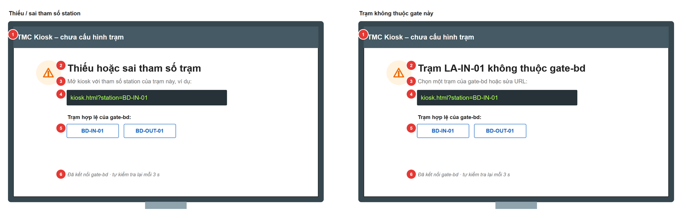

# K-03 – Lỗi cấu hình trạm

> Trạng thái: **Đã thiết kế (wireframe) · chờ duyệt** · Người viết: FE-1 · Ngày: 17/11/2026
>
> Vị trí trong sitemap: [sitemap.md § 4 – K-03](../sitemap.md#4-danh-mục-màn-hình-ánh-xạ-sitemap--thiết-kế) · Màn hình cha: kiosk.html

| Thuộc tính | Giá trị |
|---|---|
| Mã | K-03 |
| Trang / route | `kiosk.html` (thiếu/sai `?station`) |
| Loại | screen |
| Mức | Must |
| Người dùng | Kỹ thuật viên lắp đặt kiosk |
| Thành phần code | `features/kiosk` – `StationError` |
| Yêu cầu, kịch bản demo | INV-03, FR-14 |

## 1. Mục đích

Chặn việc dùng kiosk khi URL không chỉ rõ một trạm hợp lệ, tránh gửi lượt quét với trạm sai.

## 2. Điều hướng

| Vào màn hình khi | Rời màn hình khi |
|---|---|
| Thiếu tham số `station` | Sửa URL và tải lại trang → K-01 |
| `station` sai định dạng `^[A-Z]{2}-(IN\|OUT)-[0-9]{2}$` |  |
| `station` không có trong `GET /status.turnstiles` |  |

## 3. API sử dụng

- [`GET /status`](../../api/gate-agent.md#2-get-status)

## 4. Trạng thái màn hình

| Trạng thái | Nội dung chính |
|---|---|
| Thiếu / sai định dạng | Hướng dẫn cú pháp `kiosk.html?station=BD-IN-01`. |
| Trạm không thuộc gate | Liệt kê các trạm hợp lệ lấy từ `GET /status.turnstiles`. |
| Không gọi được gate | Thông báo lỗi kết nối, tự thử lại mỗi 3 s. |

## 5. Dữ liệu hiển thị

- Danh sách trạm của gate (các khóa của `turnstiles`)

## 6. Quy tắc hành vi

- Không có ô nhập quét trên màn hình này.

## 7. Thiết kế màn hình

### 7.1. Wireframe

Nguồn: [wireframes.drawio](../../drawio/wireframes.drawio), tab `K-03 Lỗi cấu hình trạm`. Số đỏ trên hình ứng với cột **#** ở mục 7.2.

### 7.2. Thành phần giao diện

| # | Thành phần | Loại | Dữ liệu (nguồn) | Cách hiển thị |
|---|---|---|---|---|
| 1 | Thanh tiêu đề | Header text | Tĩnh | Nền xám đậm, chữ trắng 18 px: "TMC Kiosk – chưa cấu hình trạm". |
| 2 | Tiêu đề lỗi | Icon cảnh báo + heading | Loại lỗi | 26 px đậm: "Thiếu hoặc sai tham số trạm" hoặc "Trạm {station} không thuộc {gateId}". |
| 3 | Giải thích | Text | Loại lỗi | 15 px xám: hướng dẫn sửa URL hoặc chọn trạm. |
| 4 | Ví dụ URL | Code block | Trạm đầu tiên trong `turnstiles` (mặc định `BD-IN-01`) | Nền tối, chữ xanh lá, font monospace: `kiosk.html?station=BD-IN-01`. |
| 5 | Danh sách trạm hợp lệ | Danh sách button (link) | Các khóa của `GET /status.turnstiles` | Mỗi trạm một nút viền xanh; không có dữ liệu → ẩn khối. |
| 6 | Trạng thái kết nối | Text | Kết quả `GET /status` | 13 px xám nghiêng: "Đã kết nối {gateId} · tự kiểm tra lại mỗi 3 s" hoặc "Không kết nối được gate – thử lại sau 3 s". |

### 7.3. Hành động (input → output)

| Mã | Hành động | Input | Xử lý / API | Output |
|---|---|---|---|---|
| K03-A1 | Chọn trạm | Bấm một nút ở [5] | Tạo URL mới với `station` đã chọn, giữ `camera`/`demo` nếu có | Tải lại trang → K-01 |
| K03-A2 | Kiểm tra lại | Bộ hẹn giờ mỗi 3 s | `GET /status` | Cập nhật [5] [6] |

## 8. Tiêu chí chấp nhận

- [ ] Thiếu `station` → hiện K-03, không có ô nhập quét, không gửi `POST /scan`.
- [ ] `station=LA-IN-01` trên gate-bd → tiêu đề nêu đúng tên trạm và gate, [5] liệt kê `BD-IN-01`, `BD-OUT-01`.
- [ ] Bấm `BD-IN-01` → chuyển sang K-01 của trạm đó.
