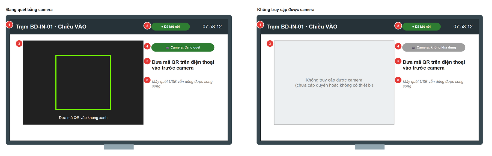

# K-04 – Quét bằng webcam

> Trạng thái: **Đã thiết kế (wireframe) · chờ duyệt** · Người viết: FE-1 · Ngày: 17/11/2026
>
> Vị trí trong sitemap: [sitemap.md § 4 – K-04](../sitemap.md#4-danh-mục-màn-hình-ánh-xạ-sitemap--thiết-kế) · Màn hình cha: kiosk.html (bổ sung cho K-01)

| Thuộc tính | Giá trị |
|---|---|
| Mã | K-04 |
| Trang / route | `kiosk.html?station=…&camera=1` |
| Loại | mode |
| Mức | Should |
| Người dùng | Người qua cổng (khi không có máy quét USB) |
| Thành phần code | `features/kiosk` – `CameraScanner` (`html5-qrcode`) |
| Yêu cầu, kịch bản demo | FR-11; demo D1 |

## 1. Mục đích

Cho phép quét QR trên điện thoại bằng webcam của máy kiosk khi demo không có máy quét USB.

## 2. Điều hướng

| Vào màn hình khi | Rời màn hình khi |
|---|---|
| Tham số `camera=1` | Giải mã được chuỗi → `POST /scan` → K-02 |

## 3. API sử dụng

- [`POST /scan`](../../api/gate-agent.md#1-post-scan)

## 4. Trạng thái màn hình

| Trạng thái | Nội dung chính |
|---|---|
| Đang mở camera | Xin quyền camera. |
| Đang quét | Khung ngắm trên nền K-01. |
| Không có quyền / không có camera | Thông báo và tiếp tục dùng ô nhập của K-01. |

## 5. Dữ liệu hiển thị

- Luồng video webcam (không lưu, không gửi đi)

## 6. Quy tắc hành vi

- Cùng một chuỗi giải mã liên tiếp chỉ gửi một lần (chặn quét đúp trong 3 s).
- Ô nhập ẩn của K-01 vẫn hoạt động song song.

## 7. Thiết kế màn hình

### 7.1. Wireframe

Nguồn: [wireframes.drawio](../../drawio/wireframes.drawio), tab `K-04 Quét bằng webcam`. Số đỏ trên hình ứng với cột **#** ở mục 7.2.

### 7.2. Thành phần giao diện

| # | Thành phần | Loại | Dữ liệu (nguồn) | Cách hiển thị |
|---|---|---|---|---|
| 1 | Thanh tiêu đề trạm | Header | Như K-01 [1] | Như K-01 [1]. |
| 2 | Chip kết nối | Status chip | Như K-01 [2] | Như K-01 [2]. |
| 3 | Khung camera | Video viewport | Luồng webcam (`html5-qrcode`) | 440×310, nền tối, khung ngắm vuông viền xanh lá; không có camera → hộp xám với lý do. |
| 4 | Chip trạng thái camera | Status chip | Trạng thái camera | Xanh "📷 Camera: đang quét" / xám "📷 Camera: không khả dụng". |
| 5 | Hướng dẫn | Text | Tĩnh | 18 px đậm: "Đưa mã QR trên điện thoại vào trước camera". |
| 6 | Ghi chú dự phòng | Text | Tĩnh | 14 px xám nghiêng: "Máy quét USB vẫn dùng được song song". |

### 7.3. Hành động (input → output)

| Mã | Hành động | Input | Xử lý / API | Output |
|---|---|---|---|---|
| K04-A1 | Bật camera | URL có `camera=1` | Xin quyền camera, khởi động bộ giải mã | [3] hiện hình, [4] xanh; bị từ chối → [3] xám, [4] xám |
| K04-A2 | Giải mã được QR | Khung hình chứa QR | Bỏ qua nếu trùng chuỗi vừa gửi trong 3 s; gọi như K01-A3 | Mở K-02 |
| K04-A3 | Quét bằng máy quét | Chuỗi vào ô nhập ẩn | Như K01-A3 | Mở K-02 |

## 8. Tiêu chí chấp nhận

- [ ] `camera=1` trên máy có webcam → quét được QR trên điện thoại chạy P-01 và nhận K-02 xanh (D1).
- [ ] Giữ nguyên QR trước camera 5 s → chỉ một `POST /scan` (chặn quét đúp).
- [ ] Từ chối quyền camera → trang vẫn hoạt động bằng máy quét.
