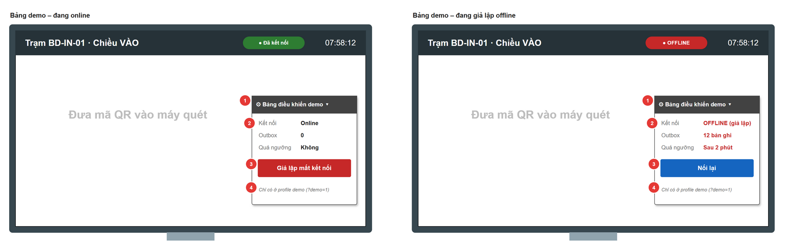

# K-05 – Bảng điều khiển demo

> Trạng thái: **Đã thiết kế (wireframe) · chờ duyệt** · Người viết: FE-1 · Ngày: 17/11/2026
>
> Vị trí trong sitemap: [sitemap.md § 4 – K-05](../sitemap.md#4-danh-mục-màn-hình-ánh-xạ-sitemap--thiết-kế) · Màn hình cha: kiosk.html (bổ sung cho K-01)

| Thuộc tính | Giá trị |
|---|---|
| Mã | K-05 |
| Trang / route | `kiosk.html?station=…&demo=1` |
| Loại | panel |
| Mức | Could |
| Người dùng | Người trình diễn |
| Thành phần code | `features/kiosk` – `DemoPanel` |
| Yêu cầu, kịch bản demo | Demo D4, T11 |

## 1. Mục đích

Bật/tắt giả lập mất kết nối Gate–Central ngay trên kiosk khi trình diễn D4/T11, không cần chạy script.

## 2. Điều hướng

| Vào màn hình khi | Rời màn hình khi |
|---|---|
| Tham số `demo=1` | Thu gọn bảng (vẫn ở K-01) |

## 3. API sử dụng

- [`POST /admin/simulate-offline`](../../api/gate-agent.md#4-post-adminsimulate-offline)
- [`GET /status`](../../api/gate-agent.md#2-get-status)

## 4. Trạng thái màn hình

| Trạng thái | Nội dung chính |
|---|---|
| Online | Nút "Giả lập mất kết nối". |
| Đang offline | Nút "Nối lại", hiện `outboxDepth` tăng dần. |
| Không khả dụng | `POST /admin/simulate-offline` trả 404 (không phải profile demo): ẩn bảng. |

## 5. Dữ liệu hiển thị

- `online`, `outboxDepth`, `offlineThresholdExceeded`

## 6. Quy tắc hành vi

- Bảng thu gọn ở góc, không che vùng kết quả quét.

## 7. Thiết kế màn hình

### 7.1. Wireframe

Nguồn: [wireframes.drawio](../../drawio/wireframes.drawio), tab `K-05 Bảng điều khiển demo`. Số đỏ trên hình ứng với cột **#** ở mục 7.2.

### 7.2. Thành phần giao diện

| # | Thành phần | Loại | Dữ liệu (nguồn) | Cách hiển thị |
|---|---|---|---|---|
| 1 | Tiêu đề bảng | Collapsible header (button) | Tĩnh | Nền xám đậm, "⚙ Bảng điều khiển demo ▾"; bấm để thu gọn/mở rộng. Bảng nằm góc phải, không che vùng kết quả. |
| 2 | Trạng thái | Key–value list | `GET /status`: `online`, `outboxDepth`, `offlineThresholdExceeded` | 3 dòng: Kết nối (Online / OFFLINE (giả lập)), Outbox ({n} bản ghi), Quá ngưỡng (Không / Có). Giá trị đỏ khi offline. |
| 3 | Nút giả lập | Button (danger / primary) | Trạng thái offline hiện tại | Đỏ "Giả lập mất kết nối" khi online; xanh "Nối lại" khi đang giả lập; khóa trong lúc gửi. |
| 4 | Ghi chú | Text | Tĩnh | 11 px xám nghiêng: "Chỉ có ở profile demo (?demo=1)". |

### 7.3. Hành động (input → output)

| Mã | Hành động | Input | Xử lý / API | Output |
|---|---|---|---|---|
| K05-A1 | Giả lập mất kết nối | Bấm [3] khi online | `POST /admin/simulate-offline {offline: true}` | 204 → [3] thành "Nối lại"; trong ≤ 3 s [2] và biểu ngữ K-01 chuyển OFFLINE |
| K05-A2 | Nối lại | Bấm [3] khi offline | `POST /admin/simulate-offline {offline: false}` | 204 → [3] thành "Giả lập mất kết nối"; outbox giảm dần về 0 |
| K05-A3 | Thu gọn / mở rộng | Bấm [1] | Lưu lựa chọn trong `localStorage` | Chỉ còn thanh tiêu đề / hiện đủ bảng |
| K05-A4 | Không có profile demo | `POST` trả 404 | – | Ẩn toàn bộ bảng |

## 8. Tiêu chí chấp nhận

- [ ] Profile `demo`: bấm "Giả lập mất kết nối" → biểu ngữ OFFLINE xuất hiện, quét vẫn được, outbox tăng (D4).
- [ ] Sau 2 phút offline → trạm VÀO hiện cảnh báo chiều vào (T11); "Nối lại" → outbox về 0.
- [ ] Không phải profile `demo` → bảng bị ẩn.
