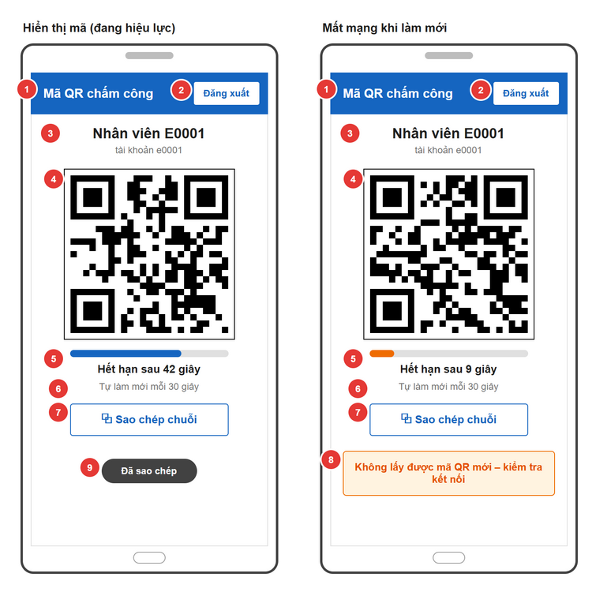

# P-01 – Mã QR cá nhân

> Trạng thái: **Đã thiết kế (wireframe) · chờ duyệt** · Người viết: FE-2 · Ngày: 17/11/2026
>
> Vị trí trong sitemap: [sitemap.md § 4 – P-01](../sitemap.md#4-danh-mục-màn-hình-ánh-xạ-sitemap--thiết-kế) · Màn hình cha: portal.html

| Thuộc tính | Giá trị |
|---|---|
| Mã | P-01 |
| Trang / route | `portal.html` |
| Loại | screen |
| Mức | Must |
| Người dùng | Nhân viên (điện thoại) |
| Thành phần code | `features/portal` – `QrPage`, `QrCountdown` (`qrcode.react`) |
| Yêu cầu, kịch bản demo | FR-03, NFR-SEC-05; demo D1, D2 |

## 1. Mục đích

Hiển thị mã QR động của chính nhân viên đang đăng nhập; mã tự làm mới nên ảnh chụp lại nhanh chóng mất giá trị.

## 2. Điều hướng

| Vào màn hình khi | Rời màn hình khi |
|---|---|
| Đăng nhập thành công với vai trò EMPLOYEE | 409 → P-02 |
| P-02 nhận lại 200 | 401 / Đăng xuất → AU-01 |

## 3. API sử dụng

- [`GET /portal/qr-token`](../../api/central.md#3-get-portalqr-token)

## 4. Trạng thái màn hình

| Trạng thái | Nội dung chính |
|---|---|
| Đang tải | Lần lấy mã đầu tiên. |
| Hiển thị mã | QR mức sửa lỗi M, đếm ngược tới `expiresAt`, mã nhân viên. |
| Đang làm mới | Giữ mã cũ cho tới khi có mã mới. |
| Mất mạng | Giữ mã hiện tại tới `expiresAt`, sau đó "Không lấy được mã QR, kiểm tra kết nối". |

## 5. Dữ liệu hiển thị

- `raw`, `expiresAt`, `refreshAfterSec`
- `employeeCode` (từ `GET /auth/me`)

## 6. Quy tắc hành vi

- Làm mới mỗi `refreshAfterSec` (30 s) và khi tab hiện lại (`visibilitychange`).
- Nút "Sao chép chuỗi" copy `raw`.
- Không log `raw`.

## 7. Thiết kế màn hình

### 7.1. Wireframe

Nguồn: [wireframes.drawio](../../drawio/wireframes.drawio), tab `P-01 Mã QR cá nhân`. Số đỏ trên hình ứng với cột **#** ở mục 7.2.

### 7.2. Thành phần giao diện

| # | Thành phần | Loại | Dữ liệu (nguồn) | Cách hiển thị |
|---|---|---|---|---|
| 1 | Thanh tiêu đề | App bar | Tĩnh | Nền xanh, chữ trắng 16 px đậm: "Mã QR chấm công". |
| 2 | Nút Đăng xuất | Button secondary | – | Góc phải thanh tiêu đề. |
| 3 | Thông tin nhân viên | Text | `GET /auth/me`: `employeeCode`, `username` | "Nhân viên {employeeCode}" 18 px đậm; dòng dưới "tài khoản {username}" 12 px xám. API không trả họ tên. |
| 4 | Mã QR | QR image | `GET /portal/qr-token` → `raw` | 200×200 px, mức sửa lỗi M, viền trắng 8 px, căn giữa; luôn là mã mới nhất. |
| 5 | Đếm ngược | Progress bar + text | `expiresAt` so với giờ hiện tại | Thanh co dần (xanh; cam khi ≤ 10 s); chữ "Hết hạn sau {n} giây" cập nhật mỗi giây. |
| 6 | Ghi chú làm mới | Text | `refreshAfterSec` | 12 px xám: "Tự làm mới mỗi {refreshAfterSec} giây". |
| 7 | Nút Sao chép chuỗi | Button secondary | `raw` | "⧉ Sao chép chuỗi"; dùng khi kiosk không có camera. |
| 8 | Cảnh báo mất mạng | Alert cảnh báo | Lỗi khi làm mới | Hộp cam: "Không lấy được mã QR mới – kiểm tra kết nối". |
| 9 | Thông báo đã sao chép | Toast | Kết quả sao chép | Viên thuốc xám đậm "Đã sao chép", tự ẩn sau 2 s. |

### 7.3. Hành động (input → output)

| Mã | Hành động | Input | Xử lý / API | Output |
|---|---|---|---|---|
| P01-A1 | Lấy mã | Mở trang (sau khi qua guard) | `GET /auth/me`, `GET /portal/qr-token` | Hiện [3] [4] [5] |
| P01-A2 | Làm mới định kỳ | Hết `refreshAfterSec` giây; tab hiện lại (`visibilitychange`) | `GET /portal/qr-token` | Thay [4], đặt lại [5]; mã cũ giữ tới khi có mã mới |
| P01-A3 | Mất mạng khi làm mới | Lỗi mạng / 5xx | Thử lại ở chu kỳ sau | Hiện [8]; giữ [4] tới `expiresAt`, sau đó ẩn [4] và chỉ còn [8] |
| P01-A4 | Sao chép chuỗi | Bấm [7] | `navigator.clipboard.writeText(raw)` | Hiện [9] trong 2 s |
| P01-A5 | Mã bị thu hồi / không có | 409 | – | Chuyển P-02 |
| P01-A6 | Đăng xuất / hết phiên | Bấm [2] hoặc nhận 401 | Xóa token | Chuyển AU-01 |

## 8. Tiêu chí chấp nhận

- [ ] QR đổi sau mỗi 30 s và mỗi lần mở lại tab; đếm ngược luôn khớp `expiresAt` (D1).
- [ ] Mã do P-01 hiển thị được kiosk chấp nhận; quét lại cùng mã → K-02 "Mã QR đã được sử dụng" (D2).
- [ ] Ngắt mạng điện thoại → [8] xuất hiện, QR biến mất khi hết hạn.
- [ ] Thu hồi mã ở Admin → trong lần làm mới kế tiếp chuyển P-02 (D3).
