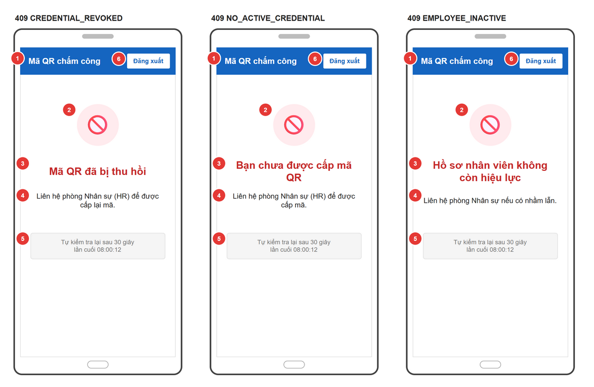

# P-02 – Không có mã QR

> Trạng thái: **Đã thiết kế (wireframe) · chờ duyệt** · Người viết: FE-2 · Ngày: 17/11/2026
>
> Vị trí trong sitemap: [sitemap.md § 4 – P-02](../sitemap.md#4-danh-mục-màn-hình-ánh-xạ-sitemap--thiết-kế) · Màn hình cha: P-01 Mã QR cá nhân

| Thuộc tính | Giá trị |
|---|---|
| Mã | P-02 |
| Trang / route | `portal.html` (409) |
| Loại | state |
| Mức | Must |
| Người dùng | Nhân viên |
| Thành phần code | `features/portal` – `NoQrNotice` |
| Yêu cầu, kịch bản demo | FR-04, NFR-SEC-06; demo D3, T2 |

## 1. Mục đích

Thay thế mã QR khi nhân viên không được cấp mã (bị thu hồi, chưa cấp, nghỉ việc); là bằng chứng của demo D3 phía Portal.

## 2. Điều hướng

| Vào màn hình khi | Rời màn hình khi |
|---|---|
| `GET /portal/qr-token` trả 409 | Lần hỏi lại (30 s) trả 200 → P-01 |
|  | Đăng xuất → AU-01 |

## 3. API sử dụng

- [`GET /portal/qr-token`](../../api/central.md#3-get-portalqr-token)

## 4. Trạng thái màn hình

| Trạng thái | Nội dung chính |
|---|---|
| CREDENTIAL_REVOKED | "Mã QR đã bị thu hồi, liên hệ HR". |
| NO_ACTIVE_CREDENTIAL | "Bạn chưa được cấp mã QR, liên hệ HR". |
| EMPLOYEE_INACTIVE | "Hồ sơ nhân viên không còn hiệu lực". |

## 5. Dữ liệu hiển thị

- `code` của Problem Details

## 6. Quy tắc hành vi

- **Không** hiển thị bất kỳ mã QR nào (kể cả mã cũ).
- Tiếp tục hỏi lại mỗi 30 s.

## 7. Thiết kế màn hình

### 7.1. Wireframe

Nguồn: [wireframes.drawio](../../drawio/wireframes.drawio), tab `P-02 Không có mã QR`. Số đỏ trên hình ứng với cột **#** ở mục 7.2.

### 7.2. Thành phần giao diện

| # | Thành phần | Loại | Dữ liệu (nguồn) | Cách hiển thị |
|---|---|---|---|---|
| 1 | Thanh tiêu đề | App bar | Tĩnh | Như P-01 [1]. |
| 2 | Biểu tượng | Icon khiên gạch chéo (ShieldOff) | Tĩnh | Tròn nền đỏ nhạt, căn giữa. |
| 3 | Thông báo chính | Heading | `code` của Problem Details | 20 px đậm đỏ: `CREDENTIAL_REVOKED` → "Mã QR đã bị thu hồi"; `NO_ACTIVE_CREDENTIAL` → "Bạn chưa được cấp mã QR"; `EMPLOYEE_INACTIVE` → "Hồ sơ nhân viên không còn hiệu lực". |
| 4 | Hướng dẫn | Text | `code` | 14 px: "Liên hệ phòng Nhân sự (HR) để được cấp lại mã." (biến thể theo `code`). |
| 5 | Trạng thái kiểm tra lại | Info box | Thời điểm lần hỏi gần nhất | Hộp xám: "Tự kiểm tra lại sau 30 giây · lần cuối {HH:mm:ss}". |
| 6 | Nút Đăng xuất | Button secondary | – | Như P-01 [2]. |

### 7.3. Hành động (input → output)

| Mã | Hành động | Input | Xử lý / API | Output |
|---|---|---|---|---|
| P02-A1 | Kiểm tra lại | Bộ hẹn giờ mỗi 30 s | `GET /portal/qr-token` | 200 → P-01; 409 → cập nhật [3] [4] [5] |
| P02-A2 | Đăng xuất / hết phiên | Bấm [6] hoặc nhận 401 | Xóa token | Chuyển AU-01 |

## 8. Tiêu chí chấp nhận

- [ ] Đăng nhập `e0020` (credential đã thu hồi) → P-02 với câu "Mã QR đã bị thu hồi"; không có QR nào trên màn hình.
- [ ] Admin cấp lại mã cho E0020 → trong ≤ 30 s Portal tự chuyển P-01.
