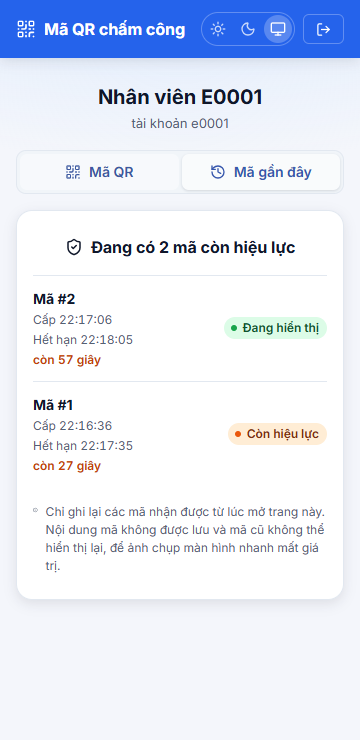

# P-03 – Mã gần đây

> Trạng thái: **Đã hiện thực · chờ duyệt** · Người viết: FE-2 · Ngày: 22/11/2026
>
> Vị trí trong sitemap: [sitemap.md § 4 – P-03](../sitemap.md#4-danh-mục-màn-hình-ánh-xạ-sitemap--thiết-kế) · Màn hình cha: portal.html (tab cạnh P-01)

| Thuộc tính | Giá trị |
|---|---|
| Mã | P-03 |
| Trang / route | `portal.html#/recent` |
| Loại | tab |
| Mức | Could |
| Người dùng | Nhân viên (điện thoại) |
| Thành phần code | `features/portal` – `RecentCodes`, `PortalTabs`, `useRecentCodes` |
| Yêu cầu, kịch bản demo | FR-03, NFR-SEC-05; demo D1, D2 |

## 1. Mục đích

Giải thích vì sao có nhiều mã cùng còn hiệu lực: mã đổi mỗi `refreshAfterSec` (30 s) nhưng mỗi mã sống 60 s, nên mã cũ vẫn quét được đến khi hết hạn (mỗi mã chỉ dùng một lần). Tab này chỉ cho **xem thông tin** của các mã đã nhận trong phiên; không hiển thị lại hình QR hay chuỗi mã, để ảnh chụp màn hình nhanh mất giá trị (NFR-SEC-05).

## 2. Điều hướng

| Vào màn hình khi | Rời màn hình khi |
|---|---|
| Bấm tab **Mã gần đây** ở P-01; hoặc mở `portal.html#/recent` | Bấm tab **Mã QR** → P-01 |
|  | `GET /portal/qr-token` trả 409 → P-02 (không còn tab, không hiện mã nào) |
|  | Đăng xuất / 401 → AU-01 |

## 3. API sử dụng

Không có API riêng. Dùng lại kết quả của [`GET /portal/qr-token`](../../api/central.md#3-get-portalqr-token) mà P-01 đã gọi (mỗi lần nhận mã ghi thêm một dòng).

## 4. Trạng thái màn hình

| Trạng thái | Nội dung chính |
|---|---|
| Có mã | Dòng tóm tắt "Đang có N mã còn hiệu lực" và danh sách mã, mới nhất trước (tối đa 10). |
| Chưa có mã | "Chưa có mã nào trong phiên này" (chỉ thoáng qua khi chưa nhận mã đầu tiên). |

Trạng thái của từng mã (suy ra từ giờ hiện tại, cập nhật mỗi giây):

| Trạng thái | Điều kiện | Hiển thị |
|---|---|---|
| Đang hiển thị | Mã mới nhất và chưa hết hạn | Badge xanh có chấm nhấp nháy |
| Còn hiệu lực | Mã cũ, chưa hết hạn | Badge cam + "còn {n} giây" |
| Đã hết hạn | Quá `expiresAt` | Badge xám |

## 5. Dữ liệu hiển thị

- Số thứ tự trong phiên ("Mã #n"), giờ cấp (lúc nhận mã), giờ hết hạn (đã quy về đồng hồ thiết bị).
- **Không** hiển thị và **không** lưu: `raw`, chữ ký, nonce, id credential.

## 6. Quy tắc hành vi

- Danh sách chỉ nằm trong bộ nhớ của trang: tải lại trang là mất; không ghi `sessionStorage`/`localStorage`.
- Chỉ ghi các mã nhận được từ lúc mở trang; không có API lịch sử.
- Khi đang ở tab này, hình QR của P-01 không được hiển thị.
- Giờ hiển thị theo giờ Việt Nam (HH:mm:ss).

## 7. Thiết kế màn hình

### 7.1. Ảnh minh họa

Chưa vẽ wireframe trong `wireframes.drawio`; ảnh dưới là ảnh chụp giao diện đã hiện thực (điện thoại 360 px, backend thật).

### 7.2. Thành phần giao diện

| # | Thành phần | Loại | Dữ liệu (nguồn) | Cách hiển thị |
|---|---|---|---|---|
| 1 | Thanh tab | Tablist (2 tab) | Tab hiện tại (`#/recent`) | Hai nút "Mã QR" / "Mã gần đây" có icon; tab đang chọn nền trắng chữ xanh. Chung với P-01. |
| 2 | Tóm tắt | Text + icon | Số mã chưa hết hạn | "Đang có {N} mã còn hiệu lực", 16 px đậm, icon khiên. |
| 3 | Dòng mã | List item | Mã #n, giờ cấp, giờ hết hạn | Tên "Mã #n" đậm; hai dòng "Cấp HH:mm:ss" và "Hết hạn HH:mm:ss" xám; "còn {n} giây" cam khi chưa hết hạn. |
| 4 | Nhãn trạng thái | Badge | Trạng thái của mã | Theo bảng ở mục 4, căn phải. |
| 5 | Ghi chú bảo mật | Text + icon | Tĩnh | 12 px xám: "Chỉ ghi lại các mã nhận được từ lúc mở trang này. Nội dung mã không được lưu và mã cũ không thể hiển thị lại, để ảnh chụp màn hình nhanh mất giá trị." |
| 6 | Trạng thái rỗng | Empty state | Danh sách rỗng | Icon + "Chưa có mã nào trong phiên này". |

### 7.3. Hành động (input → output)

| Mã | Hành động | Input | Xử lý / API | Output |
|---|---|---|---|---|
| P03-A1 | Mở tab | Bấm [1] "Mã gần đây" | Đặt hash `#/recent`; không gọi API | Hiện [2]–[5]; ẩn hình QR |
| P03-A2 | Quay lại | Bấm [1] "Mã QR" | Bỏ hash | Hiện P-01 |
| P03-A3 | Có mã mới | P-01 nhận mã (30 s/lần, khi tab trình duyệt hiện lại) | Ghi thêm một dòng (mới nhất trước, tối đa 10) | Dòng mới "Đang hiển thị"; dòng trước thành "Còn hiệu lực" |
| P03-A4 | Mã hết hạn | Đồng hồ (mỗi giây) | Tính lại trạng thái | "Còn hiệu lực" → "Đã hết hạn"; cập nhật [2] |

## 8. Tiêu chí chấp nhận

- [ ] Sau ≥ 30 s: có "Mã #2 Đang hiển thị" và "Mã #1 Còn hiệu lực", "Đang có 2 mã còn hiệu lực".
- [ ] Mã #1 hết hạn → chuyển "Đã hết hạn" và số mã còn hiệu lực giảm.
- [ ] Ở tab này không có hình QR; DOM và `sessionStorage`/`localStorage` không chứa chuỗi `TMC1.`.
- [ ] Tải lại trang tại `#/recent` → vào thẳng tab này, danh sách bắt đầu lại từ "Mã #1".
- [ ] Nhân viên bị thu hồi mã (P-02) không thấy tab và không thấy mã nào.
