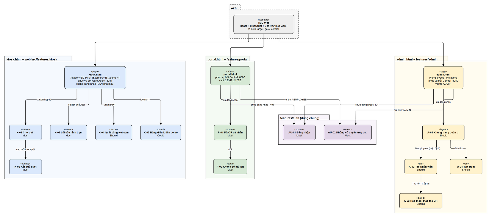
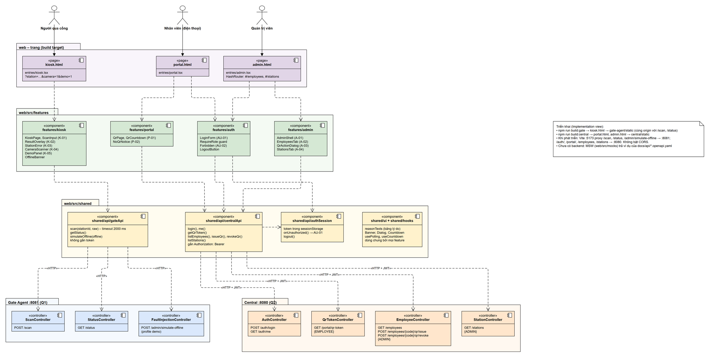

# Sitemap – ứng dụng web TMC

> Trạng thái: Draft · Người viết: FE-1, FE-2 · Người duyệt: BE-1 (Kiosk), BE-2 (Portal, Admin) · Ngày: 17/11/2026
>
> Nguồn: đặc tả triển khai M2 mục 10 (frontend), [spec](../spec/README.md), hợp đồng API [../api/README.md](../api/README.md).
> Thiết kế chi tiết từng màn hình: thư mục [screens/](screens/README.md) · Wireframe của mọi màn hình: [wireframes.drawio](../drawio/wireframes.drawio) (mỗi màn hình một tab, ảnh trong `../images/screens/`).

## 1. Mục đích và phạm vi

Tài liệu này liệt kê **mọi màn hình web cần hiện thực** trong MVP, cách tổ chức chúng thành trang
(entry HTML), quy tắc điều hướng và phân quyền giữa các màn hình, và đường đi của mỗi lời gọi từ
frontend tới backend. Mỗi màn hình có mã (`K-xx`, `AU-xx`, `P-xx`, `A-xx`) và một file thiết kế riêng
trong [screens/](screens/README.md); bảng ở mục 4 là ánh xạ giữa sitemap và các file đó.

Không thuộc phạm vi: giao diện Guard Console (G5 chỉ có `GET /guard/pending`), báo cáo chấm công, quản
lý tài khoản, cấu hình hệ thống (các component C4, C5, C6, C8, C9 ngoài MVP).

## 2. Tổng quan ứng dụng

| Trang | URL | Build target | Phục vụ bởi | Người dùng | Đăng nhập | Thư mục code |
|---|---|---|---|---|---|---|
| Kiosk | `kiosk.html?station=<stationId>[&camera=1][&demo=1]` | `npm run build:gate` | Gate Agent `:8081` / `:8082` | Người qua cổng (máy quét tại trạm) | Không (LAN nhà máy, ADR-08) | `web/src/features/kiosk` |
| Portal giả lập | `portal.html` | `npm run build:central` | Central `:8080` | Nhân viên trên điện thoại | Có, vai trò `EMPLOYEE` | `web/src/features/portal` + `features/auth` |
| Admin rút gọn | `admin.html#/employees`, `admin.html#/stations` | `npm run build:central` | Central `:8080` | Quản trị viên | Có, vai trò `ADMIN` | `web/src/features/admin` + `features/auth` |

- Mỗi trang là một **ứng dụng React độc lập** (entry `web/src/entries/<trang>.tsx`), không điều hướng
  qua lại giữa các trang. Đăng nhập (AU-01, AU-02) là thành phần dùng chung nhúng vào Portal và Admin.
- Admin dùng **hash routing** (`#/employees`, `#/stations`): Spring Boot phục vụ file tĩnh nên không cần
  cấu hình fallback cho SPA, và tải lại trang vẫn giữ đúng tab.
- Khi phát triển: `npm run dev` (Vite `:5173`) mở cả ba trang và proxy API tới hai backend; chưa có
  backend thì MSW trả dữ liệu mẫu theo `docs/api/*.openapi.yaml`.

## 3. Sơ đồ sitemap

Nguồn: [web.drawio](../drawio/web.drawio), tab `sitemap`.



Dạng cây (mũi tên là điều kiện điều hướng):

```
TMC Web
├── kiosk.html?station=…                      (Gate Agent, không đăng nhập)
│   ├── K-01 Chờ quét                         station hợp lệ (có trong GET /status.turnstiles)
│   │   └── K-02 Kết quả quét  «overlay»      sau mỗi lượt quét, tự đóng sau 3 s
│   ├── K-03 Lỗi cấu hình trạm                thiếu ?station hoặc station không thuộc gate này
│   ├── K-04 Quét bằng webcam  «mode»          ?camera=1 (bổ sung cho K-01)
│   └── K-05 Bảng điều khiển demo «panel»     ?demo=1 (bổ sung cho K-01)
├── portal.html                               (Central, vai trò EMPLOYEE)
│   ├── AU-01 Đăng nhập                        chưa có token / nhận 401
│   ├── AU-02 Không có quyền truy cập          vai trò ≠ EMPLOYEE
│   └── P-01 Mã QR cá nhân                     đã đăng nhập
│       └── P-02 Không có mã QR «state»        GET /portal/qr-token trả 409
└── admin.html                                (Central, vai trò ADMIN)
    ├── AU-01 Đăng nhập                        chưa có token / nhận 401
    ├── AU-02 Không có quyền truy cập          vai trò ≠ ADMIN
    └── A-01 Khung trang quản trị «layout»     đã đăng nhập
        ├── A-02 Tab Nhân viên  #/employees    (mặc định)
        │   └── A-03 Hộp thoại thao tác QR     bấm Thu hồi / Cấp lại
        └── A-04 Tab Trạm       #/stations
```

## 4. Danh mục màn hình (ánh xạ sitemap ↔ thiết kế)

| Mã | Màn hình | Trang / route | Loại | Người dùng | Mức | API sử dụng | Yêu cầu | Thiết kế chi tiết |
|---|---|---|---|---|---|---|---|---|
| K-01 | Chờ quét | `kiosk.html?station=` | screen | Người qua cổng | Must | [`GET /status`](../api/gate-agent.md#2-get-status), [`POST /scan`](../api/gate-agent.md#1-post-scan) | FR-11, FR-14, NFR-AVL-04, D1, D4 | [K-01-kiosk-idle.md](screens/K-01-kiosk-idle.md) |
| K-02 | Kết quả quét | overlay trên K-01 | overlay | Người qua cổng | Must | (kết quả của `POST /scan`) | FR-14, NFR-PER-01, NFR-AVL-02/03, D1, D2, D5 | [K-02-scan-result.md](screens/K-02-scan-result.md) |
| K-03 | Lỗi cấu hình trạm | `kiosk.html` (station thiếu/sai) | screen | Kỹ thuật viên lắp đặt | Must | [`GET /status`](../api/gate-agent.md#2-get-status) | INV-03 | [K-03-station-error.md](screens/K-03-station-error.md) |
| K-04 | Quét bằng webcam | `kiosk.html?camera=1` | mode | Người qua cổng | Should | [`POST /scan`](../api/gate-agent.md#1-post-scan) | FR-11, D1 | [K-04-camera-scan.md](screens/K-04-camera-scan.md) |
| K-05 | Bảng điều khiển demo | `kiosk.html?demo=1` | panel | Người trình diễn | Could | [`POST /admin/simulate-offline`](../api/gate-agent.md#4-post-adminsimulate-offline), [`GET /status`](../api/gate-agent.md#2-get-status) | D4, T11 | [K-05-demo-panel.md](screens/K-05-demo-panel.md) |
| AU-01 | Đăng nhập | `portal.html`, `admin.html` | screen | Nhân viên, quản trị viên | Must | [`POST /auth/login`](../api/central.md#1-post-authlogin), [`GET /auth/me`](../api/central.md#2-get-authme) | FR-25, NFR-SEC-04 | [AU-01-login.md](screens/AU-01-login.md) |
| AU-02 | Không có quyền truy cập | `portal.html`, `admin.html` | screen | Người dùng sai vai trò | Must | [`GET /auth/me`](../api/central.md#2-get-authme) | NFR-SEC-01, DP-10 | [AU-02-forbidden.md](screens/AU-02-forbidden.md) |
| P-01 | Mã QR cá nhân | `portal.html` | screen | Nhân viên | Must | [`GET /portal/qr-token`](../api/central.md#3-get-portalqr-token) | FR-03, NFR-SEC-05, D1, D2 | [P-01-qr-code.md](screens/P-01-qr-code.md) |
| P-02 | Không có mã QR | `portal.html` (409) | state | Nhân viên | Must | [`GET /portal/qr-token`](../api/central.md#3-get-portalqr-token) | FR-04, D3 | [P-02-no-qr.md](screens/P-02-no-qr.md) |
| A-01 | Khung trang quản trị | `admin.html` | layout | Quản trị viên | Should | [`GET /auth/me`](../api/central.md#2-get-authme) | FR-25 | [A-01-admin-shell.md](screens/A-01-admin-shell.md) |
| A-02 | Tab Nhân viên | `admin.html#/employees` | tab | Quản trị viên | Should | [`GET /employees`](../api/central.md#4-get-employees) | FR-02, FR-04, D3 | [A-02-employees-tab.md](screens/A-02-employees-tab.md) |
| A-03 | Hộp thoại thao tác QR | dialog trên A-02 | dialog | Quản trị viên | Should | [`POST …/qr/revoke`](../api/central.md#6-post-employeescodeqrrevoke), [`POST …/qr/issue`](../api/central.md#5-post-employeescodeqrissue) | FR-04, INV-01, NFR-SEC-06, D3, T2 | [A-03-qr-action-dialog.md](screens/A-03-qr-action-dialog.md) |
| A-04 | Tab Trạm | `admin.html#/stations` | tab | Quản trị viên | Should | [`GET /stations`](../api/central.md#7-get-stations) | FR-09, NFR-AVL-04, D4 | [A-04-stations-tab.md](screens/A-04-stations-tab.md) |

Loại: **screen** chiếm cả trang · **overlay** phủ lên màn hình khác trong thời gian ngắn ·
**mode / panel** phần bổ sung bật bằng tham số URL · **state** trạng thái thay thế nội dung của màn hình
cha · **layout** khung chứa các tab · **tab** nội dung theo route · **dialog** hộp thoại modal.

## 5. Điều hướng và phân quyền

### 5.1. Bảo vệ trang (guard) của Portal và Admin

```
mở trang ─► có token trong sessionStorage?
             ├─ không ─────────────────────────────► AU-01
             └─ có ─► GET /auth/me
                       ├─ 401 ─► xóa token ─────────► AU-01
                       ├─ 200, role đúng trang ─────► P-01 (Portal) | A-01 → A-02 (Admin)
                       └─ 200, role sai ────────────► AU-02
```

### 5.2. Bảng chuyển màn hình

| Từ | Sự kiện | Đến |
|---|---|---|
| AU-01 | Đăng nhập thành công, `role` đúng trang | P-01 / A-02 |
| AU-01 | Đăng nhập thành công, `role` sai trang | AU-02 |
| bất kỳ màn hình Portal/Admin | API trả 401 | AU-01 (xóa token) |
| AU-02, P-01, P-02, A-01 | Bấm **Đăng xuất** | AU-01 (xóa token) |
| P-01 | `GET /portal/qr-token` trả 409 | P-02 |
| P-02 | Lần hỏi lại (30 s) trả 200 | P-01 |
| A-01 | Chọn tab | A-02 (`#/employees`) / A-04 (`#/stations`) |
| A-02 | Bấm **Thu hồi** / **Cấp lại** | A-03 |
| A-03 | Xác nhận thành công / Hủy | A-02 (cập nhật dòng) |
| K-01 | Nhận chuỗi từ máy quét / webcam | K-02 |
| K-02 | Sau 3 s | K-01 |
| K-01 | `stationId` không có trong `GET /status.turnstiles` | K-03 |

### 5.3. Ma trận truy cập

| Màn hình | Không đăng nhập | EMPLOYEE | ADMIN |
|---|---|---|---|
| K-01 … K-05 | ✔ (LAN) | ✔ | ✔ |
| AU-01 | ✔ | ✔ | ✔ |
| P-01, P-02 | → AU-01 | ✔ | → AU-02 |
| A-01 … A-04 | → AU-01 | → AU-02 | ✔ |

Ẩn/hiện chỉ để tiện dùng; quyền thật được backend kiểm tra ở mọi API (DP-10).

## 6. Kiến trúc thành phần: frontend → backend

Nguồn: [web.drawio](../drawio/web.drawio), tab `frontend-backend` (UML component diagram).



| Tầng | Thành phần | Trách nhiệm |
|---|---|---|
| Trang | `kiosk.html`, `portal.html`, `admin.html` + `src/entries/*.tsx` | Khởi tạo React, router (Admin), React Query, chọn feature |
| Feature | `features/kiosk`, `features/portal`, `features/auth`, `features/admin` | Màn hình và trạng thái của từng nhóm màn hình (mục 4) |
| Shared – API | `shared/api/gateApi`, `shared/api/centralApi`, `shared/api/authSession` | **Nơi duy nhất gọi HTTP** (ESLint chặn `fetch` trong component). `centralApi` gắn `Authorization: Bearer` và gọi `authSession.onUnauthorized()` khi nhận 401. Kiểu dữ liệu sinh từ `docs/api/*.openapi.yaml` (`npm run gen:api:docs`). |
| Shared – UI/hook | `shared/ui`, `shared/hooks` | Bảng lý do hiển thị (`reasonTexts`), banner, dialog, đồng hồ đếm ngược, `usePolling` |
| Backend | Gate Agent: `ScanController`, `StatusController`, `FaultInjectionController` · Central: `AuthController`, `QrTokenController`, `EmployeeController`, `StationController` | Xem [spec](../spec/README.md) và [api](../api/README.md) |

### 6.1. Ánh xạ màn hình → hàm API → endpoint → backend

| Màn hình | Hàm frontend | Endpoint | Backend (module · controller) | Chu kỳ / thời hạn |
|---|---|---|---|---|
| K-01, K-03, K-05 | `gateApi.getStatus()` | `GET /status` | Gate Agent · `access` · `StatusController` | mỗi 3 s |
| K-01, K-04 → K-02 | `gateApi.scan(stationId, raw)` | `POST /scan` | Gate Agent · `access` · `ScanController` | timeout 2000 ms, không gọi lại |
| K-05 | `gateApi.simulateOffline(offline)` | `POST /admin/simulate-offline` | Gate Agent · `sync` · `FaultInjectionController` | theo thao tác |
| AU-01 | `centralApi.login(username, password)` | `POST /auth/login` | Central · `iam` · `AuthController` | theo thao tác |
| AU-01, AU-02, A-01, P-01 | `centralApi.me()` | `GET /auth/me` | Central · `iam` · `AuthController` | khi mở trang |
| P-01, P-02 | `centralApi.getQrToken()` | `GET /portal/qr-token` | Central · `employee` · `QrTokenController` | mỗi 30 s + khi tab hiện lại |
| A-02 | `centralApi.listEmployees(department, q)` | `GET /employees` | Central · `employee` · `EmployeeController` | khi đổi bộ lọc (debounce 300 ms) |
| A-03 | `centralApi.revokeQr(code, reason)` | `POST /employees/{code}/qr/revoke` | Central · `employee` · `EmployeeController` | theo thao tác |
| A-03 | `centralApi.issueQr(code)` | `POST /employees/{code}/qr/issue` | Central · `employee` · `EmployeeController` | theo thao tác |
| A-04 | `centralApi.listStations()` | `GET /stations` | Central · `station` · `StationController` | mỗi 5 s |

## 7. Màn hình ngoài MVP

| Màn hình (báo cáo) | Lý do không làm | Thay thế trong demo |
|---|---|---|
| Guard Console (G5): lượt bị từ chối, mở cổng thủ công | Đặc tả M2 mục 3.1, 3.3 | `GET /guard/pending` (gọi bằng trình duyệt / `curl`) |
| Báo cáo, tra cứu chấm công, xuất Excel (C6) | Ngoài MVP | – |
| Điều chỉnh chấm công, chốt kỳ (C4) | Ngoài MVP | – |
| Quản lý tài khoản, phân quyền (C7 đầy đủ), audit log (C8), cấu hình (C9) | Ngoài MVP | Tài khoản seed |
| Đăng ký / sửa / bật tắt trạm (C3 đầy đủ) | Ngoài MVP | Trạm seed; A-04 chỉ đọc |
